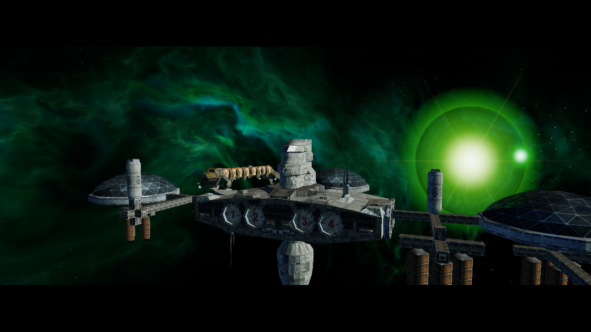
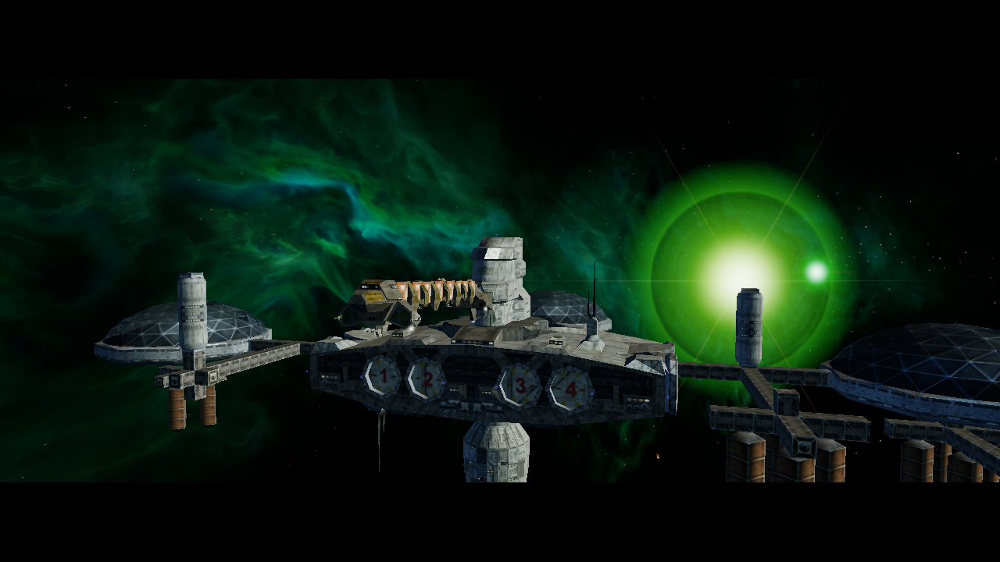

# Bloom-Blur-Radius im NAP-Lauf (2026-10-17)

Der Release-Client lief auf OpenGL 4.6 / Mesa 23.2.1 mit Intel HD Graphics
4600. Beide Starts verwendeten `lancer-renderer-aa-profile-20261016`; der
SHA-256 des aktiven Manifests war
`e6d56a0f74095c89712f35f35586bfbe5db19d28f0f106654037a53140fc3ca1`. Alle 13
NAP-Archive bestanden `nexus-pack verify`, und ihre Größen/Hashes stimmten mit
dem aktiven Manifest überein. Die App-Installation und der Freelancer-Datenroot
enthielten kein loses `DATA`.

Beide Bilder stammen aus der M01A/Freeport-7-Intro-Szene mit HDR und Bloom
aktiv. Die jeweilige Startoption war:

- `--render-bloom-radius=4`
- `--render-bloom-radius=0.25`

Der größere Radius erzeugt sichtbar einen breiteren Halo um die Sonne. Die Bilder
entstanden in getrennten Starts; die Intro-Kamera bewegt sich dazwischen. Das
ist ein Laufzeitnachweis für die Wirkung des Parameters, kein pixelgenauer
Qualitätsvergleich oder FPS-Benchmark. Die Stärke- und Schwellenwerte waren in
beiden Starts gleich. Mip-/Pyramidenqualität und Kalibrierung für weitere
Szenen bleiben offen.
