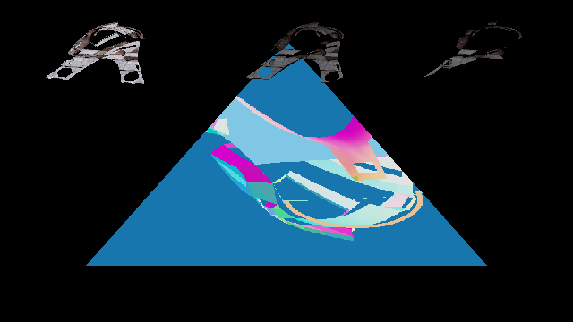
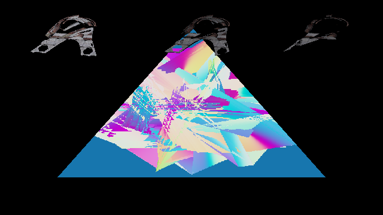

# Bretonia Elite SDL_GPU NAP material smoke (2026-10-19)

This is a backend diagnostic using a real Freelancer VMesh material draw and
production PBR shader variants through SDL_GPU/Vulkan. It loads the CMP, MAT,
and supplemental Surface textures through `NexusPackageFileProvider` from an
active NAP snapshot. It does not run the game's render graph or claim visual
acceptance.

## NAP provenance

The archive was built only from the seven files listed in
[`provenance.json`](provenance.json), all sourced from `Data/NAP/`. The archive
was inspected and `nexus-pack verify` passed before either run. Its package
size is 111,401,506 bytes; SHA-256 is
`8031335a3380a197fe6d53c073aff57a107473544afac81c25e9b55d752e84c2`.
[`active.json`](active.json) records the active package ID, size, and hash.

## Captures and result

| Surface maps off | Surface maps on |
|---|---|
|  |  |

The same selected draw was used in both runs: model `br_elite_lod1021114142815.3db`,
material `B_player01_256`, embedded diffuse `b_player01_256.tga` (DXT1,
1024×1024, 11 mips), 1,299 indexed corners, base vertex 0. The Surface-enabled
draw loaded `nm_br_player01`, `rt_br_player01`, and `mt_br_player01` from
`normalmaps_ships.txm`.

Both runs exited 0 on SDL_GPU/Vulkan at 640×360. Readback found 4/4 coverage
probes in both runs. The sampled production PBR pixel was `(65,60,63,255)` on
and `(80,74,78,255)` off. Comparing the full captures, 43,794 pixels had a
channel delta above 2, with a maximum channel delta of 230 and RGB RMSE
19.575471. The difference image is [here](br-elite-maps-diff.png).

The equivalent runtime commands, run from `Client/`, are:

```sh
SDL_VIDEODRIVER=wayland SDL_GPU_DRIVER=vulkan \
  LANCER_SDL_GPU_CAPTURE="$PWD/docs/evidence/renderer/br-elite-sdl-gpu-nap-20261019/br-elite-maps-on.ppm" \
  DOTNET_ROOT=/opt/dotnet-10 DOTNET_ROOT_X64=/opt/dotnet-10 \
  /opt/dotnet-10/dotnet src/lancer/bin/Release/net10.0/lancer.dll \
  --sdl-gpu-vmesh-nap-smoke \
  ../Data/NAP/.runtime-test-stage/br-elite-renderer-20261019/application \
  Models/ships/bretonia/br_elite/br_elite.cmp \
  Material/ships/bretonia/br_playerships.mat on
```

The second command used the same arguments with the capture filename changed to
`br-elite-maps-off.ppm` and the final argument changed to `off`.

## Limits

The capture also includes synthetic smoke and shadow panels. The VMesh now uses
a stable diagnostic camera basis, but only one material surface is drawn and
the CMP part transform is not applied. The screenshot and pixel delta prove
that NAP-backed Surface data reaches a production PBR draw; they do not prove
that the complete ship or its materials look correct. This run used Mesa's
Haswell Vulkan driver, which reports incomplete support. A full CMP assembly,
the game render graph, a supported GPU, and fixed-view comparison against
Retail remain open.
