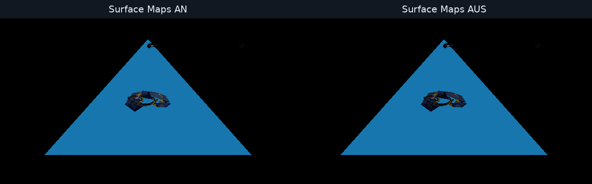
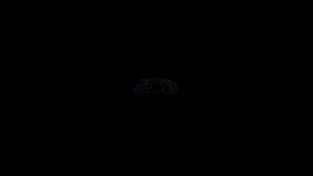

# Skinned DFM SDL_GPU diagnostic A/B (2026-10-19)

This capture is a renderer diagnostic, not a game screenshot. It uses the active QA NAP package documented in [`the prior DFM NAP smoke`](../dfm-sdl-gpu-nap-20261019/README.md), loads `Models/characters/bodies/li_male_elite_body.dfm` through `NexusPackageFileProvider`, and executes the embedded production PBR skinned shader on SDL_GPU/Vulkan.

The blue triangle is the SDL smoke's synthetic HDR scene-clear geometry, not game content. The character draw uses one DFM face group and a ship-hull Surface assignment, so these images do not establish final character-material quality.

## Diagnostic corrections

The previous DFM probe centered the model at Z=0 and scaled its largest extent to 1.55. Vulkan clips depth to `[0,1]`, so much of that test mesh fell outside the valid depth range. It now scales the extent to 0.8 and translates its depth center to 0.5. The DFM probe uses the full viewport while shadow variants remain in their quarter viewports.

The framebuffer origin is top-left while positive HLSL NDC Y maps toward the top of the image. The pixel probe and shadow probe coordinates now apply that Y inversion and use the actual viewport origin and size. The earlier three black interior values were samples at mismapped positions; corrected samples are opaque and non-black.

## A/B result

Both captures used the same NAP archive, model pose, SDL_GPU/Vulkan driver, camera, and 640x360 target. Only supplemental Surface maps changed. The map-enabled run uploaded the BC5 normal and BC4 roughness/metallic maps; the disabled run did not.

- Both runs report 3 of 4 coverage probes on the DFM. The four probes are a screen-center clear-space check plus three barycentric triangle points; all three triangle points differ from clear.
- Corrected interior samples with maps enabled: `(43,65,96,255)`, `(36,50,79,255)`, `(43,62,89,255)`.
- Corresponding samples with maps disabled: `(34,53,79,255)`, `(28,40,64,255)`, `(34,50,73,255)`.
- The triangle-centroid PBR sample is `(51,65,96,255)` enabled and `(40,53,79,255)` disabled.
- The full-frame comparison has 2,317 pixels with channel delta greater than 2, a maximum channel delta of 37, and a difference bounding box `(270,157)-(369,202)` around the DFM draw.

## Follow-up still required

- Repeat the test on a representative ship DFM/VMesh with its matching hull Surface map and inspect diffuse, normal, roughness and metallic response separately.
- Validate the material in LancerEdit and in an actual gameplay scene on a supported GPU. Mesa reports incomplete Haswell Vulkan support.
- Compare with a fixed camera and retail Freelancer output before accepting color, roughness, metallic and tangent-space appearance.
- The PPM capture is enabled only when `LANCER_SDL_GPU_CAPTURE` is set; ordinary smoke runs keep the existing small readback allocation.
