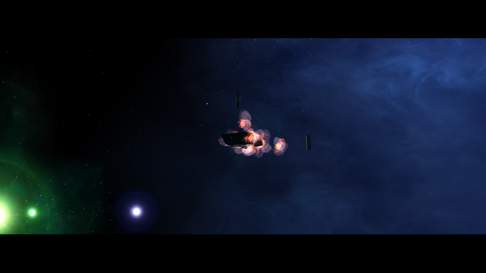

# M01A explosion with default particle rendering (2026-10-16)

A fresh Release Client run was built from the current `Data/NAP/` tree. The 12 class packages and the `QA/runtime-smoke-20261014` package contain 8,684 files staged under `Data/NAP/.runtime-test-stage/package-inputs-20261016`; the empty `.gitkeep` placeholders were excluded. All 13 NAP archives passed `nexus-pack verify`. The active snapshot is saved as [`nap-active.json`](nap-active.json).

The isolated client app had no loose `DATA` directory. Its Freelancer root contained only the EXE configuration files; all game data was mounted from the fresh NAP snapshot. The test config and the host's `/home/masterbee/.config/librelancer.ini` both omit `render_particle_effects`. `GameSettings.RenderParticleEffects` defaults to `true`, so this run exercises the normal default path without a command-line override.

The Release client (`03bfd87-git`, 20261013) used OpenGL 4.6 / Mesa 23.2.1 on Intel HD Graphics 4600. Logs reached `Finished loading game data`, `Interface loaded`, `Spawning in FP7_system` and `Found thorn mainObject`. Mission trigger `fp7_base_explode` ran at 01:15:07. The capture shows the base surrounded by multiple bright orange explosion sprites and smoke particles. There was no renderer exception or crash. The log still reports two unimplemented THN `StartIK` events, unrelated to particle rendering.

This confirms that the M01A base explosion renders in a fresh NAP-only run with the default settings. It does not establish that every weapon or explosion effect matches retail. The earlier `render_particle_effects=false` diagnosis only explains why particles disappeared in that isolated profile; it does not explain the user's reported runtime, because the current local user config leaves the option at its `true` default. Keep other effect scenes and visual parity on the renderer TODO list.
