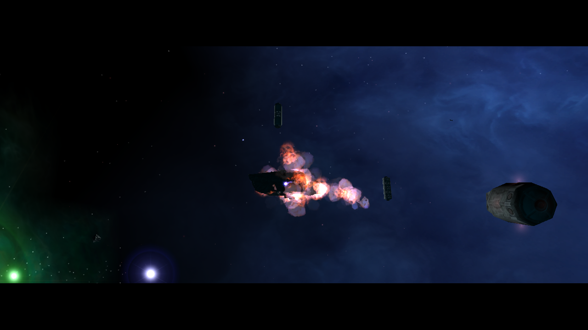

# LI fighter destruction: NAP-only runtime proof (2026-10-16)

The Release client was launched from an isolated test app with 13 active NAP
archives and no loose `DATA` directory. Twelve archives match the baseline QA
manifest; only `mission.nap` was rebuilt from inputs staged below
`Data/NAP/`. The mission package SHA-256 is
`8308bbfbfc7267f038b25933b950ab6d3c729e58831dc893b59a908dbe519962`.
All packages matched the active manifest and passed `nexus-pack verify`.

The temporary M01A mission called its standard `fp7_base_explode` trigger, then
spawned an LI fighter through `qa_spawn_test_fighter_explosion` and destroyed
it with `Act_Destroy = EXPLODE` three seconds later. The client log records the
spawn trigger at 06:16:30 and destroy trigger at 06:16:33. The captured frame
shows the ship and its visible ALE explosion:

The run confirms this fighter destruction path renders an explosion. It does
not compare against original Freelancer or validate explosion scale/timing,
transient dynamic-light contribution, large-ship fuse delivery, mines, or
equipment detachment. The QA mission and manifest are temporary and are not
part of the maintained NAP set.
