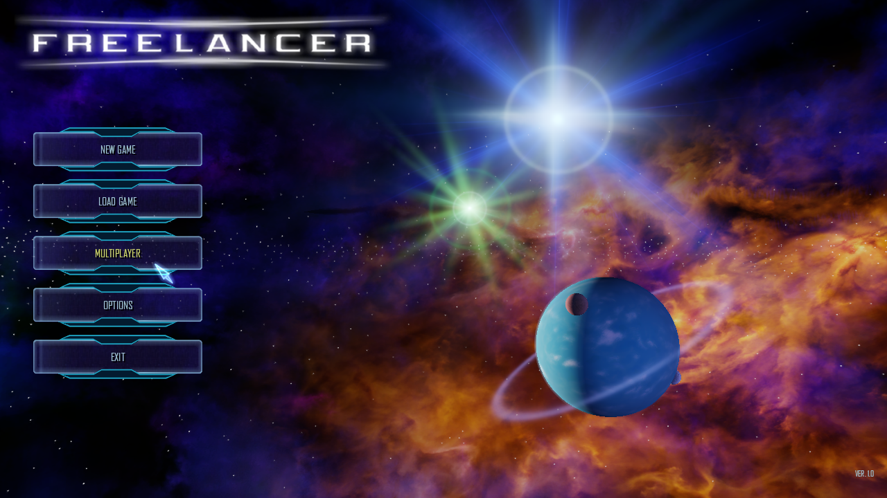

# HDR-Belichtung: NAP-Laufzeitnachweis (2026-10-17)

Der Release-Client startete mit `--render-hdr=on --render-bloom=on
--render-hdr-exposure=1` und erreichte unter OpenGL 4.6 / Mesa 23.2.1 auf
Intel HD Graphics 4600 das Hauptmenü. Das Log meldet `Finished loading game
data`, `Interface loaded` und verfügbare GPU-Timerqueries.

Der Start verwendete das geprüfte Manifest
`lancer-renderer-aa-profile-20261016`; alle 13 NAP-Archive stimmten in Größe
und SHA-256 mit dem Manifest überein und bestanden `nexus-pack verify`. Der
Anwendungs- und Datenroot enthielt kein loses `DATA`-Verzeichnis.

Dies ist ein Start-/Pfadnachweis für die Einstellung, kein kontrollierter
Bildvergleich. Die animierte Menüszene wechselt zwischen getrennten Starts;
eine Same-frame-Kalibrierung und Messung der GPU-Kosten bleiben offen.
