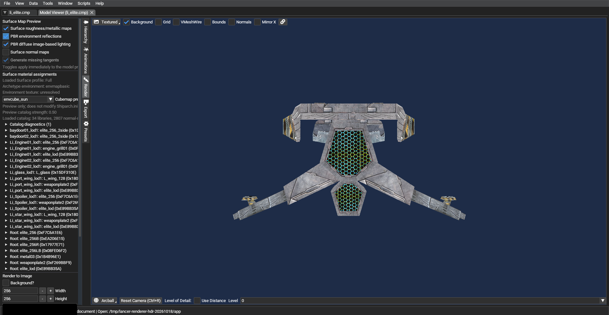

# HDR IBL Cubemap-Preview: LI_ELITE (2026-10-18)

Die Aufnahme entstand mit einem aus `Data/NAP/` gebauten und verifizierten
Surface-NAP. LancerEdit lud die Freelancer-Daten und stellte LI_ELITE dar.

Im Render-Tab waren Surface-PBR-Maps, PBR-Umgebungsreflexionen und diffuse
Image-Based-Lighting eingeschaltet; als Vorschau-Cube war `envcube_sun`
ausgewählt. Der Viewport stand noch im `Textured`-Modus. In diesem Modus lädt
der Renderer den Cube nicht; die damalige Statusanzeige `unresolved` war
irreführend. Patch 2307 kennzeichnet den Cube nun als noch nicht geladen und
führt direkt in den Lit-Modus.

Die Aufnahme bestätigt weiterhin weder einen Cube-Load noch HDR-/IBL-Bildwirkung.
Nächster Prüfschritt: den neuen Lit-Preview-Wechsel ausführen, Cube-Load im
Log/Debugger bestätigen und bei unveränderter Kamera echte Ein-/Aus-Aufnahmen
erstellen.
