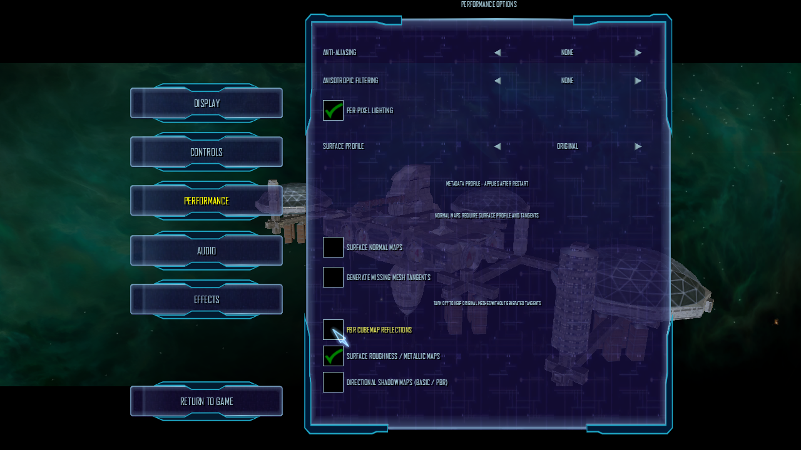
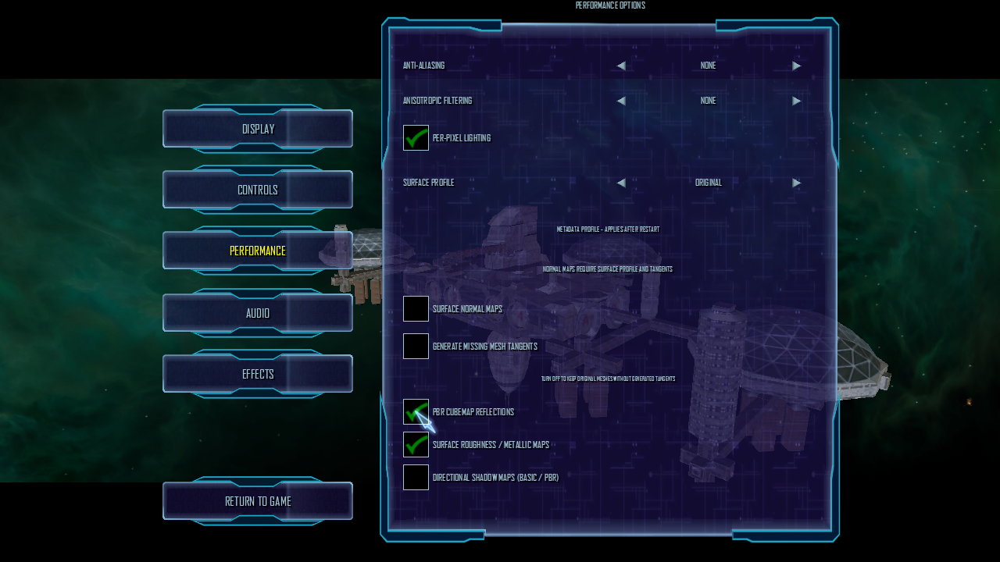

# Live Surface-PBR and IBL option update

The Release client ran a single M01A/Freeport 7 session on OpenGL 4.6 Core,
Mesa 23.2.1, and Intel HD Graphics 4600. It loaded the active NAP snapshot
`lancer-pbr-qa-20261014` (manifest SHA-256
`57af6496c39b4c35ebb32add550fd58ef00f5eb40f7658b7207a06fc99293652`). All 13
archive sizes and hashes matched the manifest and every archive passed
`nexus-pack verify`. The corresponding manifest records NAP inputs staged under
`Data/NAP/.runtime-test-stage/package-inputs-20261016` and
`Data/NAP/QA/runtime-smoke-20261014`. The running client had no loose root
`DATA` directory.

With the game paused and the Performance Options panel open, each of these
settings was toggled in the same process: surface normal maps, generated
tangents, surface roughness/metallic maps, and PBR cubemap reflections. The
isolated `lancer-ibl-live-profile.ini` was read while the panel remained open;
its corresponding setting changed immediately on each toggle. The values were
restored to the starting state before the client was closed. No restart was
needed, and the run logged no renderer exception.

The captures show cubemap reflections disabled and enabled in the same paused
session. A comparison crop outside the options panel covers the exposed ship
area (`x=390..487`, `y=250..619`): 5,931 pixels differ, with mean absolute
RGB difference 1.44/255. The right-side background crop
(`x=1080..1279`, `y=90..718`) is pixel-identical. This is evidence of a visible
same-pose response to the live toggle on the exposed object. Its exact MAT
cubemap binding and reflection quality are not independently established, so
the fixed-view acceptance on a known cubemap-bound PBR ship or model remains
open.

## Cubemap reflections disabled

## Cubemap reflections enabled

