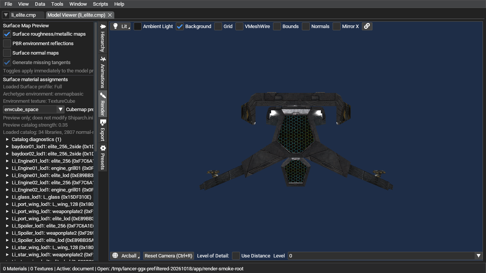

# LI_ELITE PBR environment preview A/B (2026-10-17)

This is a same-session toggle comparison in LancerEdit's Model Viewer. The
runtime data came from the active NAP-only package setup; the LI_ELITE CMP was
opened from `Data/NAP` and its hash matches the `models.nap` member.

## Conditions

- Asset: `Models/ships/liberty/li_elite/li_elite.cmp` from `Data/NAP`; its
  SHA-256 matches the `models.nap` entry (`c3323595bf0fded56c1c5072efbf3260ee74b6d2b86d40e4b8cffd8d8e52b22a`).
- Runtime data: active NAP package manifest, no loose `DATA` directory.
- View: Lit, same camera pose, `envcube_space` preview override, roughness/metallic
  maps on, ambient light `#1A1A1A`, same viewport and background.
- A: PBR environment reflections enabled. B: only that toggle disabled. The
  toggle was restored after capture.
- Screenshots are 1280x720 PNG. SHA-256: A `0b1d09a69cc8ec9b5f06d8768d9e60d649fb81ab47d624a15631ef77b4ec5011`; B `addf54eb8ad43e6d76e7967ff2715a6d46528aa6891cc3d82a03c36030d3565c`.

## Result

The fixed object crop `(510,240)-(1045,510)` changed in 39,467 pixels, with
mean absolute RGB difference 0.178/255. The background crop
`(280,80)-(620,230)` was pixel-identical. This confirms a localized visible
response to the PBR environment-reflection switch in this preview.

It does not establish that the new GGX mip selection or diffuse irradiance
convolution is visually correct: both cubemap contributions are affected by the
same toggle, the preview override is not a retail archetype assignment, and no
reference-client image or GPU timing was captured. Use the two images as a
functional A/B artifact, not as a quality sign-off.

