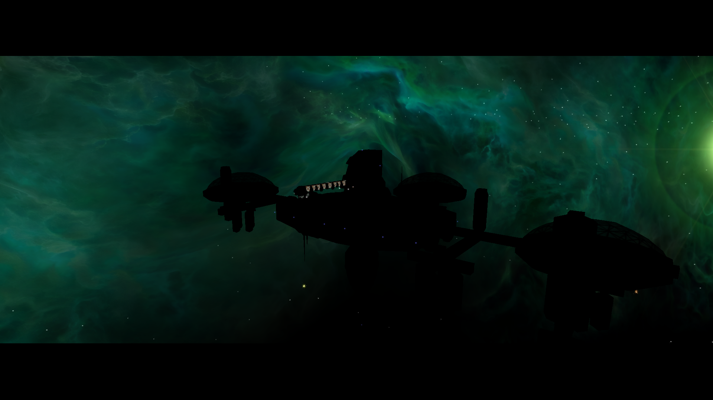
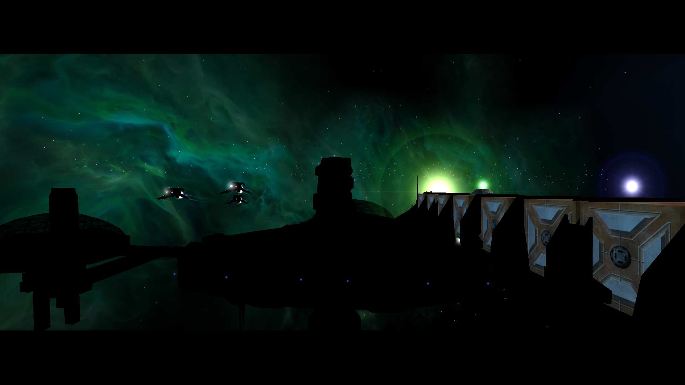
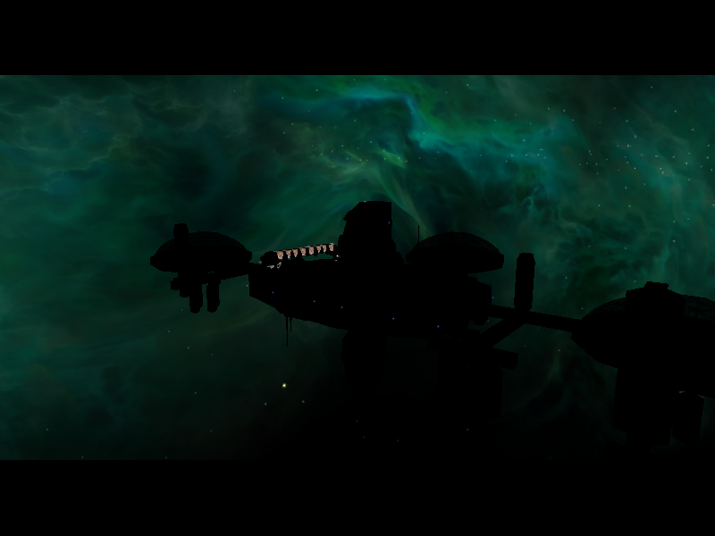
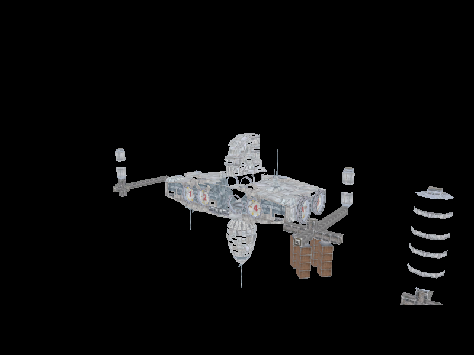

# M01A-Intro: dunkle Stationen und Schiffe

## Lauf

- Client: `03bfd87-git (20261013)`, Release-Build.
- Daten: lokaler NAP-Container aus ausschließlich `Data/NAP/`, vom Packaging-CLI
  mit 8.684 Einträgen verifiziert; keine lose `DATA` im Installationspfad.
- Start: `--new-game --render-normal-maps=off`, Surface-Profil `full`, generierte
  Tangenten an, OpenGL 4.6 / Mesa auf Intel HD Graphics 4600.
- Im Lauf wurden `Game: Finished loading game data` und `UI: Interface loaded`
  protokolliert; die M01A-Mission aktivierte Freeport-7-Szenen und rief
  `missions\m01a\m01a_fp7_01.thn` auf.

## Beobachtung

Im aufgenommenen M01A-Raumabschnitt sind große Stations-/Schiffskörper fast
schwarz. Einzelne kleine Bauteile, Turrets, Behältnisse und Lichtpunkte bleiben
hell. Der Lauf startete mit Surface-Normalmaps aus; damit ist der Befund nicht
auf eingeschaltete Normalmaps zurückzuführen. Die reproduzierte Aufnahme:

## Eingrenzung

Der Client-Parser liest `m01a_fp7_01.thn` wie folgt:

- Freeport 7, der Großtransporter und die Elite-Schiffe tragen `LIT_DYNAMIC`
  und gehören zu Lichtgruppe 0.
- `Light_sun` und `Light_fill` sind aktiv, gerichtet und gehören ebenfalls zu
  Gruppe 0. Beide haben diffuse Farbe; `Light_sun` ist nahezu weiß.
- `Scene_fp7bruce2` setzt das Szenen-Ambient explizit auf `(0, 0, 0)`.
- `Light_group2_sun` gehört zu Gruppe 2, hat keine diffuse Farbe und nur weißes
  Ambient; der Planet ist das einzige aufgeführte Compound in Gruppe 2.
- `FP7System.ini` enthält zusätzlich drei Systemlichter in der Standardgruppe 0;
  zwei davon haben `DYNAMIC_DIRECTION`, das dritte `edge_light2` ist schwach
  blau. `SystemRenderer.LoadLights()` übernimmt sie in die dauerhaften
  Systemlichter.
- Der getestete Client hat `PerPixelLighting` und `DynamicLighting` standardmäßig
  aktiviert. `surface_pbr_maps` und `pbr_environment_maps` fehlten in der
  Testkonfiguration und waren daher aus. `ObjectRenderer` startet mit
  `LitDynamic`, `LitAmbient` und `LightGroup = 0`.
- Damit sind ausgeschaltete Normal-/PBR-Karten und fehlende dynamische
  Standardflags keine hinreichende Erklärung. Noch offen sind die pro Objekt
  tatsächlich ausgewählten `FrameLights`, die resultierenden Lichtvektoren und
  Mesh-Normalen sowie der konkrete Materialshader.
- `M01a.ini` positioniert Freeport 7 bei `(3600, 1000, -21000)`. Am selben
  Punkt liegen `FP7_system_light` bei 21,3 km (53 % seiner 40-km-Reichweite),
  mit normiertem Vektor zum Licht `(-0,171, -0,047, 0,984)`, und `FP7_Crow_light`
  bei 27,7 km (55 % seiner 50-km-Reichweite), mit `(-0,965, 0,216, -0,150)`.
  Beide haben starke diffuse Farben und gehören zur Gruppe 0. `edge_light2`
  liegt ebenfalls in Reichweite, ist aber deutlich dunkler.
- Obwohl diese INI-Lichter `type = DIRECTIONAL` angeben, setzt der Datenpfad
  wegen `atten_curve = DYNAMIC_DIRECTION` ihren `LightKind` auf
  `PointAttenCurve`; der Shader richtet sie anhand der Lichtposition aus.
  Zusammen mit den zwei THN-Direktlichtern liegen fünf aktive Gruppe-0-Lichter
  unter dem Shaderlimit von neun. Reichweite und Gruppenzahl allein erklären
  die schwarzen Flächen daher nicht; ausgewählte Werte und Flächennormalen
  müssen noch zur Laufzeit bzw. am Mesh geprüft werden.

## Nachher-Aufnahme nach THN-Lichtrouting

Patch 2118 leitete die THN-Lichter und das Szenen-Ambient an die gemeinsame
Beleuchtung der Weltraumwelt weiter. Ein weiterer NAP-only-Lauf erreichte die
M01A-Szene ohne den früheren Menü-Startabsturz. Die Aufnahme zeigt weiterhin
nahezu schwarze Schiffs- und Stationskörper. Das Lichtrouting allein behebt den
Darstellungsfehler also nicht.

Space-THNs laufen mit `spawnObjects = false`; dadurch kopiert
`ThnScriptInstance` ihre Compound-Lichtflags nicht auf die bereits vorhandenen
Weltraumobjekte. Deren `ObjectRenderer`-Standardwerte passen jedoch zu diesen
THN-Objekten: Lichtgruppe 0 sowie `LitAmbient` und `LitDynamic` aktiviert.
Entscheidend offen bleiben die pro Objekt tatsächlich ausgewählten
`FrameLights`, die resultierenden Lichtvektoren und Mesh-Normalen sowie der
konkrete Materialshader. Ursache und grafische Korrektur sind nicht bestätigt.

## Geometrie- und Lichtrichtungsprobe

Am 2026-10-15 wurde eine Offline-Probe mit den LOD-0-Vertexnormalen aus
`transport_large.cmp` (4.575 Samples) und `li_elite.cmp` (2.574 Samples)
ausgeführt. Die Probe faltet die CMP-Part-Transforms und die im THN geparsten
Objektrotationen ein und vergleicht die Normalen mit den Richtungen aus
`FP7System.ini` sowie den rotierten Richtungen der beiden THN-Direktlichter.

| Objekt / Licht | mittleres positives N·L | Normalen mit N·L > 0,05 |
| --- | ---: | ---: |
| Transporter / `FP7_system_light` | 0,193 | 47,1 % |
| Transporter / `FP7_Crow_light` | 0,309 | 50,0 % |
| Transporter / `Light_sun` | 0,304 | 49,6 % |
| Transporter / `Light_fill` | 0,294 | 49,3 % |
| Elite / `FP7_system_light` | 0,287 | 52,8 % |
| Elite / `FP7_Crow_light` | 0,262 | 45,7 % |
| Elite / `Light_sun` | 0,286 | 48,8 % |
| Elite / `Light_fill` | 0,244 | 46,0 % |

Das schließt vollständig fehlende oder kollektiv umgekehrte LOD-0-Normalen und
eine globale Fehlrichtung aller vier Lichtquellen als alleinige Ursache aus.
Es beweist keine Beleuchtung der tatsächlich sichtbaren Pixel: die Probe liest
weder `ApplyLights`/`FrameLights` des Laufzeitframes noch Materialparameter,
Raster-Backface-Status oder den Pixelshader-Ausgang. Diese Messung ist daher
eine Eingrenzung, keine Ursachenbestätigung. Als nächster Schritt muss ein
RenderDoc-Replay derselben M01A-Frame-Pose die ausgewählten `FrameLights`, den
Materialshader und die Normalen-/Lichtwerte eines schwarzen Rumpfpixels prüfen.

## RenderDoc-Laufzeitbefund

Ein weiterer NAP-only-Lauf mit den optionalen Material-Debuggruppen wurde über
`renderdoccmd capture` gestartet. Die aktive NAP-Montage und ihre Hashes waren
vor dem Start geprüft. Der Capture `markers-m01a_frame902.rdc` enthält die
M01A-THN-Szene nach `m01a_fp7_01.thn`; die abgelegte Backbuffer-Aufnahme ist:

Der schwarze Stationspixel bei `(400, 300)` wird unter Event 926 von
`BasicMaterial type=DcDt; Dt=STADTL2_256.TGA; key=37` gezeichnet. Pixel History
meldet für diesen Draw `Passed = true`, kein Backface-Culling und
`shaderOut = (0, 0, 0, 1)`. Das Material bindet die Textur `STADTL2_256.TGA`
(RenderDoc-Ressource 2707, 2048 × 2048); der exportierte Texturinhalt ist
sichtbar hell. Der unmittelbar folgende Draw der Stadtlichter-Textur
`stadtls2_128 .tga` (Event 936) schreibt am selben Pixel ebenfalls Schwarz.

Der Pixelshader ist aktiv beleuchtet (`UseLighting = 1`) und erhält fünf
ausgewählte Lichter (`LightCount = 5`). Das globale Ambient und die Ambientwerte
dieser Lichter sind im Shader-CBuffer jedoch null. Die Pixel-UV aus dem
Fragmentshader lautet `(0,75954; 0,68839)`. Der aus Ressource 2707 gespeicherte
Texturinhalt ist an der korrespondierenden Mip-0-Stelle `(82, 93, 99)` und an
den entsprechenden Stellen der übrigen elf Mips ebenfalls nicht schwarz.
Pixel History meldet trotzdem den schwarzen Shaderausgang. Der reine
Textur-Readback belegt daher nicht, welchen Wert der laufende Shader tatsächlich
abgetastet hat.

Der GL-Pipelinezustand bindet Ressource 2707 an den Fragmentshader-Slot 0 für
`DtTexture`. RenderDoc beschreibt sie als 2048 × 2048 große BC1-Textur mit zwölf
Mips. Die aufgezeichnete Adressierung ist Repeat; LOD-Bias ist 0, die Grenzen
sind offen (`-1000` bis `1000`) und Anisotropie ist 1. Der Client lädt DDS-`mips`
über `DDS.FromStream`; bei unterstütztem S3TC werden komprimierte Levels direkt
als BC1 hochgeladen. Das Laufzeitlog bestätigt S3TC-Unterstützung; der Capture
führt Ressource 2707 als BC1, womit der native `glCompressedTexImage2D`-Zweig
verwendet wurde und nicht der Software-DXT1-Dekompressor. Die Clientbindung und
der Containerinhalt liefern damit keinen Hinweis auf eine fehlende Textur oder
einen falschen Texture-Slot.

Eine RenderDoc-Replay-Shader-Ersetzung gibt den gebundenen Diffuse-Sample
unmittelbar aus. Die Stationsfläche am untersuchten Draw wird dabei sichtbar;
der BC1-Sample ist also nicht die Ursache für den schwarzen Originalausgang.
Die Probe ist als Bild abgelegt:

Der Descriptor-Zugriff des Fragmentshaders zeigt die Diffuse-Textur als Ressource
2707, die `TextureCube` für `SAMPLER_EnvTexture_EnvSampler` dagegen als
`ResourceId::0` (`No Resource`). Gleichzeitig ist `EnvMapStrength` im
Material-CBuffer 1. Der aufgezeichnete Shader mischt am Ende die berechnete
Materialfarbe mit `2 * EnvSample * Materialfarbe`; bei Stärke 1 ersetzt der
Cube-Sample die beleuchtete Farbe vollständig. Der Shader-CBuffer enthält am
Pixel fünf aktive Lichter, weiße Vertex-/Diffuse-Farben und nichtschwarze
Lichtbeiträge. Damit erklären BC1-Upload und fehlendes Licht den Nullausgang
nicht.

Der Quellcode erklärt die fehlende Cube-Bindung: `BasicMaterial.Use()` löst
`envmaptex` als `TextureCube` auf, übergibt den Namen danach aber an
`RenderMaterial.BindTexture()`. Diese Routine akzeptiert ausschließlich
`Texture2D` und bindet für einen Cube den 2D-Null-Fallback. Patch 2123 bindet
die bereits aufgelöste `TextureCube` direkt an die Legacy- und PBR-Slots. Ein
frischer Release-Build mit Patch 2123 und ein erneuter NAP-only-M01A-Lauf
bestätigten, dass die Station im Intro sichtbar beleuchtet gerendert wird. Der
Lauf erreichte `Finished loading game data`, `Interface loaded`,
`m01a_fp7_01.thn` und `Found thorn mainObject`; ein Rendererabsturz trat nicht
auf. Der Screenshot steht im
[Laufzeitnachweis](intro-m01a-runtime-20261015/README.md). Dieser Sichtnachweis
ist kein pixelgenauer Vorher-nachher-Vergleich; Lichtqualität und Retail-Parität
sind damit nicht abgenommen.
