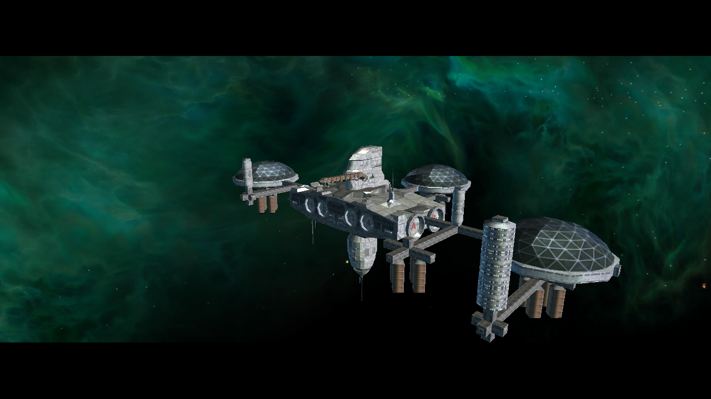
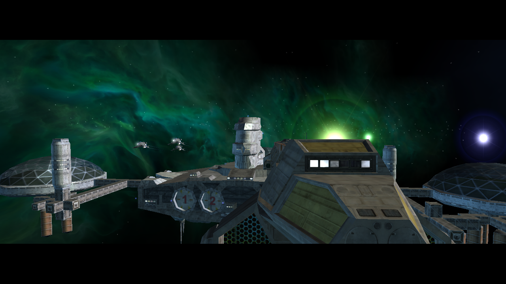
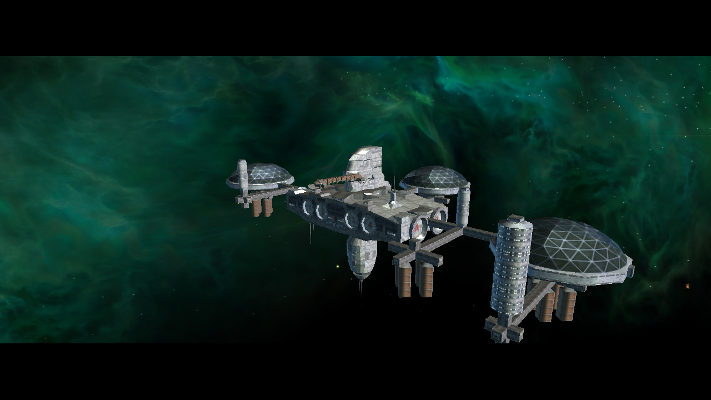

# M01A Freeport-7 runtime evidence (2026-10-15)

Both images come from NAP-only launches of the current Release client. The
station structure is visibly rendered in both runs. The first image was taken
with the normal render options enabled after the environment-cubemap binding
fix. The second was taken with a render option disabled.

These are independent runtime observations, not a controlled A/B comparison:
the camera pose and mission time differ. They show that the current build can
render illuminated station geometry in M01A, but do not measure the visual
impact of the cubemap fix. A fixed-pose capture and a before/after replay remain
necessary for that attribution.

## After cubemap binding fix

## Render option disabled

## Rebuild and NAP-only recheck (2026-10-15)

The current patch overlay reconstructed cleanly (`646` files). A fresh Release
build of `src/lancer/lancer.csproj` succeeded with zero warnings and errors.
Before launch, all 13 packages in `active.json` matched their recorded sizes and
SHA-256 values and passed `nexus-pack verify`. Their 8,695 archive entries also
matched the files and hashes under `Data/NAP/`; the test app had no loose `DATA`
directory.

The game started with `--new-game --render-normal-maps=off` on OpenGL 4.6 / Mesa
with an Intel HD Graphics 4600. Logs reached `Finished loading game data`,
`Interface loaded`, `m01a_fp7_01.thn` and `Found thorn mainObject`. The captured
station is illuminated, and the run produced no renderer crash. This repeats
the visual sanity check on a fresh build; it still does not provide a fixed-pose
pixel comparison. The startup also logged an 83 ms slow server update and 27
dropped client ticks, so frame pacing remains open.

The window was closed through X11 after capture. Shutdown then emitted a
`BadWindow` error and an OpenAL cleanup warning; a clean shutdown is therefore
not verified.

