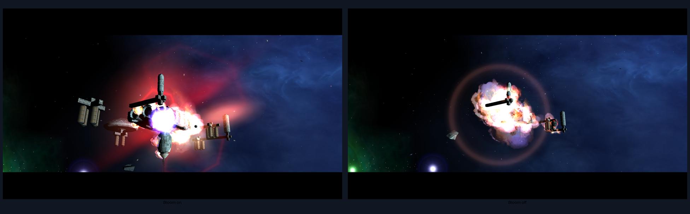
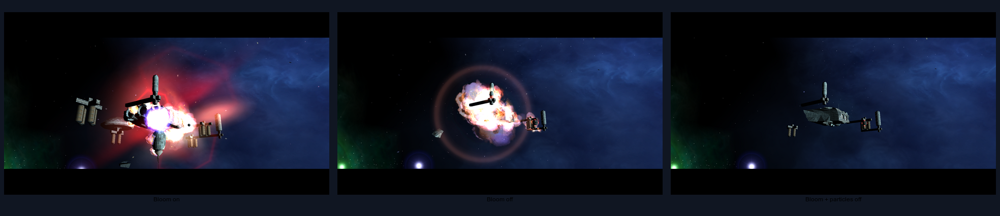
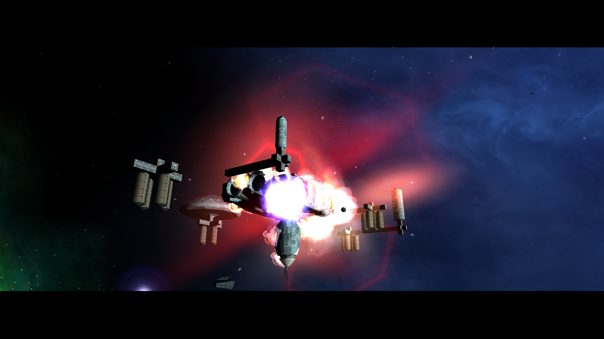

# Vollständiger NAP-only-Spielstart mit Renderer-Optionen (2026-10-19)

## Umfang und Provenienz

- Die 13 Runtime-Paketklassen `effects`, `equipment`, `material`, `mission`,
  `models`, `runtime`, `script`, `sounds`, `surface`, `system`, `ui`, `video`
  und `world` wurden ausschließlich aus Dateien unter `Data/NAP/` gepackt.
  Die EXE-Ressourcen aus `Data/NAP/RuntimePackage/` wurden dem Runtime-Paket
  zugeordnet.
- Die Einträge der 13 Archive wurden mit `nexus-pack verify` geprüft. Die
  Modelle (2.353 Einträge), Materialien (263), Texturen (45), UI (857), Welt
  (956), Skripte (1.527) und Sounds (1.840) waren enthalten.
- Die aktive Manifestkopie liegt hier. Sie nennt Manifest-ID
  `lancer-render-assets-20261019`, eindeutige Mount-Reihenfolge 1–13 und
  Größe/SHA-256 jedes Archivs. Im isolierten Spielroot gab es kein loses
  `DATA`-Verzeichnis.
- Der Test verwendete die .NET-10-Release-Ausgabe des Clients. Die lokale
  Konfiguration schaltete HDR, Normalmaps, ergänzende PBR-Maps, PBR-Umgebung,
  diffuse IBL, dynamische Beleuchtung, Schatten, Bloom und Soft Particles ein.

## Laufzeitbefund

Der Client lud Spieldaten und UI, initialisierte 53 Systeme und betrat
`FP7_system`. Der Log enthält danach `Found thorn mainObject` und laufende
M01A-Intro-Trigger bis zum Aufruf von `m01a_fp7_02b.thn`. Es trat in diesem
Lauf keine `RenderMaterial.SetLights`-Ausnahme und keine Crashmeldung auf.
Damit ist der kombinierte Optionssatz auf dem vollständigen NAP-Datenbestand
bis in eine laufende Intro-Szene gestartet.

Der erste X11-Capture wurde während des Übergangs aufgenommen und war schwarz.
Ein zweiter, isolierter Lauf mit eigenem `HOME` und XDG-Verzeichnissen startete
mit `Save: Located 0 saves`; ein späterer Capture desselben Vollbild-OpenGL-Fensters
zeigt die laufende M01A-Intro-Szene. Station, Schiffe, Nebel, Sterne und eine
Explosion sind sichtbar; die Cutscene rendert schwarze Letterbox-Balken. Das
Bild bestätigt die Szene, aber ohne Vergleichslauf nicht den einzelnen Beitrag
jedes aktivierten Effekts. Der Testlauf endete durch das vorgesehene 120-Sekunden-Timeout (Exit 124), nicht
durch einen Spielabsturz. Ein separater Lauf änderte nur Bloom auf `off` und
erreichte ebenfalls `FP7_system` sowie den M01A-Trigger `play_sad_music`; beide
Profile starteten mit null Spielständen und denselben NAP-Paketen. Ein dritter
Lauf ließ Bloom aus und schaltete zusätzlich `--render-particle-effects=off`. Die beiden
Aufnahmen sind zeitlich auf diesen Trigger ausgerichtet, aber wegen Animation,
Explosion und Kamerafahrt nicht framegenau. Sie zeigen eine qualitative
Änderung der großflächigen Aufhellung. Der deutliche Ring bleibt auch mit Bloom
aus sichtbar und muss als eigener Effekt weiter isoliert werden; seine Ursache
ist aus diesem Bildpaar nicht bestimmt.

Die dritte Aufnahme entfernt zusammen mit der Explosionswolke auch den großen
Ring. Der M01A-Trigger startet `freeport7_dome_fuse2`; dieses Fuse startet am
Dome `gf_piratestationexplode#3` (`Data/NAP/Effects/fx/FuseFreeport7.ini`).
`ExplosionsAle.ini` ordnet diesen visuellen Effekt
`gf_piratestationexplode.ale` und den Texturen `hexagon.txm` /
`planetflare.txm` zu. Die ALE-Datei enthält `FxRectAppearance`-Einträge
`gf_piratestationexplode_flashbang#...` mit `planetflare`. Zusammen mit dem
Ein/Aus-Lauf weist das den großen Ring dem Freelancer-Explosionssprite zu; er
ist kein Bloom-Halo. Welche Flashbang-Instanz den sichtbaren Ring zeichnet, ist
noch nicht einzeln aufgelöst.

Die zeitlich getrennten Bilder sind kein pixelgenauer Bloom- oder Halo-
Kalibrierungstest. Es ist kein FPS- oder GPU-Kostenbeleg.

Der Log meldete erneut, dass `sun.sph` nicht alle sechs Seiten enthält; siehe
[`Sun sphere asset and renderer path`](../sun-sph-placeholder-20261018.md).

## Noch offen

Dieser Lauf beweist weder den visuellen Beitrag jeder einzeln eingeschalteten
Funktion noch deren Qualität, stabile Bildrate, GPU-Kosten oder Hardware-
Kompatibilität. Für diese Abnahmen sind interne Renderer-Screenshots oder
RenderDoc-Aufnahmen desselben Frames sowie Einzel-A/B-Läufe erforderlich.
