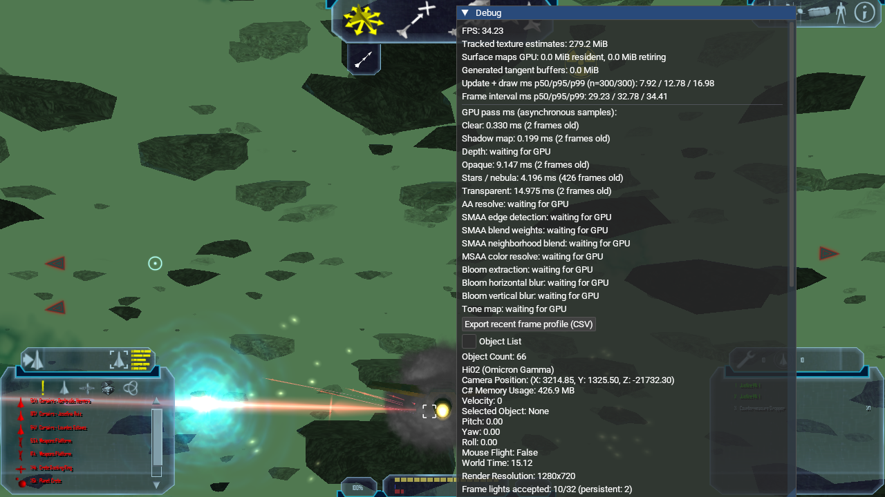
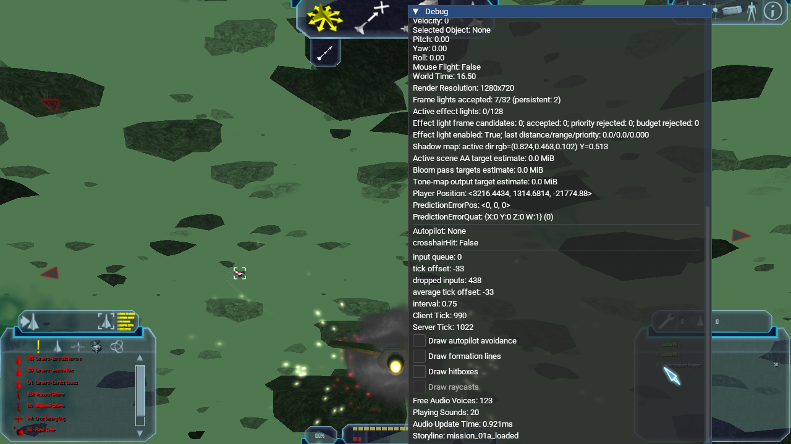
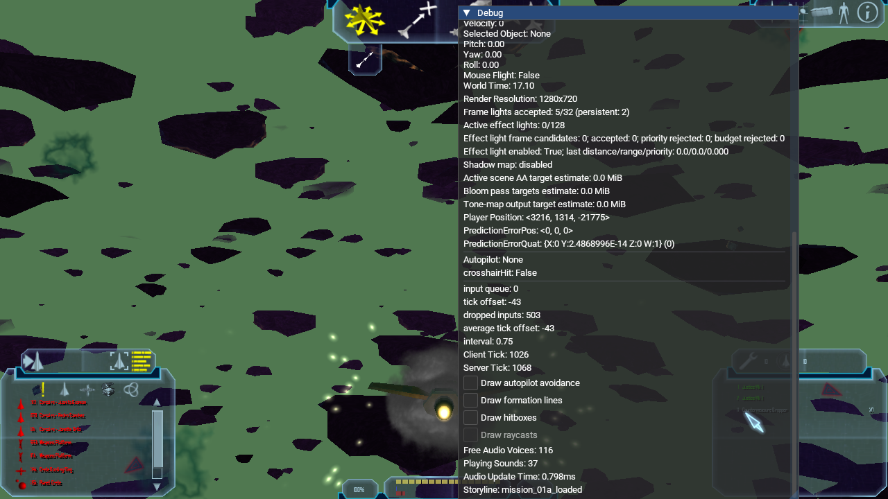

# Hi02 directional light, shadow pass, and nebula light-slot runtime check

A Release client used OpenGL 4.6 Core, Mesa 23.2.1, and Intel HD Graphics 4600.
It loaded the same Hi02 save in both runs, with local invulnerability enabled
for the QA player. The only renderer override difference was
`--render-shadows=on` versus `--render-shadows=off`.

The isolated application used manifest
`lancer-renderer-aa-profile-20261016` (SHA-256
`e6d56a0f74095c89712f35f35586bfbe5db19d28f0f106654037a53140fc3ca1`). Its 13
NAP archives matched the manifest and passed `nexus-pack verify`; their inputs
were staged only under `Data/NAP/.runtime-test-stage/package-inputs-20261016`
and `Data/NAP/QA/runtime-smoke-20261014`. The app had no loose root `DATA`
directory.

## Findings

- The on run entered Hi02 with an active directional system light. The debug
  panel reported `active dir rgb=(0.824,0.463,0.102) Y=0.513`, matching
  `Hi02_system_light` from the NAP `LightSource` data.
- The shadow pass completed and produced an asynchronous GPU sample of
  `0.199 ms` (two frames old). The off run reported `Shadow map: disabled`.
- Both runs remained in gameplay without the previously observed `Too many
  lights!` exception. The on run remained active for more than a minute and
  the off run for more than a minute.
- The runs used the same save and nearly the same camera position, but the
  world times and active combat/effect frames differed. The images demonstrate
  pass execution, directional-light selection, and the option state; they do
  not prove pixel-exact shadow quality, isolate the visual shadow contribution,
  or provide a controlled performance comparison.

## Shadow pass active

## Selected directional light

## Shadow pass disabled

