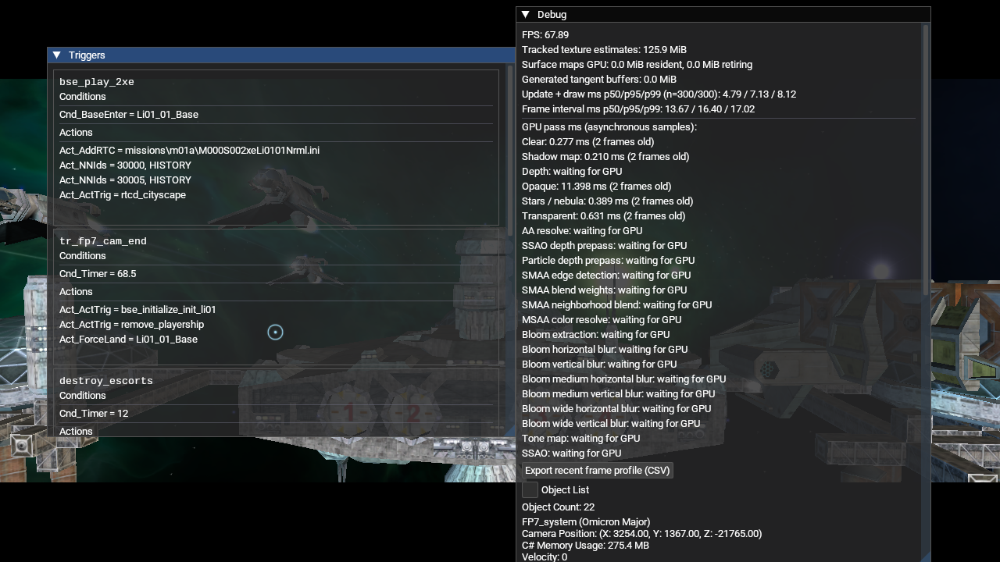

# OpenGL shadow depth-range runtime check (2026-10-18)

## Runtime setup

- Release client rebuilt from the current patch overlay (`84f09a6d0`), 1280×720, Mesa 23.2.1, OpenGL 4.6, Intel HD Graphics 4600.
- Isolated XDG config, save, cache and state directories under `/tmp/lancer-shadow-depth-contract-20261018/`. Started with `--new-game --render-shadows=on`; the debug overlay was enabled to read GPU pass timings.
- The active NAP manifest and all 13 package sizes and SHA-256 hashes were checked before launch. Every archive passed `Nexus.Packaging.Cli verify`; the manifest is attached as [`nap-active.json`](nap-active.json). Package provenance and the staged INI hashes are in [`package-provenance.txt`](package-provenance.txt). There was no loose root `DATA` or `data` directory.

## Result

The log reached `Finished loading game data`, `UI: Interface loaded`, `Entering system FP7_system`, and `Found thorn mainObject`. The screenshot shows the live Freeport-7 scene and a nonzero `Shadow map: 0.210 ms` GPU sample. This confirms the OpenGL renderer still schedules and executes the shadow-map pass after patch 2374 added an explicit clip-depth capability for the shared PBR shadow shader. The OpenGL backend reports the legacy `[-1,1]` depth convention, so this check exercises the preserved OpenGL mapping in the current shader.

This earlier log reported `explosion_impulse`, `particle_effect` and `MinSpecLOD` as unknown INI entries. Patch 2376 now parses and renders `particle_effect`; the new NAP startup in `dynamic-asteroid-effects-20261018` no longer reports it. `explosion_impulse` and `MinSpecLOD` remain unsupported and unrelated to this shader check.

## Limits

This is an execution and startup regression check, not a fixed-pose before/after image comparison. It does not establish shadow quality, the visually correct light source, caster coverage or a stable FPS baseline. The scene is FP7 intro on Intel HD 4600; other scenes and GPUs remain open.
