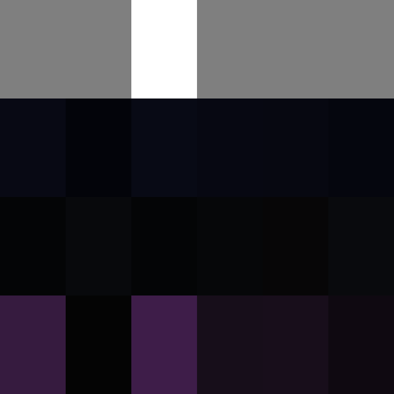
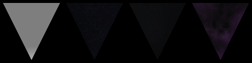

# Produktions-PBR und echte Cubemap-MATs

Datum: 2026-10-14

## Probeaufbau

- SDL3-Offscreen-Kontext mit OpenGL 4.6 Core auf Intel HD Graphics 4600 / Mesa
  23.2.1.
- Eingebettetes `PBR.bin` aus dem gebauten Client, Shaderfeature `ENVMAP`
  (Featuremaske 64), Produktions-PBR-Fragment und reguläre FVF-Vertexpipeline.
- Testdreieck mit Weiß-Diffuse, Metallwert 1, Roughness 0,25, schwarzem
  Umgebungslicht und fester Kamera-/Weltmatrix. Die Reflexionsrichtung ergibt
  für diesen Draw −Z.
- Die vier Eingaben stammen aus `Data/NAP/`. `UtfLoader.LoadResourceFile`
  liest die MAT-Texture-Library; `TextureData.Initialize` führt das enthaltene
  CUBE-DDS durch `DDS.FromStream` und liefert eine `TextureCube`. Diese wird
  über die Produktionseinheit `t5/s5` gebunden.
- Bei neun Mipstufen wird Roughness 0,25 mit `EnvMipCount = 8` auf Level 2
  abgebildet. `envmapbasic` hat nur eine Mipstufe und bleibt auf Level 0.

## Ergebnis

| Eingabe | SHA-256 | Mips | Mittelpixel RGB |
|---|---|---:|---|
| `Material/fx/envmapbasic.mat` | `18c30f383fc451dcb5e596668770fcbc517cb88dadf7ea64c685a01c2a2432bc` | 1 | (126, 126, 126) |
| `Surface/fx/envcube_space.mat` | `c0b9908383e7e6837bf61d7c9f256636bf16cb455f800e3ebe9a10ebe3eba9db` | 9 | (13, 14, 22) |
| `Surface/fx/envcube_sun.mat` | `862be2bc062cf6d636c998b88c6fb9ca36434c7d5ff862544d0a78eba0b2b70f` | 9 | (17, 17, 21) |
| `Surface/fx/envcube_nebula.mat` | `c360f2222aea189f6bf0c62d37ff2ba2bd2d82c8bde4a14cb110abd0a30af0eb` | 9 | (23, 18, 25) |

Alle vier Läufe endeten erfolgreich und lieferten unterschiedliche, nicht
schwarze Cube-Proben. Das belegt für diese GPU die Produktions-PBR-ENVMAP-
Variante, die Slotbindung, den MAT→UTF→DDS→TextureCube-Ladeweg und die
roughnessbasierte Auswahl einer vorhandenen Mipstufe. Der sechsfarbige
synthetische Richtungsprobe ist separat unter
[synthetic-cubemap-slot5-20261014.md](synthetic-cubemap-slot5-20261014.md)
dokumentiert.

Danach sampelte ein zweiter Offscreen-Draw dieselben vier geladenen MAT-Cubes
mit einem Richtungs-Probe an den sechs Achsen auf Mip 0. Die RGB-Mittelpixel
pro Richtung lauten:

| Cube | +X | −X | +Y | −Y | +Z | −Z |
|---|---:|---:|---:|---:|---:|---:|
| `envmapbasic` | (127,127,127) | (127,127,127) | (255,255,255) | (127,127,127) | (127,127,127) | (127,127,127) |
| `envcube_space` | (8,9,20) | (3,4,10) | (8,10,21) | (7,8,18) | (7,8,17) | (5,6,14) |
| `envcube_sun` | (4,5,6) | (8,9,12) | (4,5,6) | (6,7,9) | (7,6,7) | (9,10,13) |
| `envcube_nebula` | (54,27,63) | (4,4,4) | (62,29,73) | (23,14,26) | (24,14,27) | (15,9,17) |

Damit sind DDS-Flächenfolge und GPU-Richtungssampling für die tatsächlichen
NAP-Cubes belegt. Dieser Zusatz nutzt einen kleinen Achsen-Probe-Shader; er
beweist weder die Retail-Orientierung im PBR-Mesh noch die Cube-Auswahl pro
Umgebung.

## Grenzen und nächste Arbeit

Der kontrollierte Draw verwendet Testgeometrie und vorgegebene Uniforms. Er
beweist keine korrekte Reflexionsrichtung auf LI_ELITE, keine sichtbare
In-Game-Qualität und keine GPU-Bindung im ModelViewer-Draw. Dessen bisheriges
OFF/ON-ROI bleibt bei 0 geänderten Pixeln.

Offen bleiben die Auswahl der `envcube_*` über den `[CubeMap]`-Katalog anhand
der aktiven Umgebung, die Einbindung von `[CubeMap] strength`, visuelle
Orientierungs-/Stärkeabnahme auf echten Schiffen und Stationen sowie eine
GGX-vorgefilterte IBL-Pipeline. Normale DDS-Mipmaps ersetzen kein GGX-Filtering.

## Surface-Katalog-Resolver und Strength (2026-10-14)

Ein zweiter Lauf verwendet `GameResourceManager` mit `SurfaceMapsIni.Load` auf
`Surface/fx/SurfaceMaps.ini`. `ResolveEnvironmentCube` erhält jeweils den
Nickname aus dem `[CubeMap]`-Katalog, lädt die referenzierte MAT bei Bedarf aus
dem VFS und gibt die konfigurierte Stärke an den PBR-Materialpfad weiter. Alle
Laufzeitdateien stammen aus `Data/NAP/`; es wurden keine losen Freelancer-Daten
verwendet.

| Katalog-Nickname | MAT | Mips | gelesene Stärke | Mittelpixel RGB mit Produktions-PBR |
|---|---|---:|---:|---|
| `envcube_space` | `Surface/fx/envcube_space.mat` | 9 | 0,35 | (8, 9, 13) |
| `envcube_sun` | `Surface/fx/envcube_sun.mat` | 9 | 0,5 | (12, 13, 15) |
| `envcube_nebula` | `Surface/fx/envcube_nebula.mat` | 9 | 0,4 | (15, 12, 16) |

Zum Vergleich ergab der vorherige kontrollierte Draw mit Stärke 1 für dieselben
Texturen (13, 14, 22), (17, 17, 21) und (23, 18, 25). Damit sind die
Katalogauflösung, das bedarfsgesteuerte Laden der drei MATs und die Weitergabe
der jeweiligen Stärke bis zum Produktionsshader auf diesem OpenGL-Gerät
bestätigt. `envmapbasic` wurde in diesem Lauf separat direkt geladen und dient
als Legacy-/Fallback-Cube; es ist kein Eintrag der drei Surface-Werte.

Das ändert die Bewertung des Null-Differenz-ModelViewer-A/B nicht: Eine
kontrollierte Geometrie beweist weiterhin keine sichtbare, korrekt orientierte
Reflexion auf Retail-Schiffen oder im Spiel. Dafür müssen Materialzustand,
Mesh-Richtung und tatsächliche ModelViewer-/Spiel-Draws geprüft werden. Eine
GGX-vorgefilterte IBL-Pipeline ist ebenfalls nicht Teil dieses Nachweises.
