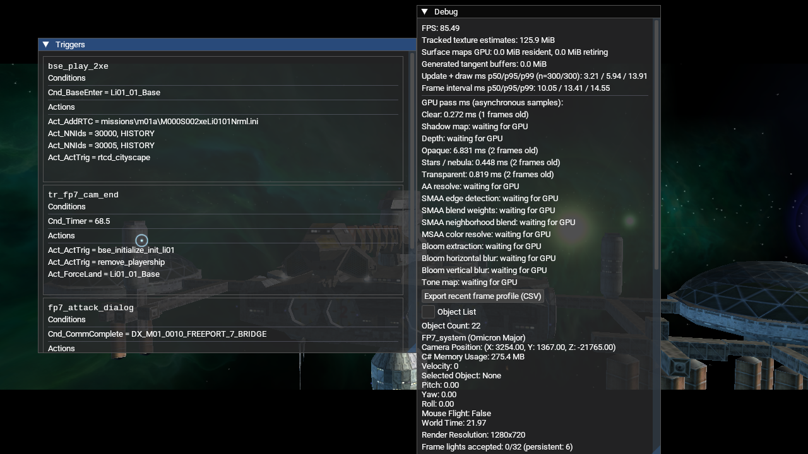
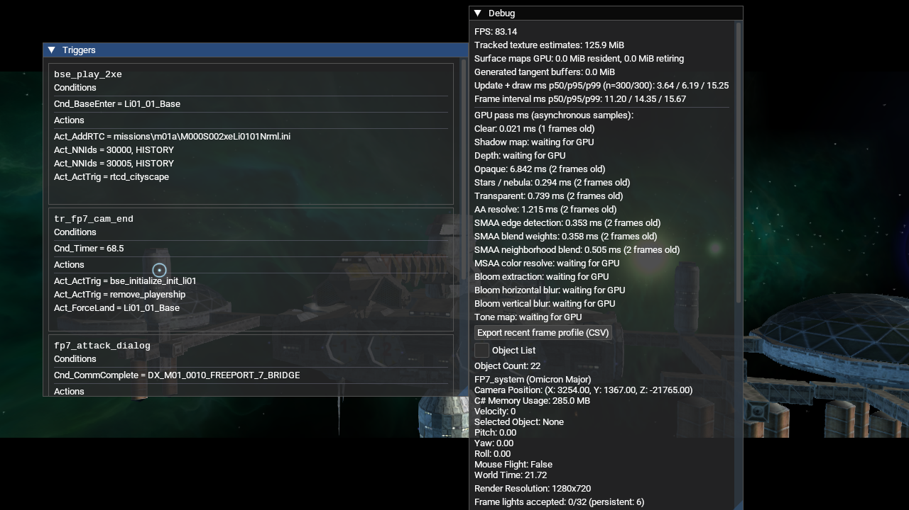
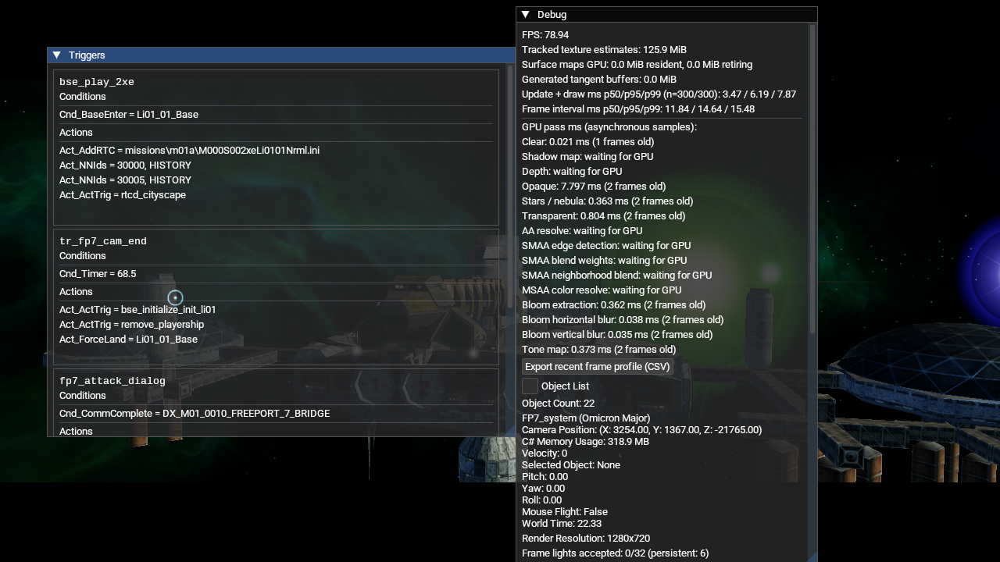
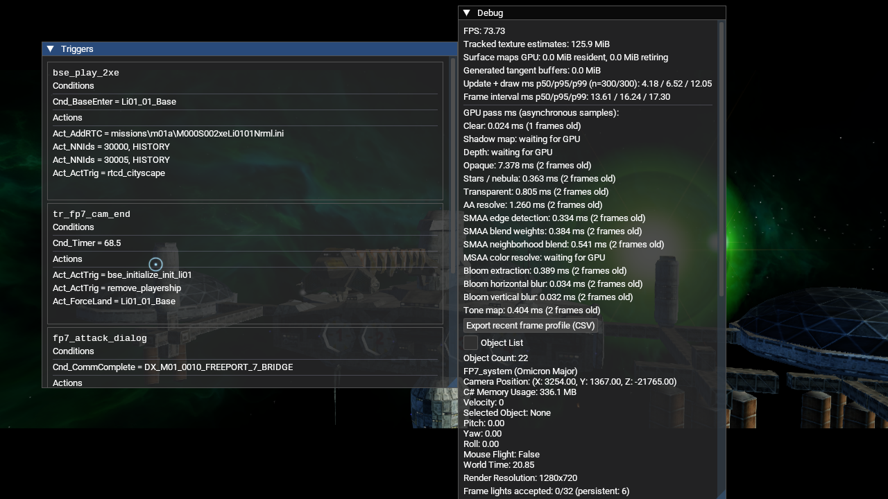
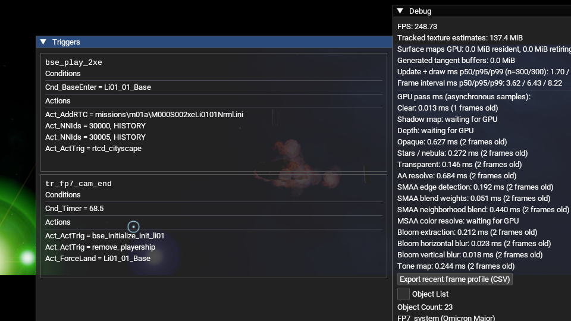
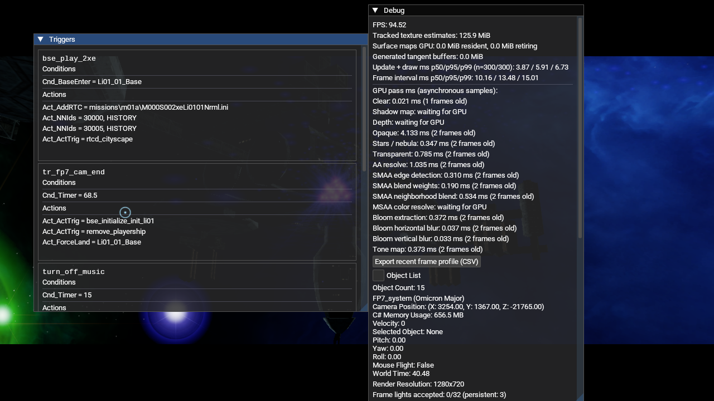

# HDR/LDR- und AA-Laufzeitvergleich (2026-10-17)

Vier Release-Starts mit derselben NAP-only-Installation und derselben M01A-
Intro-Kamerafahrt auf OpenGL 4.6 Core / Mesa 23.2.1 / Intel HD Graphics 4600.
Alle Läufe verwendeten 1280×720, `--new-game`, Debug-GPU-Timer und dieselben
13 NAP-Archive. Der Datenpfad war das Anwendungsverzeichnis mit aktivem Paket-
Manifest; ein loses Root-`DATA`-Verzeichnis war nicht vorhanden.

Vor den Starts stimmten Manifest und Archivlängen/-Hashes mit
[`nap-active.json`](nap-active.json) überein. Das Manifest
`lancer-renderer-aa-profile-20261016` hat SHA-256
`e6d56a0f74095c89712f35f35586bfbe5db19d28f0f106654037a53140fc3ca1`.
Alle 13 Archive bestanden `nexus-pack verify`. Die dokumentierten Paketquellen
liegen ausschließlich unter [`package-inputs.txt`](package-inputs.txt) in
`Data/NAP/`.

## Aufnahmen und GPU-Samples

Die Weltzeit im Debug-Overlay liegt zwischen 20,85 und 22,33 Sekunden. Die
Intro-Kamera bewegt sich; die Bilder zeigen dieselbe Passage mit leicht
unterschiedlichem Zeitstand. Die separaten Starts sind daher ein visueller
Funktionsvergleich, kein pixelgenauer oder statistisch kontrollierter Benchmark.

| Modus | Weltzeit | FPS bei Aufnahme | Frameintervall p50/p95/p99 (ms) | GPU-Pässe (ms) |
| --- | ---: | ---: | ---: | --- |
| LDR, kein AA | 21,97 | 85,49 | 10,05 / 13,41 / 14,55 | keine Postprocess-/AA-Samples |
| LDR, SMAA High | 21,72 | 83,14 | 11,20 / 14,35 / 15,67 | SMAA Edge 0,353; Weights 0,358; Neighborhood 0,505; AA Summe 1,215 |
| HDR + Bloom, kein AA | 22,33 | 78,94 | 11,84 / 14,64 / 15,48 | Extract 0,362; Blur H/V 0,038 / 0,035; Tonemap 0,373 |
| HDR + Bloom + SMAA High | 20,85 | 73,73 | 13,61 / 16,24 / 17,30 | SMAA Edge 0,334; Weights 0,384; Neighborhood 0,541; AA Summe 1,260; Bloom Extract 0,389; Blur H/V 0,034 / 0,032; Tonemap 0,404 |

GPU-Timer sind asynchron und zwei Frames alt. FPS- und Frameintervallwerte
sind Momentaufnahmen aus einer animierten Szene mit sichtbarem Debug-Overlay;
sie sind nicht als Leistungsversprechen oder isolierter Effekt-Aufschlag zu
interpretieren.

### LDR, kein AA

### LDR, SMAA High

### HDR und Bloom, kein AA

### HDR und Bloom, SMAA High

## Ergebnis und offene Abnahme

Alle vier Pfade erreichten die Intro-Szene. Die Overlay-Samples belegen, dass
SMAA in beiden LDR-/HDR-AA-Modi alle drei SMAA-Pässe ausführt; HDR führt Bloom
vor Tone Mapping aus, und HDR ohne AA nutzt ebenfalls Bloom und Tone Mapping.
LDR ohne AA umgeht die Postprocess-Kette. Im gezeigten Bild sind HDR/Bloom
sichtbar, der SMAA-Unterschied ist bei dieser 1280×720-Aufnahme subtil.

Resize-/Minimize-/Restore-Verhalten, Fehler-Injektion, weitere GPUs/Backends,
Referenzbilder aus dem Originalspiel und längere Frame-Profile bleiben offen.
Die gemessenen Kosten sind daher keine finale Performance-Abnahme.

## Resize- und Minimize/Restore-Smoke

Ein weiterer HDR+SMAA-Lauf blieb während des Fensterzyklus aktiv. Das SDL-
Fenster wurde von 1280×720 auf 960×540 verkleinert; `xwininfo` bestätigte
960×540 und der Screenshot zeigt weiterlaufende SMAA-, Bloom- und Tonemap-
Samples. Danach wurde das Fenster auf 1280×720 gesetzt, minimiert und wieder
sichtbar gemacht. `xwininfo` bestätigte nach dem Restore 1280×720 und
`IsViewable`; der Debug-Overlay zeigte wieder 1280×720, aktive Postprocess-
Samples und rund 94,5 FPS. Im Laufprotokoll wurden keine GL-, FBO- oder
Exception-Fehler gefunden.

| Zustand | Bild |
| --- | --- |
| Resize 960×540 |  |
| Restore 1280×720 nach Minimize |  |

Das ist ein einzelner OpenGL-/Mesa-Smoke-Lauf. Fehler-Injektion, längere
Minimize-/Restore-Zyklen und weitere Backends/GPU-Treiber bleiben offen.
