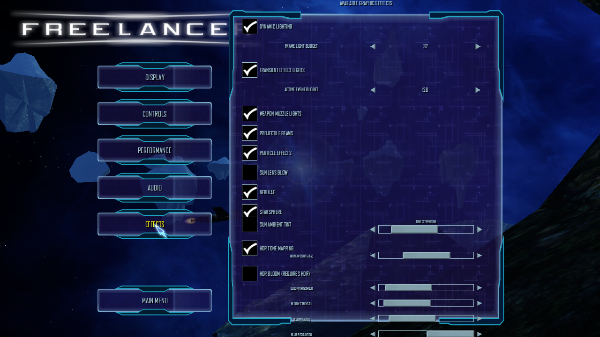
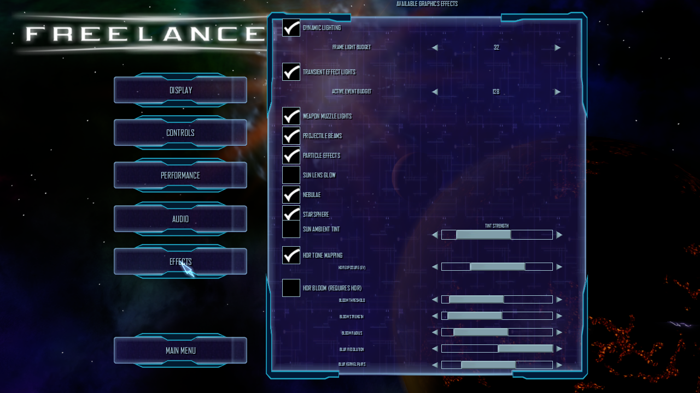
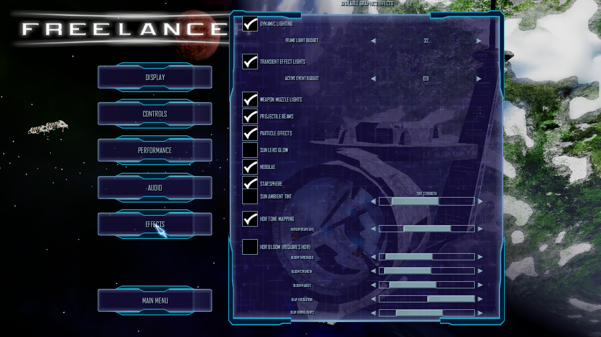
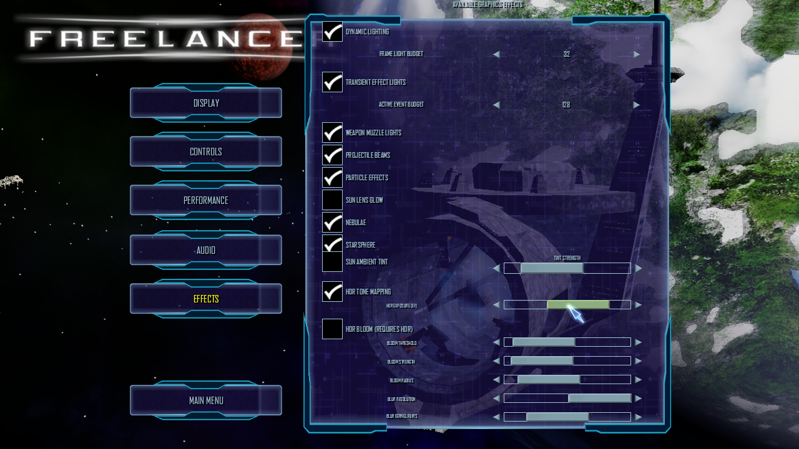
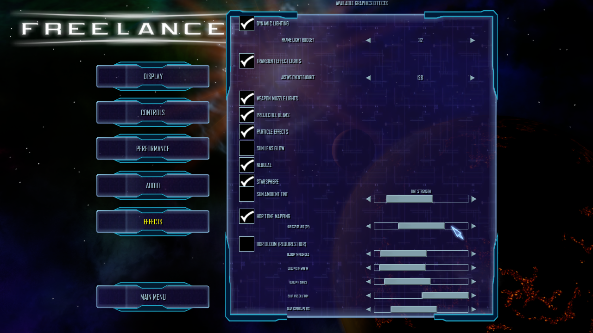

# Effects options layout and HDR hitbox smoke

The Release Client was rebuilt after patch 2361 regenerated the embedded
`options.designer.lua` resource from `uixml/options.xml`. Only that generated
entry was refreshed in `Interface/Default/interface.json`; other UI resources
were kept unchanged.

## Runtime setup

- Client: `03bfd87-git (20261017)`, Release, .NET 10.
- Graphics: OpenGL 4.5, Mesa 23.2.1, llvmpipe, 1280x720.
- NAP manifest: `lancer-pbr-qa-20261014`, SHA-256
  `57af6496c39b4c35ebb32add550fd58ef00f5eb40f7658b7207a06fc99293652`.
- All 13 archive sizes and SHA-256 values matched `packages/active.json`
  immediately before launch; all 13 also passed `nexus-pack verify` after the
  run. The archives are the Data/NAP test set staged under
  `Data/NAP/.runtime-test-stage/package-inputs-20261016`; the app root had no
  loose `DATA` or `data` directory.
- The client reached `Game: Finished loading game data` and
  `UI: Interface loaded`.

## Findings

Before the patch, the effects panel declared 490 logical units of controls inside
a 450-unit frame. The lower Bloom controls were clipped, and the HDR checkbox's
wide hit area overlapped the exposure slider. The updated panel is 450 units
high; all effect rows, through the kernel slider at Y=426, fit in the frame. HDR
and Bloom checkbox hit areas are narrowed and separate from their slider tracks.

The HDR exposure slider thumb moved visibly after a mouse-wheel input over its
track, while HDR remained enabled. A drag attempt did not provide a clear value
readout; the UI exposes no numeric EV label. Bloom calibration and GPU cost
remain separate renderer acceptance work.

## Screenshots

### Before

### After

### Exposure slider response

Before and after one wheel step over the slider track. The thumb moves while
HDR stays enabled.

### Exposure row hitbox

