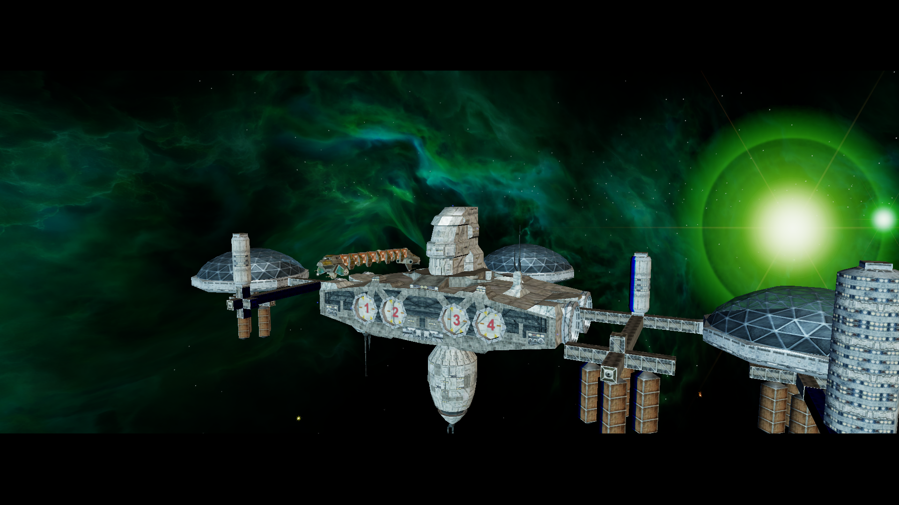

# RenderGraph Intro Smoke Check — 2026-10-17

This capture records the first live NAP-only launch after fixing the reusable
`SystemRenderPassGraph` order-buffer validation.

- Runtime: Linux x64, OpenGL 4.6, Mesa 23.2.1, Intel HD Graphics 4600
- Data: active NAP manifest `lancer-pbr-lighting-qa-20261017`, 13 archives;
  archive sizes and SHA256 values were rechecked before launch. No loose root
  `DATA` directory was present.
- Options: HDR on, Bloom on, antialiasing none, SSAO off
- Log evidence: `Game: Finished loading game data` and `UI: Interface loaded`;
  the client continued into the M01a intro and spawned into FP7. No render-graph
  schedule exception occurred during the 45-second smoke run.
- The screenshot is a visual smoke capture, not a controlled before/after
  quality comparison or an FPS baseline.

