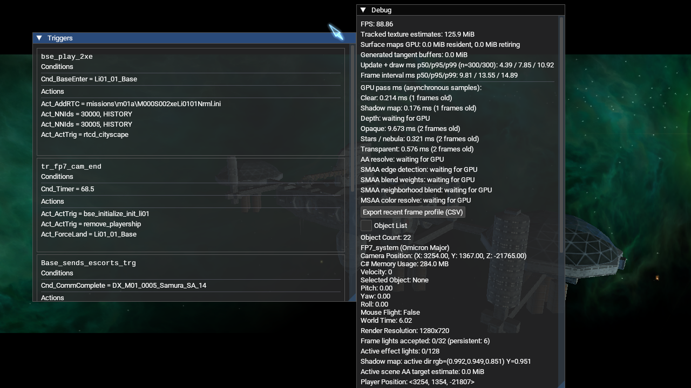

# Shadow-Map-Diagnose im Lauf (2026-10-17)

Der aktuelle Release-Client wurde mit `--new-game --render-shadows=on` im
OpenGL-4.6-Lauf auf Mesa 23.2.1 / Intel HD Graphics 4600 gestartet. Die
Testinstallation war NAP-only: aktives Manifest
`lancer-renderer-aa-profile-20261016`, SHA-256
`e6d56a0f74095c89712f35f35586bfbe5db19d28f0f106654037a53140fc3ca1`; alle
13 Archivgrößen und Hashes stimmten und `nexus-pack verify` bestand für jedes
Archiv. Der App-Ordner enthielt kein loses `DATA`.

Der Client lud `m01a_fp7_01.thn`, betrat `FP7_system` und lief in der Mission.
Der interne Screenshot per `USER_SCREEN_SHOT` zeigt das Debug-Overlay mit
`Shadow map: active dir rgb=(0.992,0.949,0.851) Y=0.951` sowie einem
asynchronen `Shadow map`-GPU-Timer-Sample von 0,176 ms. Das belegt, dass die
Schattenmap im M01A/OpenGL-Lauf erstellt wurde und die Diagnoseanzeige aktuelle
Werte ausgibt.

Dies ist ein einzelner dynamischer Intro-Frame, kein kontrollierter
Schatten-Ein/Aus-Vergleich. Der GPU-Zeitwert ist ein einzelnes Sample, keine
FPS-Kostenmessung. Hi02-Auswahl, Bildqualität, Bias-Abstimmung, stabile
Kamerapose und Leistungsdifferenz bleiben offen.

Ein späterer Hi02-Probeversuch mit korrektem System-Nickname `Hi02` lud die
Welt, aber der temporäre Spielstand endete im `You are dead`-Menü. Der interne
Frame zeigte dort `Shadow map: no active directional light`; dieser Zustand
liegt außerhalb eines aktiven System-Renderframes und ist kein Beleg für die
Lichtauswahl in Hi02. Der Versuch wird daher nicht als Auswahl- oder
Schattennachweis gewertet. Ein gesunder, reproduzierbarer Hi02-Spielstand und
eine feste Kamerapose sind für den Vergleich weiter erforderlich.
