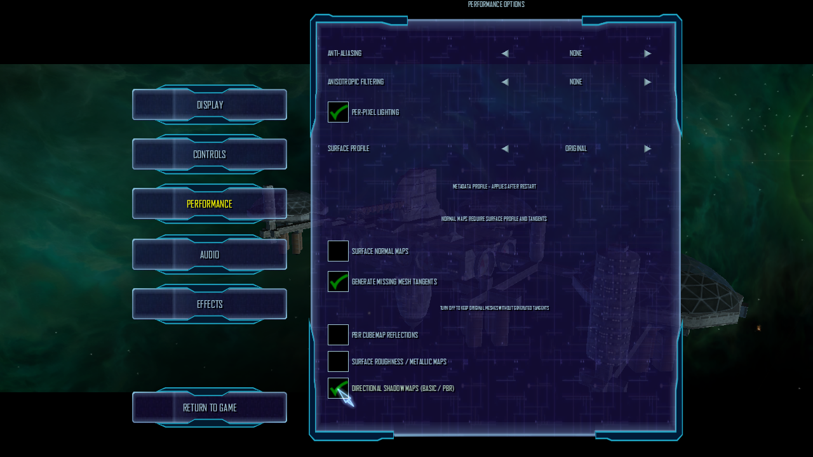
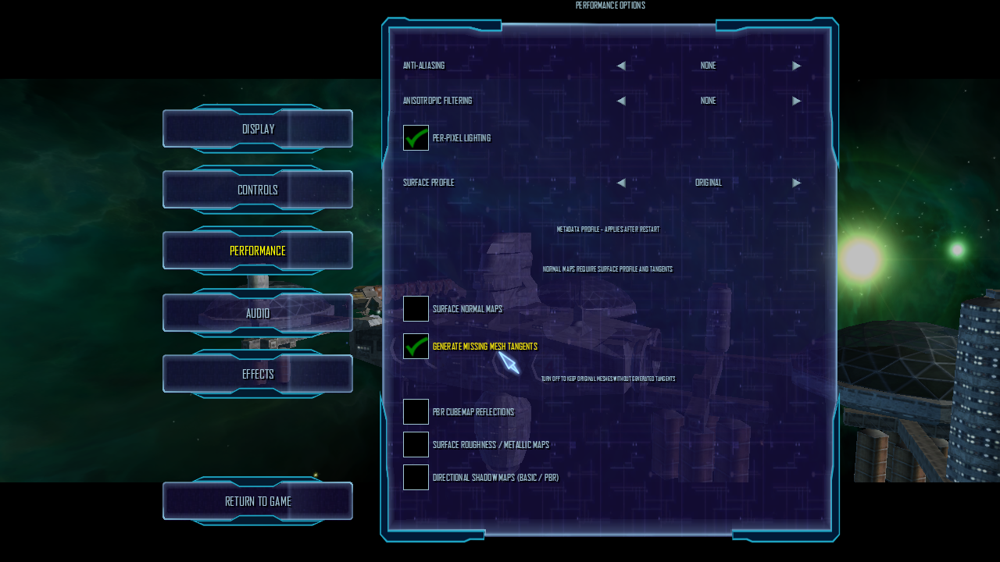

# Live shadow toggle runtime check (2026-10-17)

The current Release build was launched from a NAP-only application copy with
`--new-game --render-shadows=on` on OpenGL 4.6 / Mesa 23.2.1 / Intel HD Graphics
4600. The app was rebuilt from `src/lancer/bin/Release/net10.0`; it had no loose
root `DATA` directory. All 13 active NAP archives were verified against the
manifest `lancer-renderer-aa-profile-20261016` (SHA-256
`e6d56a0f74095c89712f35f35586bfbe5db19d28f0f106654037a53140fc3ca1`) and each
passed `nexus-pack verify`. Package inputs are listed in the adjacent runtime
smoke report and are all under `Data/NAP/`.

In the same M01A process, the Performance panel initially showed directional
shadows checked. The checkbox was clicked off, Options was closed, then reopened;
the checkbox remained off and the supplied profile contained
`render_shadows = false`. This confirms the menu callback applies the current
setting and the option survives closing/reopening the menu. The client reached
`Found thorn mainObject` and remained running during the interaction. No error
or exception was logged during the toggle.

The images document the checkbox before and after the live toggle. The M01A
intro continues to animate behind the menu, so this pair does **not** isolate
shadow image quality or provide a controlled scene/FPS comparison. The earlier
shadow runtime report contains asynchronous pass timings, but an on/off cost
comparison, stable-pose image comparison, shadow bias calibration, and broader
GPU/material coverage remain open.

## Shadows on

## Shadows off after closing and reopening Options

