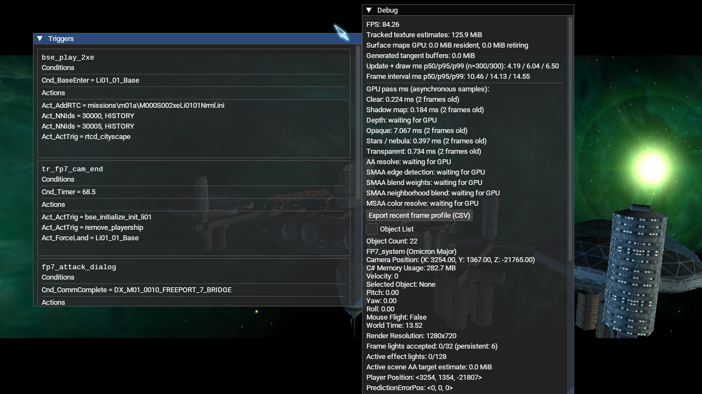
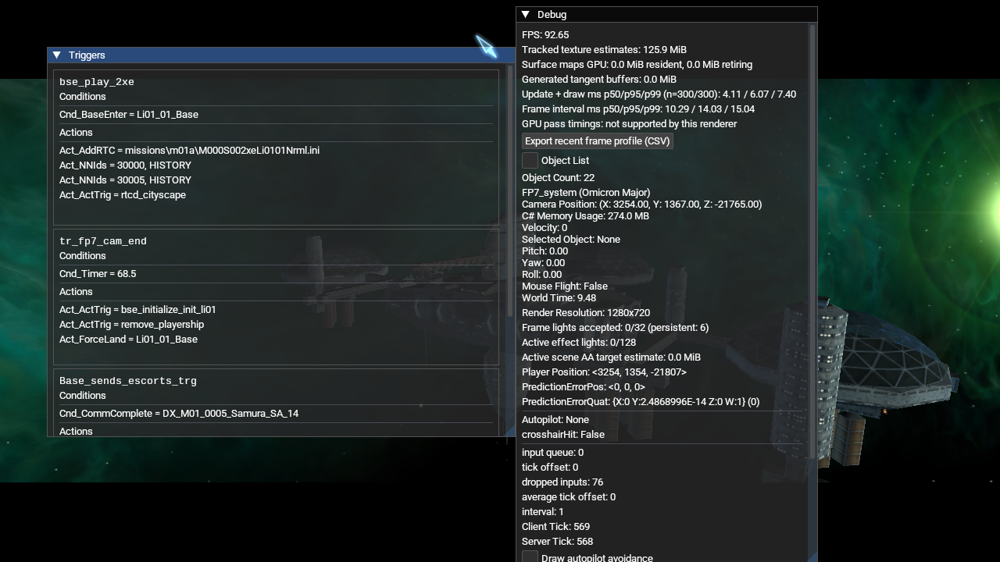

# Shadow-map runtime smoke (2026-10-17)

The Release client was launched with `--new-game --render-shadows=on` on
OpenGL 4.6 Core, Mesa 23.2.1, Intel HD Graphics 4600. It loaded all 13 NAP
packages and reached the M01A/FP7 intro scene.

Before launch, all package sizes and SHA-256 values matched the active
`lancer-renderer-aa-profile-20261016` manifest. The manifest hash was
`e6d56a0f74095c89712f35f35586bfbe5db19d28f0f106654037a53140fc3ca1`; all 13
archives passed `nexus-pack verify`. Their source inputs are the staged package
folders under `Data/NAP/.runtime-test-stage/package-inputs-20261016` and
`Data/NAP/QA/runtime-smoke-20261014`. The runtime application had no loose root
`DATA` directory.

The Debug view recorded a `Shadow map` GPU pass sample of 0.184 ms (two frames
old), with the scene running at about 84 FPS at the capture point. This capture
uses the final `DEPTH_COMPONENT32F` format. This is one
asynchronous sample in a changing intro scene, not a controlled cost comparison
or a performance guarantee. The capture confirms that shadow-map rendering
runs in this OpenGL configuration and that the client reaches the scene without
a shadow-pass crash.

A second run forced OpenGL ES with `librelancer_renderer=gles`. The current
Release client reported OpenGL ES 3.2 / Mesa 23.2.1, loaded the interface,
entered the M01A intro and reached `Found thorn mainObject`. The `DEPTH_COMPONENT32F`
shadow target did not produce an FBO or GL error, and the client remained active
through the capture. GLES does not expose the current GPU pass timers, so no
shadow-pass duration was available. The earlier attempt with `DEPTH_COMPONENT24`
and `FLOAT` failed on this same driver; the Khronos ES format/type table permits
`DEPTH_COMPONENT32F` with `FLOAT` ([Khronos OpenGL ES 3.1 specification](https://registry.khronos.org/OpenGL/specs/es/3.1/es_spec_3.1.pdf)), and this retest confirms it on this GLES 3.2 Mesa device. It does not cover every GLES 3.1 implementation.

The screenshot does not prove shadow image quality or that the visible dark
areas are caused by the shadow map. A same-pose on/off comparison, caster and
receiver checks, other GPUs, other material families, cascades and representative
FPS profiles remain open. The client was closed after capture; a clean shutdown
was not part of this smoke run.

## Desktop OpenGL

## OpenGL ES 3.2

