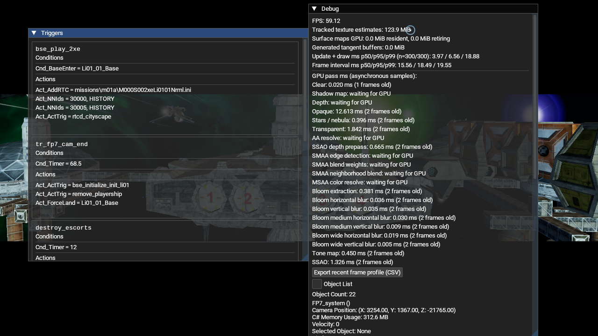
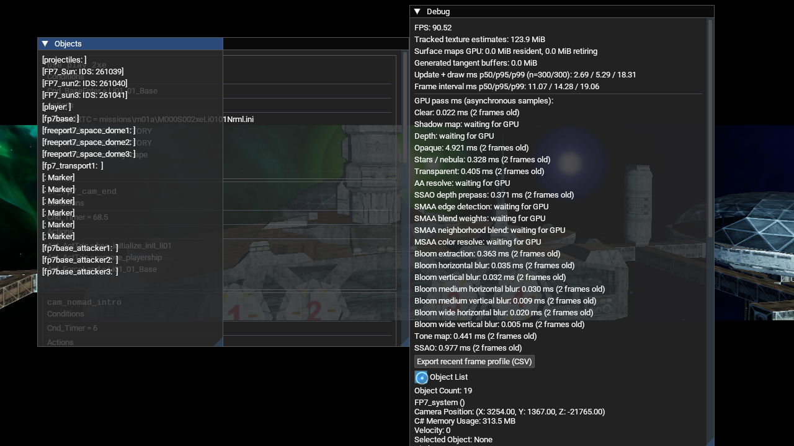

# M01A Transporterlicht – gezielter NAP-Lauf 20 (2026-10-18)

## Laufbedingungen

- Release-Client `03bfd87-git (20261017)`, OpenGL 4.6 / Mesa 23.2.1, Intel HD Graphics 4600.
- Aktives Manifest `lancer-pbr-qa-20261014`, SHA-256 `57af6496c39b4c35ebb32add550fd58ef00f5eb40f7658b7207a06fc99293652`; alle 13 Archive wurden gegen Größe und SHA-256 geprüft und bestanden `nexus-pack verify`.
- Das Client-App-Verzeichnis enthielt kein loses `DATA`. Der konfigurierte Freelancer-Wurzelpfad enthielt nur die EXE-Konfiguration; die Spieldaten wurden aus dem aktiven NAP-Snapshot geladen. Der NAP-Snapshot ist aus den unter `Data/NAP/` gestuften Paketquellen dokumentiert.
- Isoliertes Konfigurations-, Save- und XDG-Profil unter `/tmp/lancer-ship-occlusion-20261018/run2/`.
- Die Logs bestätigen `Finished loading game data`, `UI: Interface loaded`, `Mission_01a` und `Act_CallThorn: missions\m01a\m01a_fp7_01.thn`.
- 50 Screenshots im Einsekundenabstand wurden ab dem THN-Aufruf mit ImageMagick aus dem LibreLancer-Fenster aufgenommen. `camera-19s.png` stammt etwa 19 Sekunden danach; in `object-list-22s.png` wurde die Debug-Objektliste kurz geöffnet. Sie zeigt den Szenenobjektnamen `fp7_transport1`.
- Der Debug-Overlay meldete während des Laufs HDR/Bloom/SSAO und aktive GPU-Timerwerte für Opaque, Transparenz, Bloom, Tonemapping und SSAO. Der Lauf belegt die aktive Systemrenderer-Pipeline auf diesem OpenGL-Gerät, aber keine FPS-Baseline: Aufnahme, Overlay und bewegte Cutscene beeinflussen die Messung.

## Aufnahmen

## Aussage und offene Prüfung

Der Lauf bestätigt, dass `fp7_transport1` in der aktiven M01A-Szene existiert und dass die Render-Pipeline die Intro-Szene darstellt. Die Aufnahmen weisen den sichtbaren Rumpf und konkrete Blinkpixel noch nicht eindeutig diesem Objekt und den Heck-Hardpoints `HpRunningLight12/13` zu. Der gemeldete frontale Winkel, die Blinkphase und der Tiefenvergleich am Billboard-Draw sind weiterhin nicht abgenommen. Das Log enthält außerdem `Unimplemented event: StartIK`; dadurch ist dieser Lauf keine vollständige THN-Paritätsprüfung.
