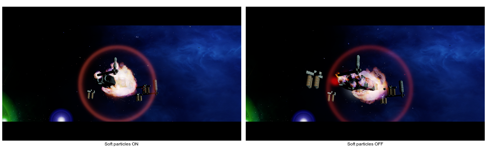

# Soft-particle runtime A/B: M01A base explosion (2026-10-18)

## Setup

Two Release runs used the same NAP-only application, active manifest, 1280×720 window, client configuration, and `--render-antialias=smaa-high`. The only renderer override changed between runs: `--render-soft-particles=on` and `--render-soft-particles=off`. Both used OpenGL 4.6 / Mesa 23.2.1 on Intel HD Graphics 4600.

Each run started the same M01A intro. The `fp7_base_explode` mission trigger occurred 44 seconds after entering `FP7_system` in the ON run and 43 seconds after entry in the OFF run. The screenshots were captured about three seconds after that trigger. Both clients reached the scene and remained alive until capture.

## Result

The side-by-side images show a visible change in the explosion plume and how it overlays the base. This confirms the startup option reaches the runtime draw path for this effect scene. The camera and particles continue moving between the separately launched runs, so image differences also include scene-time variation. This is a visual smoke comparison, not a pixel-exact depth-fade calibration. Depth-edge tuning, a frozen-camera comparison, and GPU-cost measurement remain open.

Original captures: [ON](soft-particles-on.png), [OFF](soft-particles-off.png).

## Runtime and NAP evidence

- [ON runtime log](runtime-on.log.txt)
- [OFF runtime log](runtime-off.log.txt)
- [Active manifest](nap-active.json), manifest ID `lancer-render-profile-current-20261018`; SHA-256 `fb817c9d87d30bf7b990c469077551fc0b921be04bc81f53fa9f51845fd1541d`.
- All 13 archives were built from `Data/NAP/.runtime-test-stage/package-inputs-20261016/` and passed manifest size/hash checks and `nexus-pack verify` before launch. See [package inputs](package-inputs.txt). The app root had no loose `DATA` or `data` directory.
