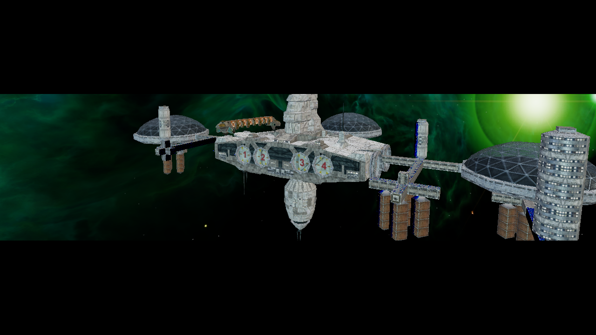
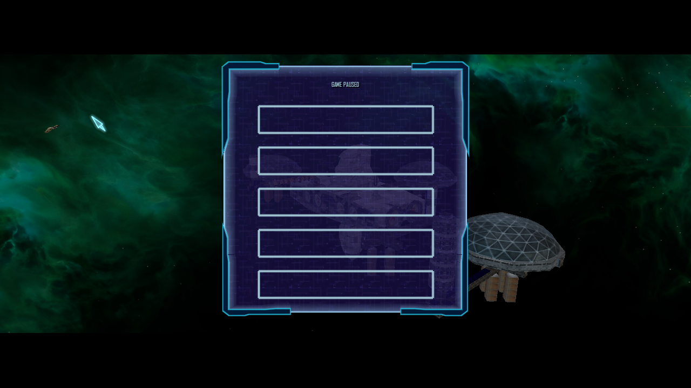

# HDR SSAO intermediate viewport regression — 2026-10-18

## Finding

The HDR scene target was sent through SSAO into a same-size intermediate render
texture. The THN drawable viewport starts at `(0,101)` and is 517 px high for a
1280×720 window. Reusing that drawable offset inside the intermediate texture
cropped the visible HDR result.

The pre-fix capture has non-black rows 202–516. After patch
`2333-ssao-offscreen-local-viewport.patch`, the visible rows are 101–617, which
matches the intended THN viewport. The row bounds were measured from the
1280×720 PNGs by sampling every eighth pixel and selecting rows whose mean RGB
exceeds 1. The two captures are diagnostic viewport evidence; they are not a
pixel-identical scene-quality comparison because camera/simulation timing and
pause overlay differ.

## NAP-only runtime provenance

- Client build: LibreLancer `03bfd87-git (20261017)`, .NET 10 Debug build.
- OpenGL 4.5, Mesa 23.2.1 llvmpipe, Xephyr `:92`, 1280×720.
- Active manifest: `lancer-renderer-ssao-hdr-20261018`, SHA-256
  `e8ee3121d210a47d51daf484696ddd7273acb5d82ed1c5a3440d43d07a4cb98c`.
- 13 archives were rebuilt from the corresponding class directories directly
  under `Data/NAP/`; `runtime.nap` was built from
  `Data/NAP/QA/runtime-smoke-20261014/`. All 13 archive hashes matched the
  active manifest and all archives passed `nexus-pack verify`.
- The application root had no loose `DATA` or `data` directory. The run logged
  `Finished loading game data`, `Interface loaded`, `Spawning in FP7_system`,
  and `Entering system FP7_system`.
- HDR and SSAO were enabled; bloom was disabled for this capture. The render
  options otherwise remained those in the saved visual-test configuration.

## Captures

### Before the viewport fix

SHA-256: `17cc491c0e4a9fc48db3541d5d499cf4a62c55076fa4238ca8b202017657c183`

### After the viewport fix

SHA-256: `0d7c1e293439fcbf9f429316117e067424fc36f50cd7644b39b164bda4d1643c`

The result verifies the letterbox boundaries for the HDR+SSAO path on this
OpenGL/Mesa runtime. It does not establish cross-driver behavior, HDR/LDR color
parity, PBR/IBL quality, or FPS impact.
