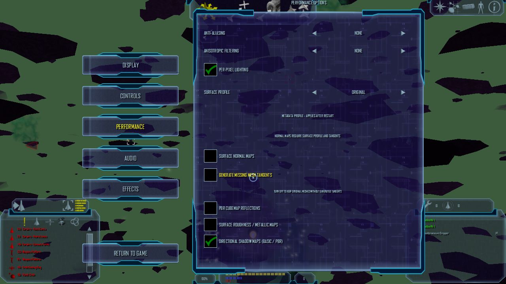
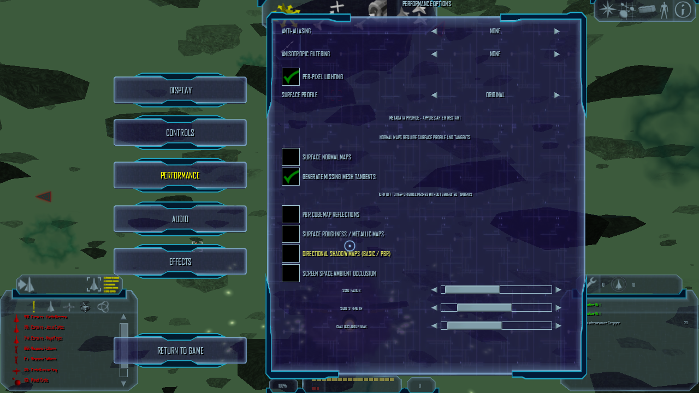
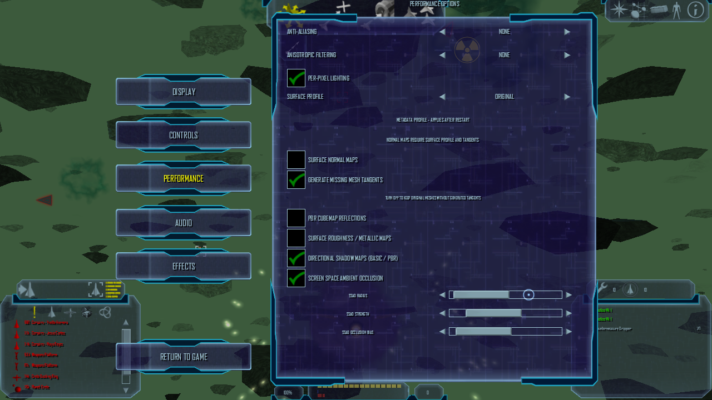
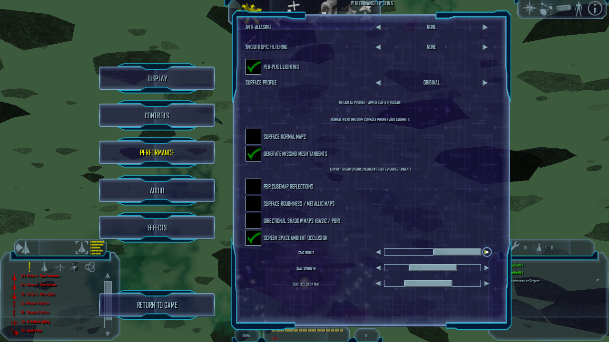

# SSAO options layout runtime check

## Result

At 1280x720, the previous Performance options layout clipped the SSAO checkbox and its quality controls. The compacted layout places the checkbox and all three sliders inside the visible panel. The screenshots were captured from LibreLancer's in-game screenshot path; desktop X11 window capture returned black for this OpenGL window.

## Runtime details

- Release client built after regenerating the embedded interface from `uixml/options.xml` with BuildLL's `GenerateInterface` target.
- NAP-only Hi02 runtime on OpenGL 4.6 / Mesa 23.2.1, Intel HD Graphics 4600; resolution 1280x720.
- Before launch, `packages/active.json` identified manifest `lancer-diffuse-ibl-20261018`; all 14 declared archives matched their sizes and SHA-256 hashes, and the application root had no loose `DATA` directory.
- The SSAO checkbox was enabled from the live Performance page and saved to the isolated test `qa.ini` as `render_ssao = true`.
- With initial values radius 25, strength 2 and bias 0.1, holding the radius slider's right arrow moved it to the maximum. Returning to the game saved `render_ssao_radius = 50.000`; strength and bias remained `2.000` and `0.100`.
- Visual SSAO quality calibration remains open; this interaction proves control movement and persistence, not the effect's image quality.

The moving Hi02 background differs between captures; these images prove the layout, toggle and slider-persistence paths, not an image-quality A/B comparison.
