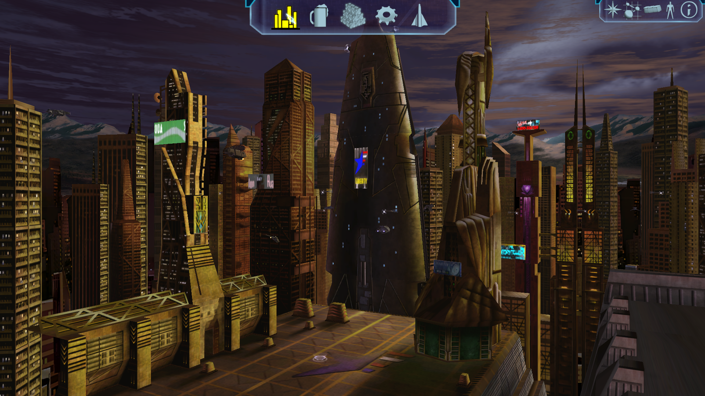

# Sonnenambient: Save-Start für den Weltraum-A/B-Test (2026-10-16)

Der Release-Client wurde aus der aktuellen NAP-only-Testinstallation gestartet. Vor dem Lauf wurden Größen und SHA-256 aller 13 Einträge des aktiven Manifests `lancer-explosion-qa-20261016` geprüft; anschließend bestanden alle Archive `nexus-pack verify`. Der Freelancer-Datenpfad zeigte auf das Paket-Testroot ohne loses `DATA`.

`--load-save` lud eine Kopie von `/home/masterbee/.local/share/Librelancer/AutoSave.fl`; Originalsave und normales Benutzerprofil wurden nicht verwendet. Der isolierte Lauf nutzte eigene `XDG_CONFIG_HOME`, `XDG_DATA_HOME`, `XDG_STATE_HOME` und `XDG_CACHE_HOME` Verzeichnisse unter `/tmp/lancer-ambient-save-ab-20261016/`. Der Log bestätigt `Game: Finished loading game data`, `Save: Loaded inventory` und den M01A-Basiszustand in `FP7_system` / `Li01_01_Base`.

Der Missionsauftrag lautet „Look for a job in the bar“. Das ist kein freier Weltraum-Spielstand und die Basisansicht belegt keine systemweite Sonnenambient-Wirkung. Klickversuche auf die gezeigte System-Hotspot-Navigation bestätigten keinen Übergang in den Weltraum. Der Client blieb nach Escape bedienbar und wurde danach beendet.

Nächster notwendiger Testinput: ein aus derselben NAP-Paketgeneration geladenes Save außerhalb der Startmission und außerhalb einer Nebel-Ambient-Überschreibung, vorzugsweise HI02 für Rot, EW06 für lokale Rot/Grün-Fälle und BR02 als Weißkontrolle. Erst dann das Sonnenambient in derselben Sitzung und unveränderter Pose vergleichen.
