# Sonnenfarbene Umgebungsbeleuchtung: NAP-Laufzeitbilder (2026-10-15)

Die acht Bilder stammen aus Release-Client-Läufen mit dem NAP-Manifest
[`lancer-pbr-qa-20261014`](nap-active-manifest.json). Vor dem Lauf waren alle
13 Archive gegen Manifestgröße und SHA-256 geprüft, mit `nexus-pack verify`
validiert und ihre 8.695 Einträge per Inhaltshash den Quellen unter
`Data/NAP/` zugeordnet. Das Runtime-Paket stammt aus
`Data/NAP/.runtime-test-stage/`. Das Testverzeichnis hatte kein loses `DATA`.

Der aktuelle Client wurde zuvor mit
`dotnet build src/lancer/lancer.csproj -c Release --no-restore
-p:UseSharedCompilation=false` gebaut (22 Projekte, 0 Warnungen, 0 Fehler).
Die Läufe verwendeten denselben gespeicherten Charakter je System,
`--invulnerable=on` und jeweils `--render-sun-ambient=on` oder `=off`.
Die Bildschirmaufnahme erfolgte über den internen Spiel-Screenshot bei
1280×720.

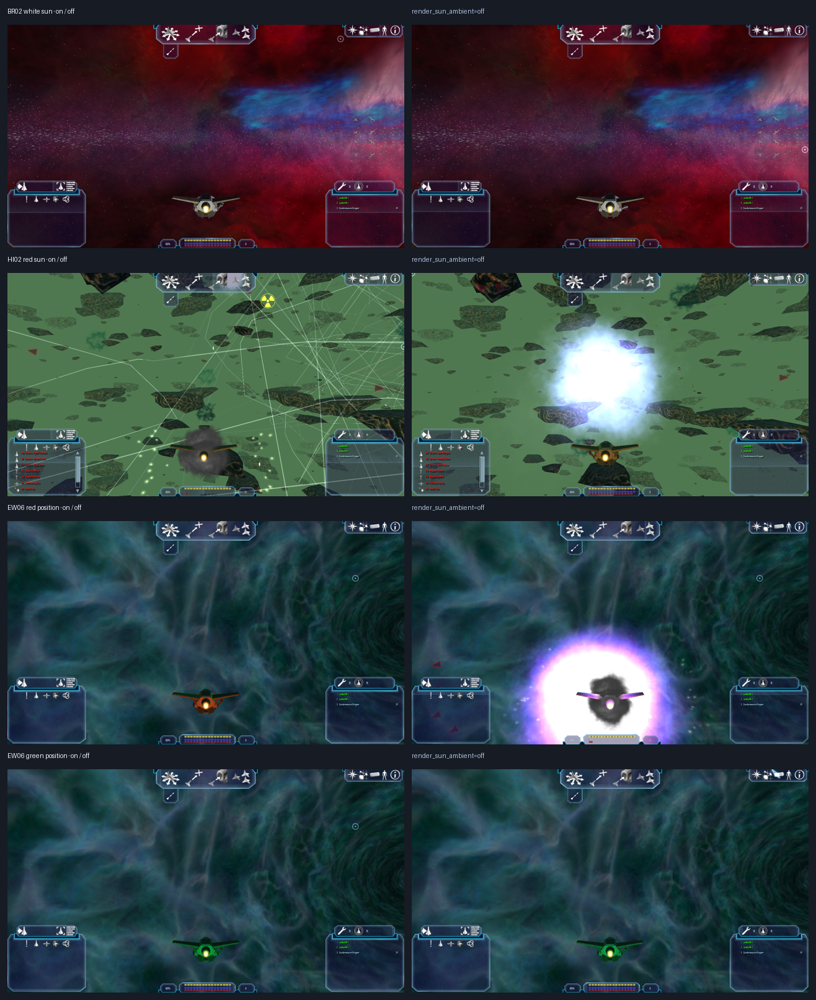

## Einzelbilder

### BR02: weißes Sonnenlicht

| Umgebungsanteil an | Umgebungsanteil aus |
|---|---|
| 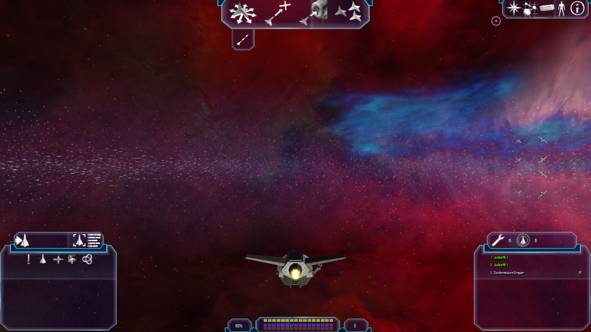 | 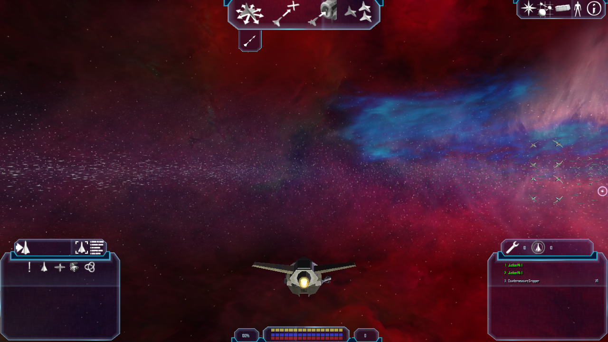 |

### HI02: rotes Sonnenlicht

| Umgebungsanteil an | Umgebungsanteil aus |
|---|---|
| 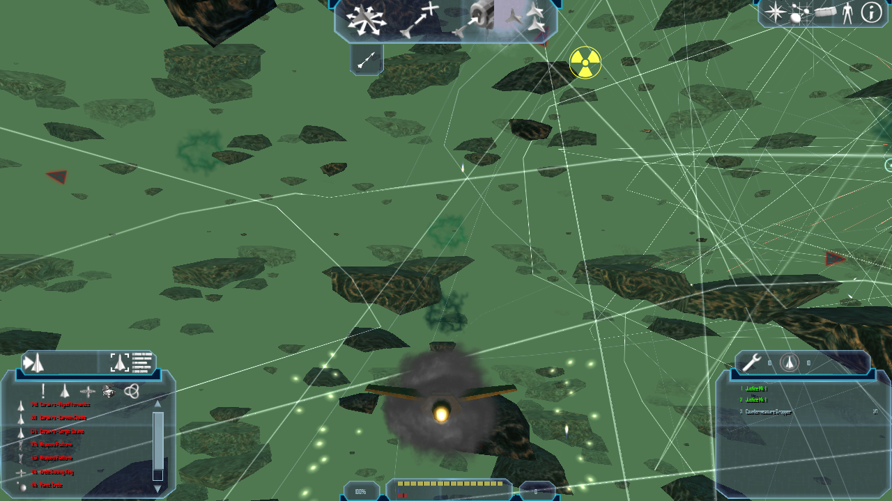 | 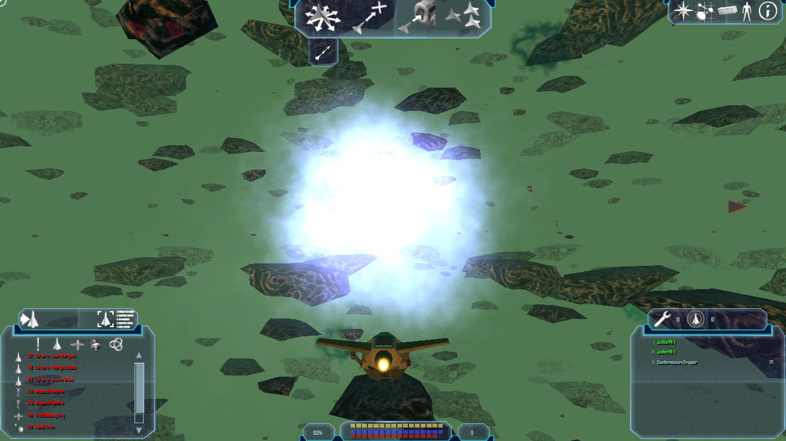 |

### EW06: rote und grüne Lichtbereiche

| Position rot · an | Position rot · aus |
|---|---|
| 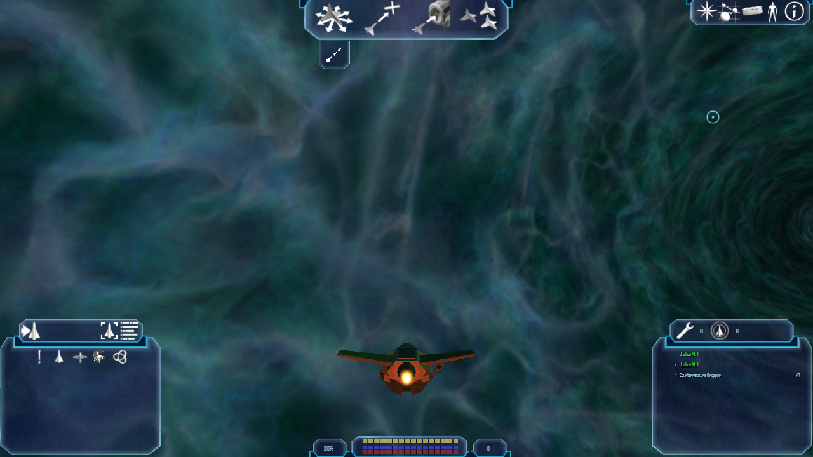 | 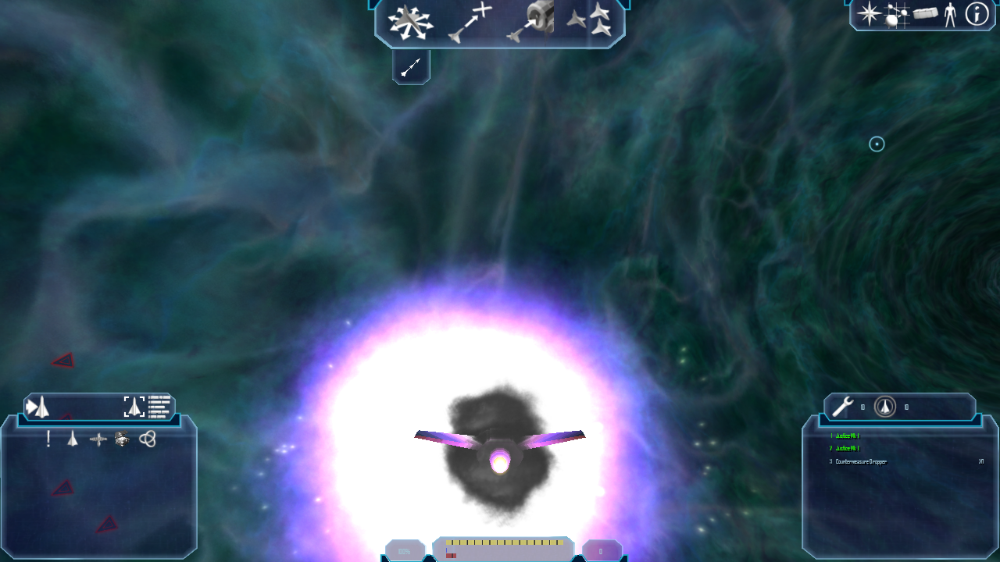 |

| Position grün · an | Position grün · aus |
|---|---|
| 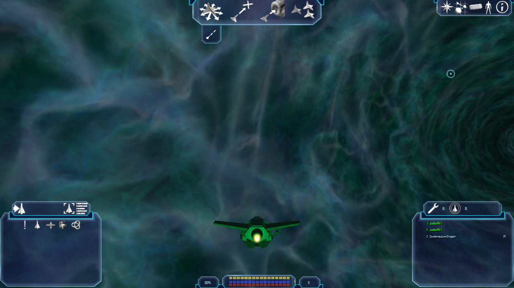 | 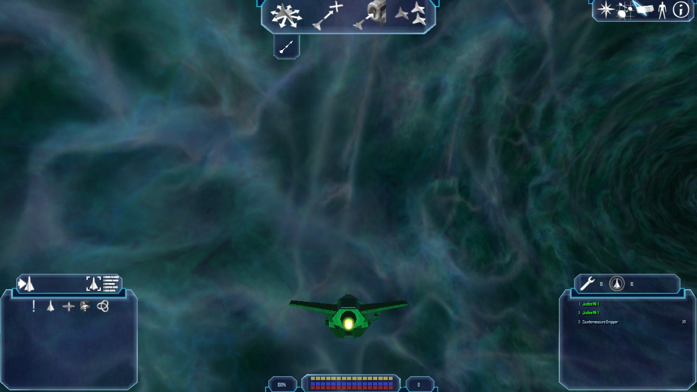 |

## Prüfergebnis und Grenzen

- Alle Läufe erreichten `Finished loading game data`, `Entering system` und
  `Player: Spawning`. Es wurde kein Todesbildschirm aufgenommen.
- BR02 ist ein Neutralfall: Bei weißem Systemlicht zeigen die Bilder keine
  belastbare sichtbare Farbverschiebung.
- Die beiden EW06-Grünbilder zeigen dieselbe stark neblige Ansicht. Die
  Nebula-Übersteuerung scheint den Systemambient-Anteil zu verdecken; der
  Bildvergleich allein belegt den internen Override-Pfad nicht.
- Die HI02- und EW06-Rotbilder sind keine pixelgenauen A/B-Paare. Spawnposition,
  Kamera, bewegte Objekte und Effekte weichen zwischen den getrennten Läufen ab.
  Die großen Bildunterschiede eignen sich nicht zur Kalibrierung des 25%-Blends.
- Die Aufnahmen belegen NAP-Laufzeit und Screenshots, aber noch keine
  reproduzierbare Farbkalibrierung und keine Parität mit dem Originalspiel.

Die vollständige Abnahme bleibt offen: feste Kamerapose, gleiche Szene und
Framezeit für an/aus, direkte Sicht auf rote und grüne Lichtquellen außerhalb
der Nebel-Übersteuerung sowie ein kontrollierter Mehrfachsonnenfall. Die
offenen Renderer-Schritte stehen in
[`renderer-roadmap.md`](../../../renderer-roadmap.md).

## Sofortschalter im pausierten Menü (2026-10-15)

Patch 2136 verdrahtet die Checkbox mit `GetCurrentSettings()` und
`ApplySettings()`. Der aktuelle Settings-Satz wird damit sofort angewendet und
gespeichert, ohne andere noch nicht bestätigte Optionswerte zu überschreiben.
Im NAP-only Release-Lauf wurde die Checkbox im Effekte-Tab im pausierten
M01A-Lauf umgeschaltet. `render_sun_ambient` wechselte direkt in der verwendeten
Client-Konfiguration zwischen `false` und `true`; der Client blieb aktiv und
der Log erreichte `Finished loading game data`, `Interface loaded` und
`Found thorn mainObject` ohne Crash.

| Ambient aus | Ambient an |
|---|---|
| 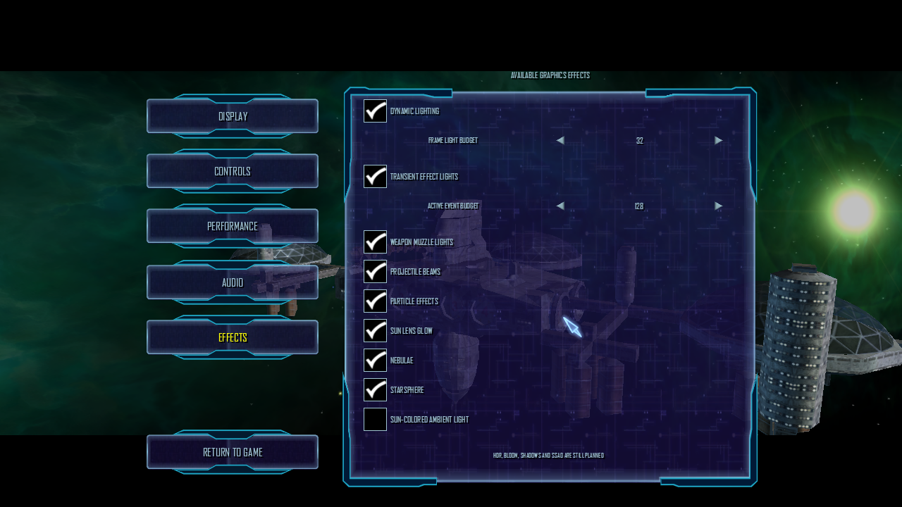 |  |

Die beiden Bilder belegen den UI-Zustand und das sofortige Anwenden. Das M01A-
Intro bewegt sich trotz Optionsmenü weiter; die Bilder sind deshalb kein
pixelgenauer Beleuchtungsvergleich und kalibrieren den 25%-Farbanteil nicht.
Die kontrollierte visuelle Abnahme mit ruhender Kamera bleibt offen.

## HI02-Livewechsel in derselben Sitzung

Im laufenden HI02-Spielstand `hi02-red.fl` wurde `render_sun_ambient` im
pausierten Effekte-Menü erst ausgeschaltet und danach eingeschaltet. Nach jeder
Änderung wurde die Szene kurz fortgesetzt, die Einstellung in `client.ini`
geprüft (`false` beziehungsweise `true`) und erneut pausiert. Die Aufnahmen
zeigen denselben Spielertransporter und dieselbe Sitzung:

| Sonnenambient aus | Sonnenambient an |
|---|---|
| 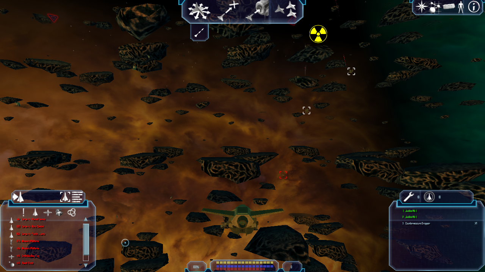 | 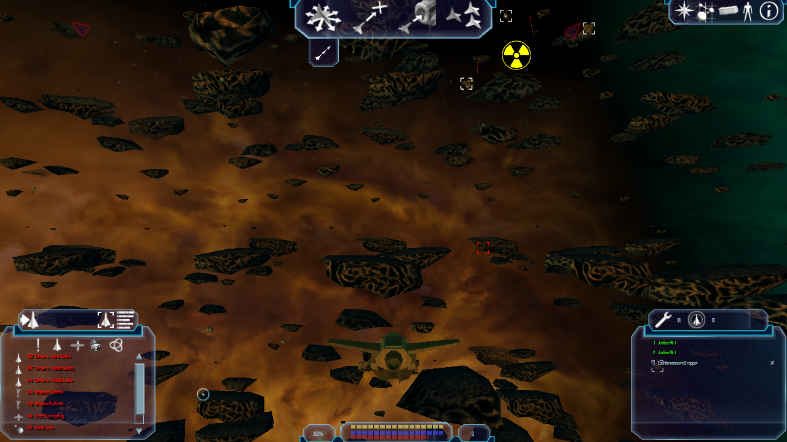 |

Am Schiff ist kein klarer Farbwechsel zu erkennen. Die kurzen Fortsetzungen
verschieben Asteroiden und Effekte; daher taugt das Paar nicht zur quantitativen
Kalibrierung. Es bestätigt den Live-Konfigurationswechsel, aber noch nicht die
sichtbare Wirkung der Beleuchtung. Der nächste Schritt ist, den effektiven
Ambient-Beitrag an einem ruhigeren, nicht von Nebel überschriebenen Objekt zu
messen und bei Bedarf die Farbmischung anzupassen. Der 25%-Anteil bleibt bis
dahin unkalibriert.
