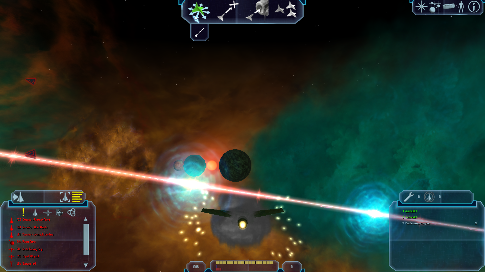
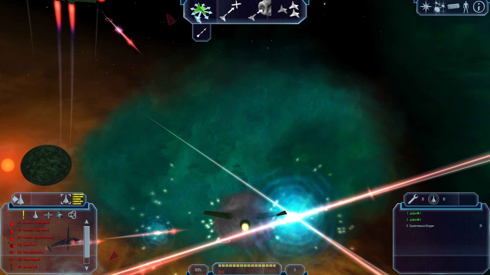

# HI02-Sonnenambient: NAP-Startdiagnose (2026-10-16)

Diese Aufnahmen belegen einen erfolgreichen NAP-only-Spielstart in `Hi02` mit
dem Sonnenambient-Schalter jeweils an und aus. Sie sind **kein direktes A/B**:
Die Bilder stammen aus getrennten Starts; Kamera/Pose und lokale Kampf- und
Waffeneffekte unterscheiden sich. Daraus wird keine sichtbare Ambient-Wirkung
oder 25%-Kalibrierung abgeleitet.

## Laufbedingungen

- Manifest: [`lancer-explosion-qa-20261016`](nap-active-manifest.json), 13
  erforderliche Pakete. Der Runtime-Stamm `render-smoke-root` enthielt kein
  loses `DATA`-Verzeichnis; die Paketquellen stammen aus `Data/NAP/`.
- Vorhandenes Release-Artefakt, LibreLancer `03bfd87-git (20261013)`, .NET 10,
  OpenGL 4.6 auf Mesa/Intel HD Graphics 4600.
- Der isolierte Save basiert auf
  `Data/NAP/.runtime-test-stage/EXE/newplayer.fl`; `[StoryInfo]` wurde entfernt.
  Gültiger Save-Systemname ist `Hi02` gemäß `Data/NAP/World/universe/Universe.ini`.
  `HI02_system` ist kein Universe-Nickname und lieferte keinen World-Callback.
- Save-Position für beide Läufe: `30000, 0, 30000`; Start mit
  `--invulnerable=on`. Der frühere Punkt `10000, 0, 15000` endete im Game-Over-
  Bildschirm und wurde verworfen.
- Aufnahmen: X11-Fensteraufnahme mit 1920×1080 Pixeln; der Client war auf
  1280×720 konfiguriert.

## Laufzeitnachweis

Beide Läufe meldeten `World restore completed for Hi02`, `Spawning in Hi02` und
`Entering system Hi02`. Der aktivierte Lauf setzte
`render_sun_ambient = true` und `--render-sun-ambient=on`; der deaktivierte Lauf
setzte `false` und `--render-sun-ambient=off`.

Die beiden Teststarts erreichten keine reproduzierbare, ruhige Szene und keinen
verwertbaren Wechsel über das Pause-/Optionsmenü. Im Systemhintergrund sind
Sternensphären-Nebel sichtbar; nahe Schiffe, Laser und Effekte ändern sich
zwischen den Starts. Eine Messung des Ambient-Beitrags bleibt offen.

## Diagnosebilder

| Schalter an, separater Start | Schalter aus, separater Start |
|---|---|
|  |  |
