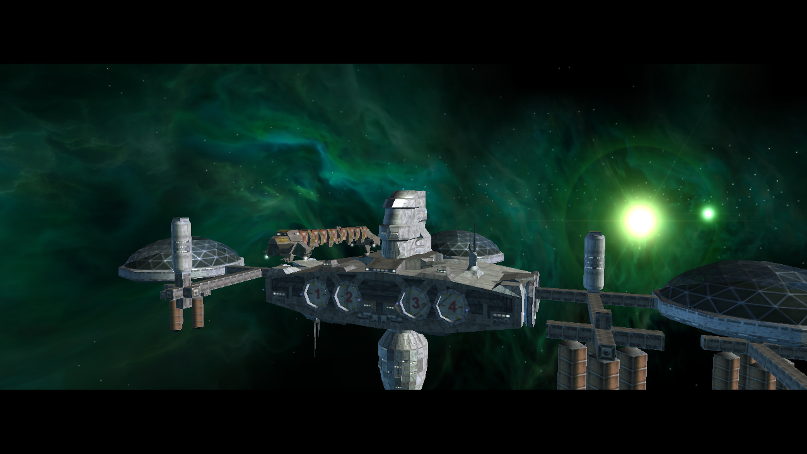
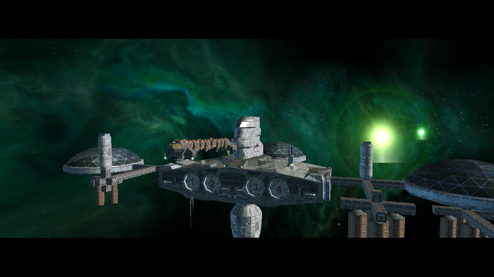
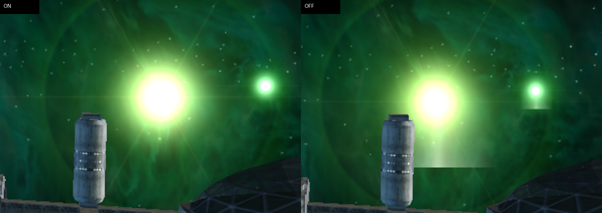

# M01A sun lens-glow runtime check (2026-10-15)

Two Release-client launches used the NAP-only application package
`lancer-pbr-qa-20261014` and the same `m01a_fp7_01.thn` mission scene on Mesa
OpenGL 4.6 / Intel HD Graphics 4600. Both logs contain `Game: Finished loading
game data`, `UI: Interface loaded`, and `Mission: Running trigger
timer_escort_launch`.

The screenshots were captured two seconds after that trigger, once with
`--render-sun-lens-glow=on` and once with
`--render-sun-lens-glow=off`. They are 1280x720 and show the setting reaching a
visible difference around the sun. The camera continues moving during the
trigger, so the pair is not a same-frame pixel comparison. The crop is for
inspection only; it is not evidence of visual parity with original Freelancer.

The application was closed by the capture harness after each image. The OFF
run emitted an X11 `BadWindow` message during harness shutdown; this does not
invalidate the captured frame, but these runs do not verify clean shutdown.

## Full frames

### Lens glow on

### Lens glow off

### Sun crop

