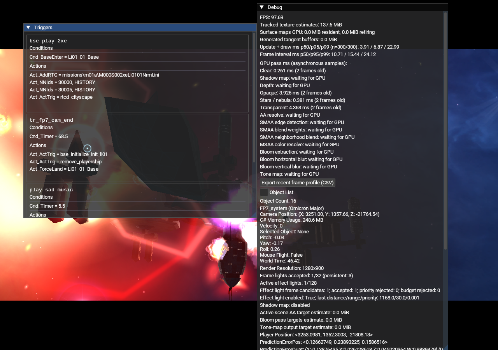
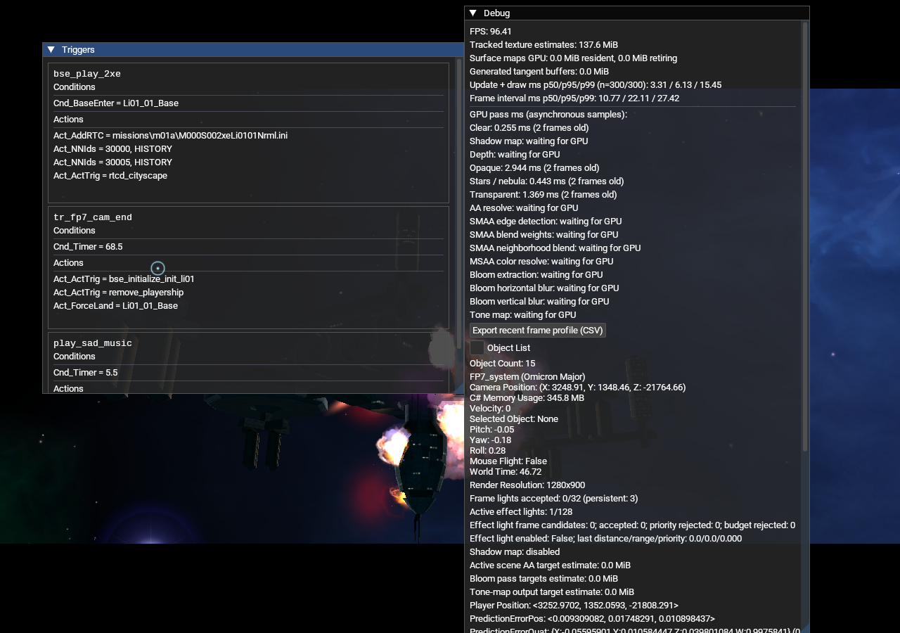

# Transient effect-light frame selection QA (2026-10-18)

This capture pair checks the transient-light selection path and its startup
switch. Both Release runs used the same M01A QA mission, camera scene, OpenGL
backend, 1280x900 resolution, and 32-light frame budget. The only command-line
setting difference was `--render-transient-effect-lights=on` versus `off`.

The runtime app used 13 NAP archives and no loose `DATA` directory. Package
inputs were sourced from `Data/NAP/`; the QA mission was staged under
`Data/NAP/.runtime-test-stage/explosion-ship-qa-20261018-inputs/Mission`.
Before the screenshot capture, the active manifest and all archive sizes/SHA-256
values were checked, and every archive passed `nexus-pack verify`. At capture
time the app used manifest ID `lancer-renderer-aa-profile-20261016`, mission
package SHA-256 `aa1525155f0f077182f2da2ac9e3999ab2440c2e882d17d1cdc25d1e753fc133`,
and QA effects package SHA-256
`6efb83571820629ef0ae5a6352eef442e59f6c59f33baf3af2fae9d7db1d1038`. This QA
effects archive contains the exaggerated fixture and is separate from the
retail-curves archive rebuilt for follow-up validation. The production package
tree was not changed.

## Result

With the switch on, the debug view reported one effect-light candidate,
one accepted frame light, zero priority rejects, distance 1168.0, range 30.0,
and priority 0.001. With the switch off, it reported zero candidates and zero
accepted frame lights. The persistent effect-light pool still contained one
light in both runs, which is independent of whether it is submitted to the
frame-light list.

The fixture deliberately used an exaggerated QA LightAnim profile to make the
contribution obvious in a screenshot. The red/orange image is therefore only
proof of the light-selection and toggle plumbing. It does not represent retail
Freelancer colors, light strength, timing, or final visual quality. A separate
retail-curve visual check remains necessary.

## Captures

### Switch on

### Switch off

