# Renderer-Vergleichsbilder

Die Bildpaare liegen dauerhaft unter [`docs/evidence/renderer/`](evidence/renderer/).
Sie zeigen A/B-Nachweise für Surface-Normalmaps und ergänzende PBR-Maps; sie
sind keine Abnahme der gesamten Renderer-Roadmap. Rohbilder, Differenzbilder
und Messwerte bleiben zusammen gespeichert.

## Intro M01A: Freeport 7, Cubemap-Fehlerbehebung

RenderDoc zeigte für den dunklen Stationsdraw einen fehlenden EnvMap-Cube bei
`EnvMapStrength = 1`; Patch 2123 bindet die aufgelöste Cubemap direkt. Der
aktuelle Release-Build rendert die Station sichtbar beleuchtet. Die Bilder
stammen aus unterschiedlichen dynamischen Intro-Läufen und sind daher ein
visueller Vorher-/Nachher-Hinweis, kein pixelgenauer A/B-Test.

| Vor Patch 2123: fast schwarze Station | Nach Patch 2123: beleuchtete Station |
|---|---|
|  |  |

[RenderDoc- und Fehleranalyse](evidence/renderer/intro-m01a-dark-objects-20261015.md) ·
[NAP-only-Lauf, Bedingungen und Einschränkungen](evidence/renderer/intro-m01a-runtime-20261015/README.md)

## LancerEdit Model Viewer: LI_ELITE

Gleiche Kamera, neutralgraues Umgebungslicht (RGB 129) und generierte Tangenten.
Die Messung beschränkt sich auf den Modellbereich; der Hintergrund-Kontrollbereich
blieb pixelgleich.

| Normalmaps aus | Normalmaps an |
|---|---|
| 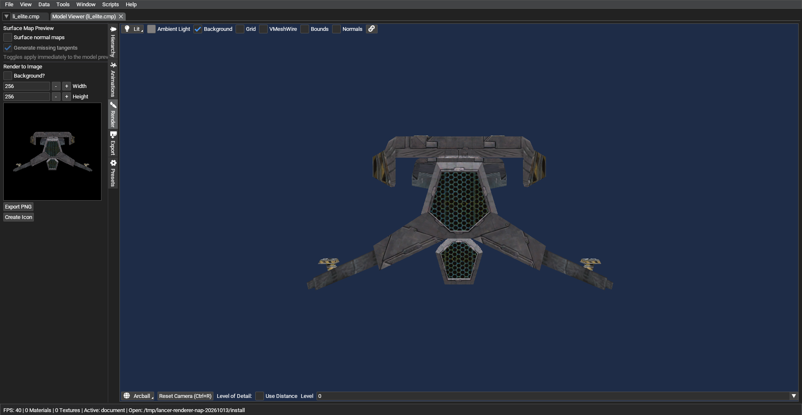 | 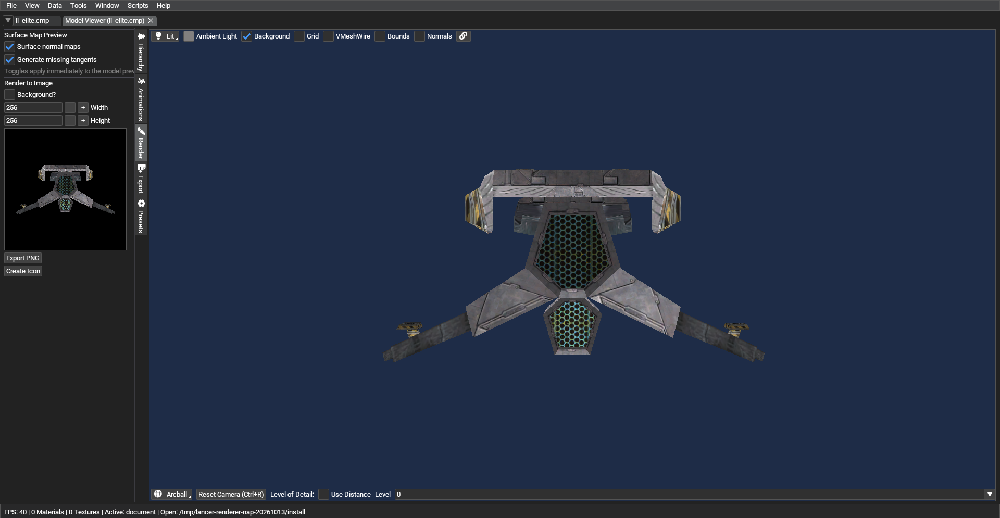 |

[A/B-Zusammenstellung](evidence/renderer/modelviewer-li-elite-normalmaps-ab.png) ·
[Differenzbild](evidence/renderer/modelviewer-li-elite-normalmaps-difference.png) ·
[Messwerte und Prüfsummen](evidence/renderer/surface-normalmaps-comparison-20261014.json)

## Geladenes LI_ELITE: Normalmap ohne PBR-Maps

Der Offscreen-A/B zeichnet dasselbe geladene LI_ELITE mit aktiviertem
Basic-Pixellicht. `surface_pbr_maps` und Cubemap-Reflexionen sind aus;
Roughness-/Metallic-Maps werden nicht geladen oder ausgewertet. Nur
`surface_normal_maps` wechselt. Der Vergleich ändert 3.914 Pixel bei
512×512 und erreicht RMSE 1,284884. Das bestätigt die Surface-Normalmap im
Basic-FVF-Pixellichtpfad ohne künstliche Metallic-Karte. Die Änderung ist unter
dem festen schwarzen Ambientlicht subtil; normale Client-/Spielqualität und
Leistung sind damit nicht abgenommen.

| Surface-Normalmaps aus | Surface-Normalmaps an, PBR-Maps aus |
|---|---|
| 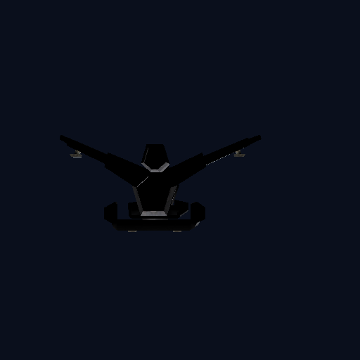 | 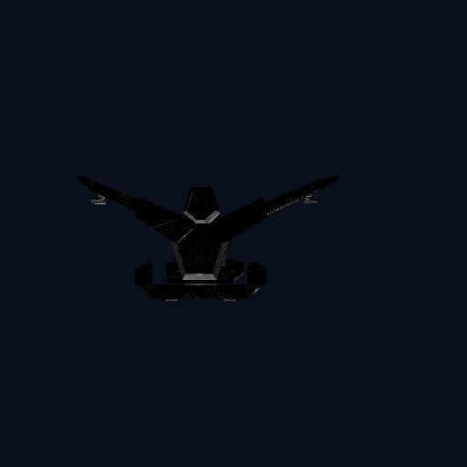 |

[A/B-Übersicht](evidence/renderer/surface-normal-only-20261014/li-elite-normal-only-ab.png) ·
[Differenzbild, 4× verstärkt](evidence/renderer/surface-normal-only-20261014/li-elite-normal-only-difference-4x.png) ·
[Messung und Prüfsummen](evidence/renderer/surface-normal-only-20261014/li-elite-normal-only-20261014.json)

Mit Normalmap-Stärke `0` ist das LI_ELITE-Bild bytegleich zum Lauf mit
`surface_normal_maps` aus. Die Kontrollaufnahme liegt unter
[li-elite-normal-only-strength-0.png](evidence/renderer/surface-normal-only-20261014/li-elite-normal-only-strength-0.png).

Der fehlende-Tangenten-Fallback wurde zusätzlich mit einem GPU-Dreieck ohne
Tangentattribute geprüft. Es verwendet das geladene LI_ELITE-BasicMaterial und
dessen Normalmap-Binding. Option an/aus ergibt 0 geänderte Pixel und keinen
Absturz. Das ist ein synthetischer Geometrie-Check, keine Retail-VMesh-Referenz.

[Fallback-A/B](evidence/renderer/surface-normal-only-20261014/li-elite-no-tangent-ab.png) ·
[Messung und Prüfsummen](evidence/renderer/surface-normal-only-20261014/li-elite-normal-only-20261014.json)

## LI_ELITE-Retail-VMesh unter gerichteten Lichtern

Das geladene `LI_ELITE.cmp` wird im Basic-FVF-Pixellichtpfad einmal ohne und
einmal mit der Normalmap aus dem aktiven NAP-Datensatz gerendert. Die
Tangenten werden generiert; Roughness-/Metallic-Maps und Cubemap-Reflexionen
bleiben aus. Das A/B ändert 7.252 Pixel bei +X-Licht und 4.949 Pixel bei
+Y-Licht. Die gerichteten Läufe zeigen den Einfluss auf das echte Retail-Mesh;
die exakte Polarität der Asset-Normalen muss noch mit einer unabhängigen
Referenz verglichen werden.

| Beleuchtung | Surface-Normalmaps aus | Surface-Normalmaps an |
|---|---|---|
| +X | 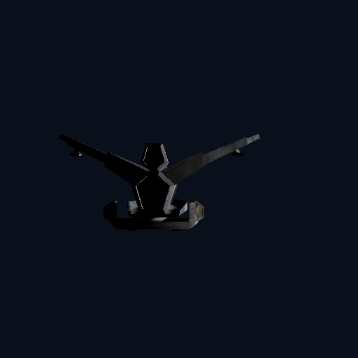 | 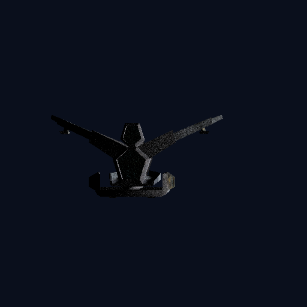 |
| +Y | 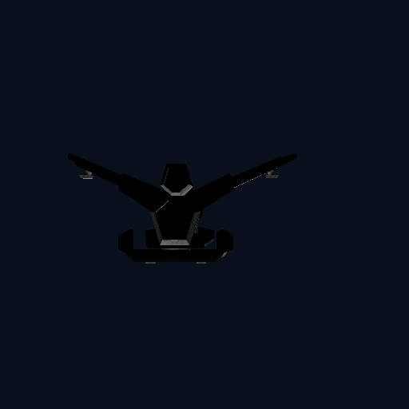 | 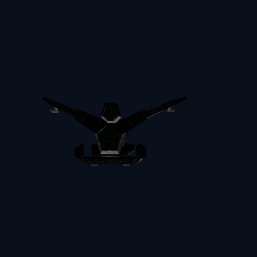 |

[Kontaktbogen](evidence/renderer/surface-normal-only-20261014/li-elite-retail-tbn-directional-ab.png) ·
[Messung und Prüfsummen](evidence/renderer/surface-normal-only-20261014/li-elite-retail-tbn-directional-20261014.json)

## TBN-Achsen und +Y-Kanal: gerichtete Shaderkontrolle

Mit dem LI_ELITE-BasicMaterial aus dem NAP-Testcontainer zeichnet ein
Tangenten-QA-Dreieck im Basic-FVF-Produktionsshader. Ein gerichtetes +X-Licht
wird mit einer +X-Tangentnormalmap und ein gerichtetes +Y-Licht mit einer
+Y-Tangentnormalmap verglichen. Beide Karten ändern 23.930 Pixel gegenüber
der Neutralmap. Das bestätigt die Achsenbelegung des Shaderpfads; die
Tangentdaten und Karten sind synthetisch. Eine gerichtete Retail-VMesh-Referenz
ist weiterhin offen.

| +X Licht, Neutralmap | +X Licht, Normal +X | +Y Licht, Neutralmap | +Y Licht, Normal +Y |
|---|---|---|---|
|  | 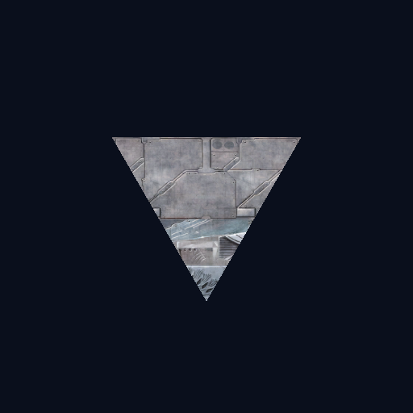 | 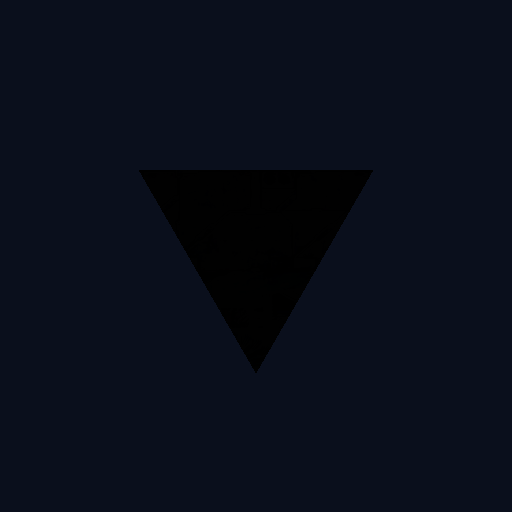 |  |

[Kontaktbogen](evidence/renderer/surface-normal-only-20261014/li-elite-tbn-axis-control-ab.png) ·
[Messung und Prüfsummen](evidence/renderer/surface-normal-only-20261014/li-elite-tbn-axis-control-20261014.json)

## Neutralnormal-Kontrolle im Basic-FVF-Shader

Ein tangentenfähiges QA-Dreieck nutzt das aus dem verifizierten NAP-Container
geladene LI_ELITE-BasicMaterial. Die im Speicher erzeugte BGRA8-Karte
`(R,G,B)=(128,128,255)` ergibt bei Stärke 1 bytegleiche Pixel gegenüber dem
Lauf ohne Normalmap. Eine geneigte Positivkontrolle ändert 23.930 Pixel und
bestätigt, dass der Shader die Karte auswertet. Das ist ein Shader-Kontrolltest,
keine neutrale Textur aus dem NAP und keine Retail-VMesh-Abnahme.

| Keine Karte | Neutrale Karte | Geneigte Positivkontrolle |
|---|---|---|
|  |  | 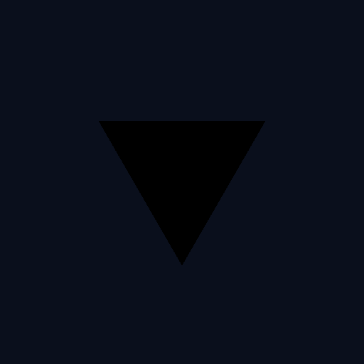 |

[A/B-Übersicht](evidence/renderer/surface-normal-only-20261014/li-elite-neutral-map-control-ab.png) ·
[Messung und Prüfsummen](evidence/renderer/surface-normal-only-20261014/li-elite-neutral-map-control-20261014.json)

## Retail-VMesh mit Original- und Neutralmap aus NAP

Der LI_ELITE-Offscreenlauf wurde mit zwei aktiven Paketständen bei identischer
Kamera, Beleuchtung und Materialbindung wiederholt. In beiden Fällen waren nur
die Normalmaps des LI_ELITE-Rumpfs aktiv; PBR-Maps und Cubemaps blieben aus.
Die Map-freien Bilder sind über beide Läufe bytegleich. Das Original-NAP änderte
1.110 Pixel (RMSE 1,062918), die neutrale BC5-Kontrollkarte aus dem separaten
QA-NAP 704 Pixel (RMSE 0,039848). Die geringe Restabweichung der Neutralmap
kommt vom BC5-Mittelwert 128/255, der mathematisch nicht exakt 0,5 ist. Stärke
`0` bleibt bytegleich zur Map-freien Kontrolle. Beide aktiven Manifeste und alle
Paketprüfsummen wurden vor dem Lauf geprüft; die QA-NAP-Datei wurde aus Dateien
unter `Data/NAP/` gebaut.

| Surface-Normalmap aus | Neutralmap aus NAP | Originalmap aus NAP |
|---|---|---|
| 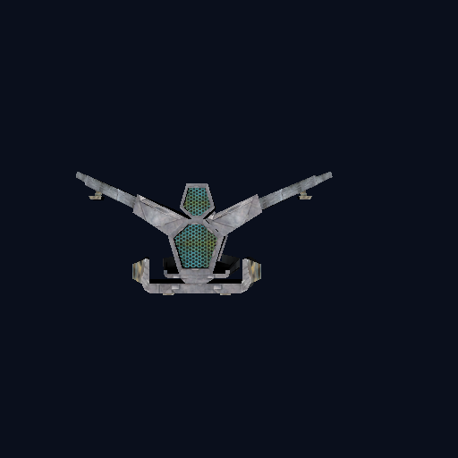 |  |  |

[Kontaktbogen](evidence/renderer/surface-normal-only-20261014/li-elite-nap-normalmap-ab.png) ·
[Stärke-0-Kontrolle](evidence/renderer/surface-normal-only-20261014/li-elite-nap-normalmap-strength-0.png) ·
[Messung, Manifest- und Asset-Prüfsummen](evidence/renderer/surface-normal-only-20261014/li-elite-nap-normalmap-20261014.json)

## LancerEdit Model Viewer: LI_ELITE Surface PBR-Maps

Gleiche Kamera, Lit-Modus, neutrales Umgebungslicht (Swatch ca. RGB 137/135/135),
Surface-Normalmaps aus und generierte Tangenten an. Nur der Schalter für
Surface-Roughness/Metallic-Maps ändert sich. Helle Reflexe an den inneren
Schiffspanels werden mit aktivierten Maps sichtbar. Die Hintergrund-Kontrollregion
blieb pixelgleich.

| Surface-PBR-Maps aus | Surface-PBR-Maps an |
|---|---|
| 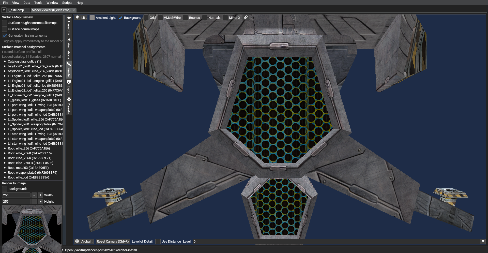 | 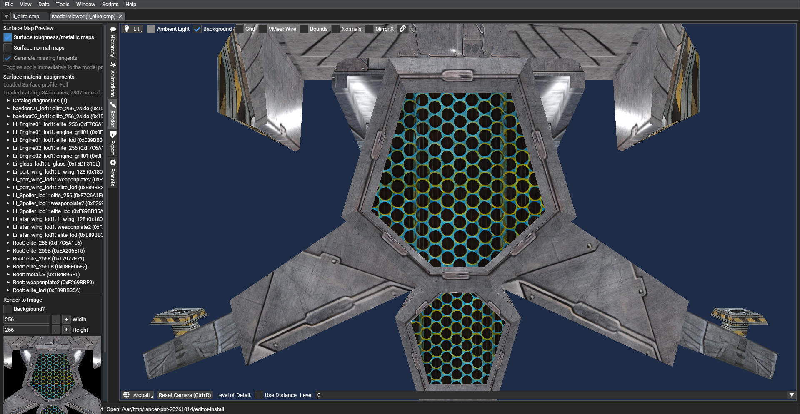 |

[Ansicht nebeneinander](evidence/renderer/modelviewer-li-elite-surface-pbr-ab.png) ·
[Differenzbild](evidence/renderer/modelviewer-li-elite-surface-pbr-difference.png) ·
[Messwerte, Bedingungen und Prüfsummen](evidence/renderer/surface-pbr-maps-comparison-20261014.json)

## LI_ELITE-Retailmesh: Roughness und Metallic getrennt

Der Offscreen-Draw lädt dasselbe Retail-VMesh durch den Produktions-PBR-Shader.
Der PBR-Pfad und die INI-Faktoren (`roughness=1`, `metallic=1`) bleiben in
allen Varianten aktiv. Gegenüber der skalaren Kontrolle wird nur die jeweilige
NAP-Mapbindung ergänzt. Normalmaps und Cubemaps sind aus. Die echte
BC4/ATI1-Roughnesskarte ändert 7.188 Pixel (RMSE 9,128530); die Metallickarte
7.090 Pixel (RMSE 3,938230). Zusammen ändern sie 7.090 Pixel (RMSE 7,612834).
Die Shaderfunktionen `getRoughness` und `getMetallic` lesen jeweils `.r`; nur
Diffuse-Albedo wird zusätzlich durch `SRGBtoLinear` konvertiert. ATI1 lädt in
OpenGL als `GL_COMPRESSED_RED_RGTC1_EXT`, also als lineare Einkanaltextur.

| PBR nur mit Skalaren | Roughness-Map | Metallic-Map | Beide Maps |
|---|---|---|---|
| 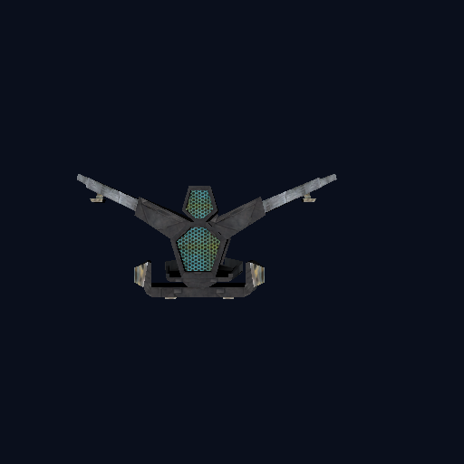 | 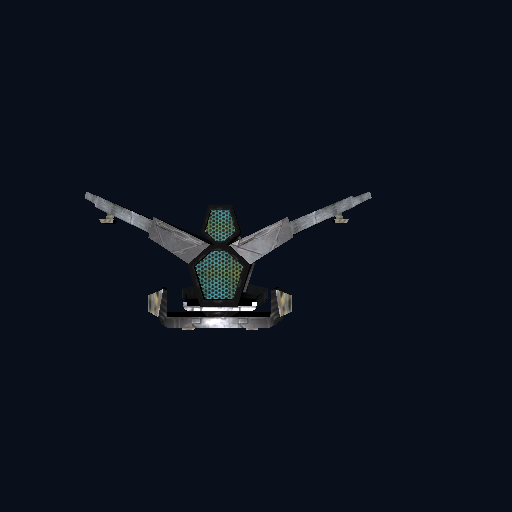 |  |  |

[Kontaktbogen](evidence/renderer/surface-pbr-retail-20261014/li-elite-retail-pbr-maps-ab.png) ·
[Messwerte, NAP-Manifest und Prüfsummen](evidence/renderer/surface-pbr-retail-20261014/li-elite-retail-pbr-maps-20261014.json)

Der Test verwendet `uv=0` und `pbr_uv=0`. Roughness/Metallic können nun
unabhängig von Normalmap und Tangentenbasis UV0 oder UV1 verwenden; fehlt
`pbr_uv`, bleibt das bisherige gemeinsame Verhalten erhalten. Der UV1-Pfad mit
nichtidentischer `MaterialAnim` ist noch nicht in einem Retail-GPU-Draw
abgenommen.

## LancerEdit Model Viewer: PBR-Cubemap-Prototyp

Das Paar verwendet `LI_ELITE.cmp` bei fester Arcball-Kamera im Lit-Modus. In
beiden Zuständen sind Surface-Roughness/Metallic-Maps eingeschaltet, Surface-
Normalmaps ausgeschaltet und generierte Tangenten eingeschaltet. Der
Archetyp-Resolver zeigt `envmapbasic`; der ResourceManager löst diesen Eintrag
als `TextureCube` auf. Das Material `elite_256` hat im Surface-Katalog
Roughness- und Metallic-Karten. Nur der Schalter für PBR-Umgebungsreflexionen
ändert sich. Der Vergleich ergibt im Modell-ROI 0 geänderte Pixel. Diese
Ansicht bestätigt den Preview-Bindungspfad, aber keine sichtbare Reflexion. Der
Asset-Audit zeigt, dass die +X-Fläche von `envmapbasic` RGB (127,127,127)
enthält; die schwarze Probe ist daher nicht durch ein schwarzes +X-Quellpixel
erklärt. Ob Slot 5/Sampler oder Richtungsinterpretation die damalige schwarze
Ausgabe verursachte, blieb offen. Zu diesem Zeitpunkt wählte der PBR-Pfad noch
keine `envcube_*`-Karte aus der Surface-INI; die inzwischen ergänzte Auswahl
wird im folgenden Abschnitt geprüft.

| PBR-Cubemap aus | PBR-Cubemap an |
|---|---|
| 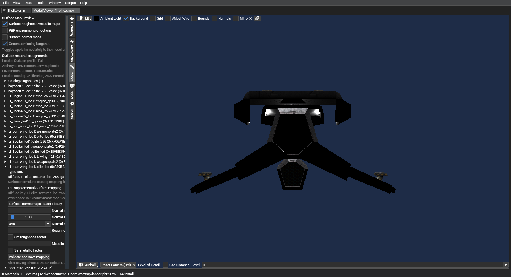 |  |

[Ansicht nebeneinander](evidence/renderer/pbr-environment-20261014/li-elite-env-ab.png) ·
[Material-Zuordnung](evidence/renderer/pbr-environment-20261014/li-elite-material-maps.png) ·
[Direkte +X-Cubemap-Probe (temporärer Shader)](evidence/renderer/pbr-environment-20261014/li-elite-env-fixed-positive-x-debug.png) ·
[Messbedingungen und Prüfsummen](evidence/renderer/pbr-environment-20261014/pbr-environment-ab-20261014.json)

Dieser ältere Versuch schaltete nur `pbr_environment_maps` um und ergab im
ModelViewer 0 geänderte Pixel. Die Laufzeitdiagnose bestätigte `pbr=True`,
`TextureCube` und die aktivierte `ENVMAP`-Variante; eine temporäre direkte
Ausgabe des +X-Samples blieb schwarz. Die spätere Katalogauflösung und der
ModelViewer-Override ergänzen die Auswahl der `envcube_*`-Karten. Der nächste
Abschnitt prüft sie mit einem vollständig geladenen LI_ELITE-Modell.

## Geladenes LI_ELITE-Modell: Cubemap-Katalog

Ein Offscreen-Lauf lädt die Spieldaten aus dem geprüften NAP-Manifest,
kompiliert die Produktionsshader und zeichnet `li_elite.cmp` über den normalen
`RigidModel.DrawBuffer`-/`BasicMaterial`-Pfad. Die 19 Material-Drawcalls lösen
Surface-PBR-Zuordnungen auf, darunter `mt_li_elite_hull` und
`rt_li_elite_hull`. Kamera, Licht, Modell und Renderziel bleiben zwischen den
Aufnahmen gleich; nur die Cubemap-Auswahl ändert sich. Gegenüber
`envmapbasic` unterscheiden sich bei jeder `envcube_*`-Karte 13.160 Pixel im
512×512-Bild. Die sichtbare Änderung ist subtil; das vierfach verstärkte
Differenzbild macht sie leichter prüfbar.

| Kein Environment | Legacy `envmapbasic` | Space | Sun | Nebula |
|---|---|---|---|---|
| 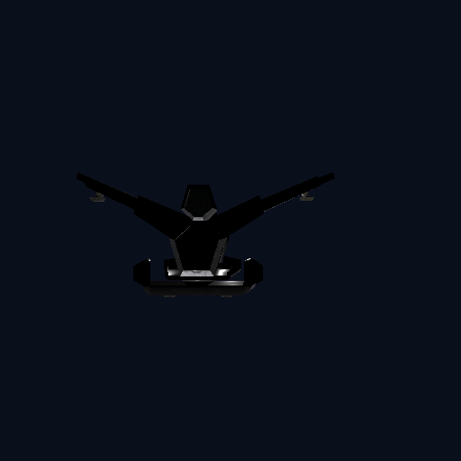 |  |  | 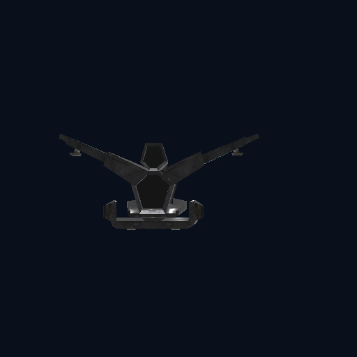 |  |

[Vergleichsübersicht](evidence/renderer/pbr-environment-20261014/li-elite-loaded-cubemap-ab.png) ·
[Differenz Space gegen `envmapbasic`, 4× verstärkt](evidence/renderer/pbr-environment-20261014/li-elite-loaded-cubemap-difference-space-4x.png) ·
[Messwerte, Paketmanifest und Prüfsummen](evidence/renderer/pbr-environment-20261014/li-elite-loaded-cubemap-20261014.json)

Der Offscreen-Test belegt, dass die ausgewählten Katalog-Cubemaps den
Produktions-Draw eines geladenen Retail-Modells verändern. Er nimmt den
interaktiven ModelViewer-Schalter und die Darstellung einer vollständigen
Spielszene noch nicht ab.

## Spielszene: Liberty-Stadtbild, vollständiges Profil

Gleicher gespeicherter M01a-Basisstand, Client-Build, NAP-Manifest und Kamera;
Normalmaps aus. Nur `surface_pbr_maps` wechselt. Nach der Korrektur für
Room-Vertex-Beleuchtung und Backface-Normalen bleiben die Stadtfassaden mit
PBR-Maps sichtbar beleuchtet; der zuvor beobachtete großflächige Schwarzeffekt
tritt in diesem Vergleich nicht mehr auf. Beide Release-Läufe erreichen die
Missionsszene ohne Surface-Map-Lease-Absturz. Das ist ein erfolgreicher
Regressionstest für diesen Fehler, aber noch keine allgemeine PBR-Abnahme.
Himmel, Verkehrsschiffe und UI bewegen sich zwischen den Aufnahmen; die
Pixel-Differenz ist daher keine reine Materialmessung.

| Surface-PBR-Maps aus · full | Surface-PBR-Maps an · full |
|---|---|
| 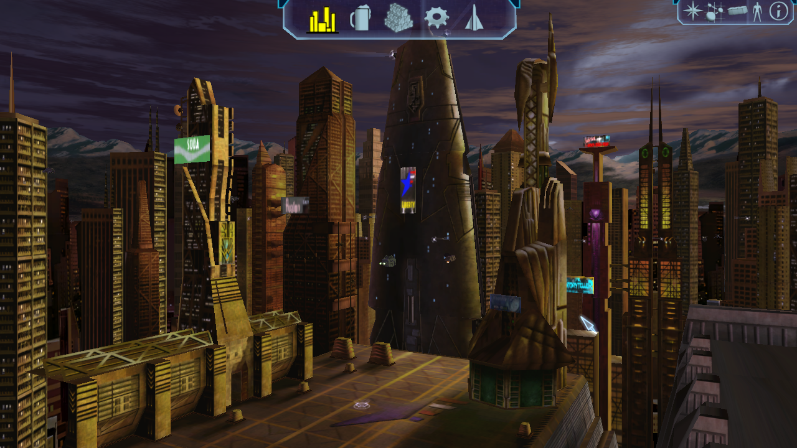 | 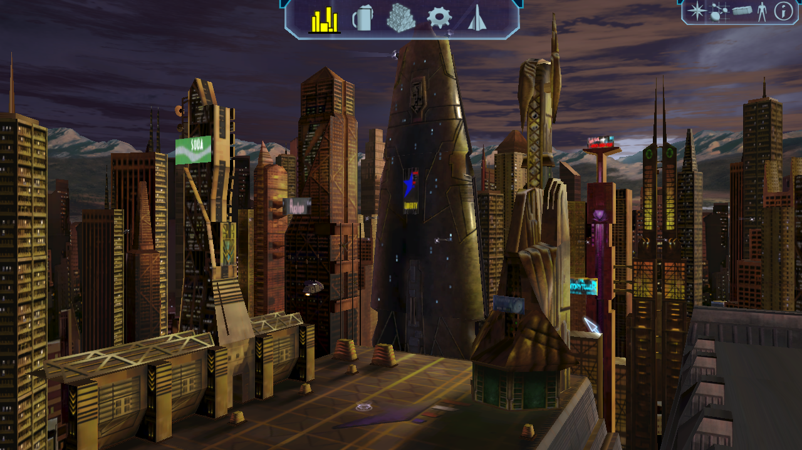 |

[A/B-Zusammenstellung](evidence/renderer/ingame-cityscape-surface-pbr-ab.png) ·
[Differenzbild, 3× verstärkt](evidence/renderer/ingame-cityscape-surface-pbr-difference-3x.png) ·
[Messwerte, Manifest und Crash-Fix](evidence/renderer/ingame-cityscape-surface-pbr-20261014.json)

## DFM: LI male elite und KU Kym

Die DFM-Paare vergleichen UV0 am LI-Charakter und UV1 am KU-Kym. Die
Bildänderungen sind messbar, aber klein; sie belegen die funktionale Bindung
und UV-Auswahl, nicht die finale Materialqualität.

### LI male elite · UV0

| Normalmaps aus | Normalmaps an |
|---|---|
| 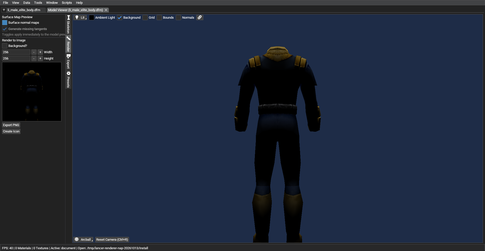 | 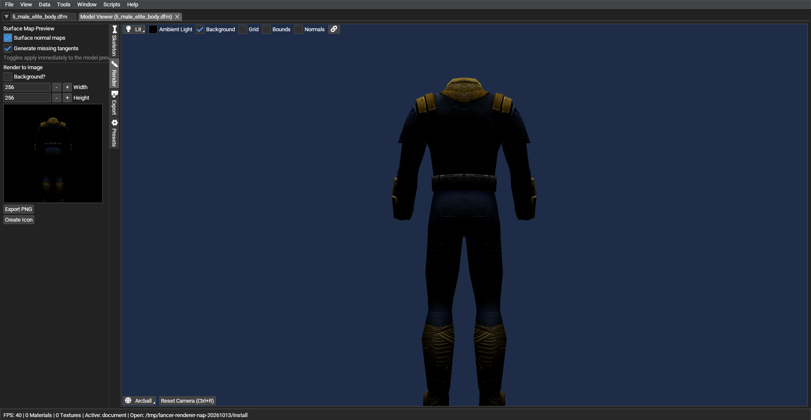 |

[A/B](evidence/renderer/dfm-li-male-elite-uv0-normalmaps-ab.png) ·
[Differenzbild](evidence/renderer/dfm-li-male-elite-uv0-normalmaps-difference-8x.png)

### KU Kym · UV1

| Normalmaps aus | Normalmaps an |
|---|---|
| 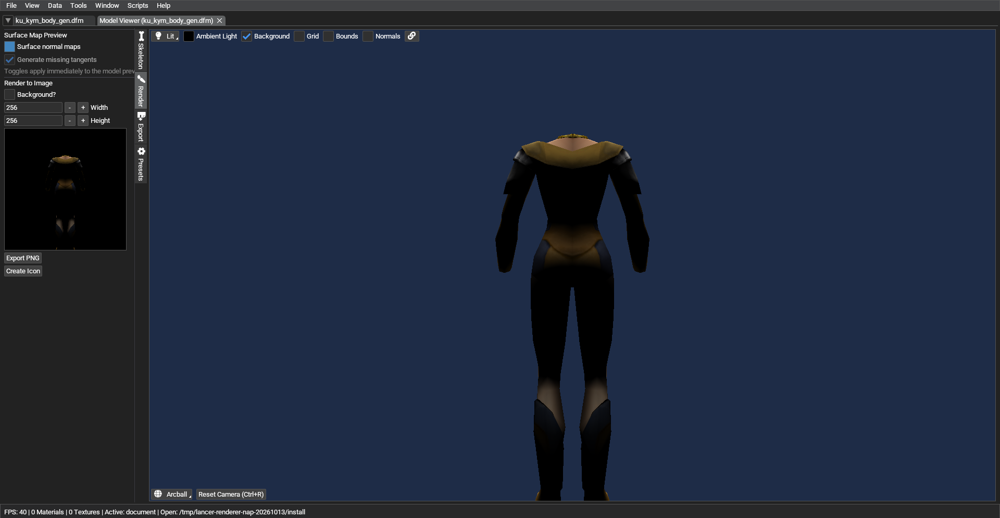 |  |

[A/B](evidence/renderer/dfm-ku-kym-uv1-normalmaps-ab.png) ·
[Differenzbild](evidence/renderer/dfm-ku-kym-uv1-normalmaps-difference-8x.png) ·
[Messwerte](evidence/renderer/dfm-normalmaps-ab-20261013.json)

## Spielszene: Station

Dieses Paar zeigt den Optionsablauf im Spiel. Die Messung ergab weniger
Änderungen als die Wiederholungsabweichung desselben Zustands. Es bestätigt
deshalb **keine sichtbare Normalmap-Wirkung** in der Spielszene.

| Option aus | Option an |
|---|---|
| 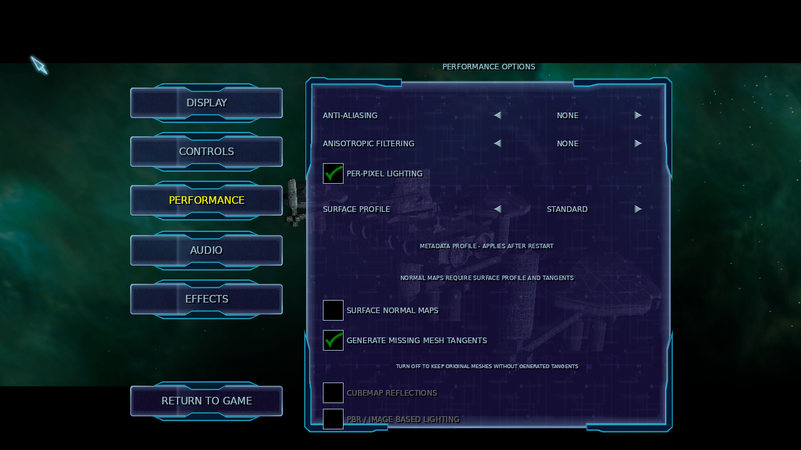 |  |

[A/B](evidence/renderer/ingame-options-normalmaps-ab.png) ·
[Messung und offene Prüfschritte](evidence/renderer/surface-normalmaps-comparison-20261014.json)

### Früherer Live-Toggle im pausierten Spiel

Ein älterer Lauf schaltete die Surface-Normalmaps im selben pausierten Client
von an auf aus. Die Stationsregion zeigt eine lokale Änderung; außerhalb der
Station ist sie deutlich kleiner. Das Paar ist nur ein vorläufiger Hinweis:
das Anwenden der Option setzte die Simulation kurz fort, und für diesen Lauf
fehlen Wiederholungsaufnahmen desselben Zustands. Zusammen mit dem späteren
Optionsmenü-Paar reicht es daher nicht für eine reproduzierbare In-Game-Abnahme.

| Normalmaps an · vor dem Umschalten | Normalmaps aus · nach dem Umschalten |
|---|---|
| 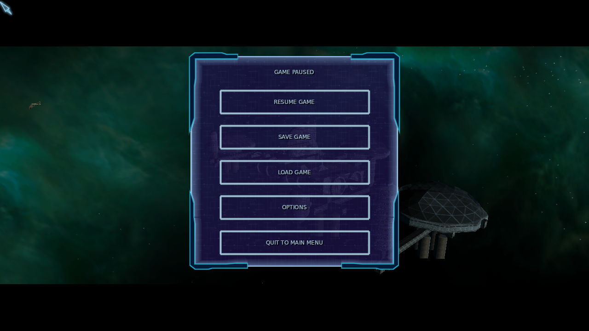 |  |

[Verstärktes Differenzbild](evidence/renderer/ingame-direct-toggle-difference.png) ·
[Messmethode und Prüfsummen](evidence/renderer/ingame-direct-toggle-preliminary-20261013.json)
