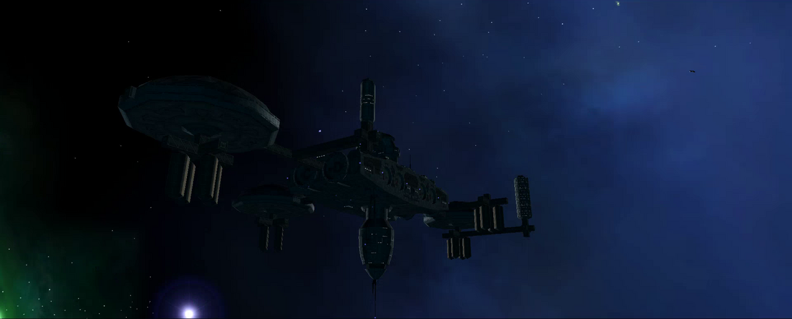
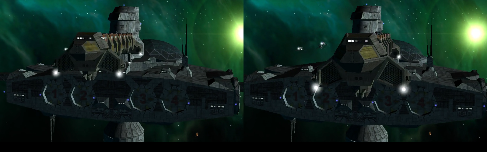
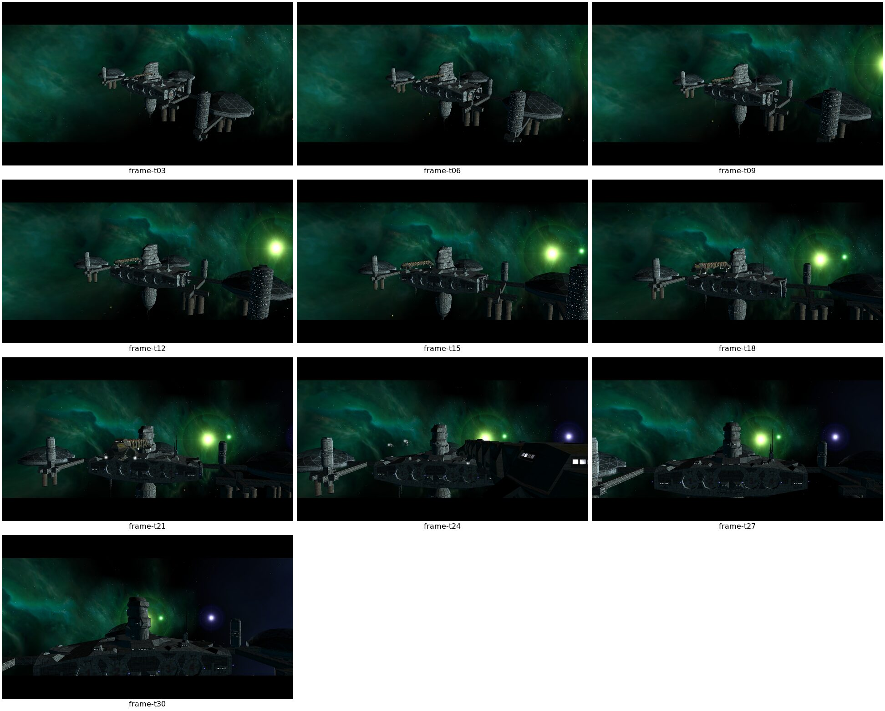

# Durchscheinende Schiffslampen

## Befund

Gemeldet ist eine frontale Kamerafahrt im Intro, in der blinkende Hecklichter
beziehungsweise deren Glows des Transporters `ge_large_transport` durch den
sichtbaren Rumpf scheinen. Der Fehler wurde bereits vor den jüngsten Renderer-
Änderungen beobachtet und ist daher nicht als Regression dieser Änderungen
belegt. Der Clientlauf bestätigt die M01A-Szene und ihre Transport-Entity. Die
THN-Datei animiert `ship_ge_large_transport_1` auf `Path_1`. Die vorhandenen
Bilder zeigen jedoch Freeport 7; ohne Objekt-ID-Overlay ist der sichtbare lange
Rumpf nicht sicher dem Transporter zuzuordnen. Außerdem zeigen sie noch nicht
den gemeldeten frontalen Kamerawinkel.

Die Zuordnung zu M01A `Script/missions/m01a/m01a_fp7_01.thn` ist durch einen
Clientlauf bestätigt: Der frische Spielstart rief diese Szene auf; das
M01A-NPC-Loadout `MSN01a_Large_Transport` bindet `ge_large_transport` mit
blinkenden `SlowLargeWhite`-Lichtern an Running-Light-Hardpoints. Der frühere Renderpfad zeichnete animierte Licht-Bulbs und Glows als additive
Billboards ohne Tiefentest.

## Änderung

Beide Billboard-Typen im `LightEquipRenderer` prüfen nun den Tiefenpuffer. Der
Physik-Sichtliniencheck bleibt ergänzend aktiv; er ignoriert aktuell den eigenen
Schiffskörper.

## Codehinweis für die Diagnose

`SystemRenderer` zeichnet die transparenten Befehle nach dem Opaque-Pass mit
deaktiviertem Depth-Write; `DepthEnabled` bleibt aktiv. `LightEquipRenderer`
reiht sowohl Glow- als auch Bulb-Billboards mit `depthTest: true` ein, und
`Billboards.DrawCommands()` deaktiviert den Tiefentest nur für explizit
markierte Billboards. `ModelRenderer.DepthPrepass()` ist leer, opake
Schiffsteile schreiben ihre Tiefe aber im normalen Opaque-Pass. Der statische
Codepfad schaltet den Tiefentest somit nicht ab; noch ungeprüft ist der
konkrete Tiefenwert an den verdächtigen Bildpunkten während des GPU-Draws.

Die Retail-Dateien `transport_large.cmp` und `utility_transport.mat` wurden
gegeneinander aufgelöst: Die tatsächlich referenzierten VMesh-Materialien
verwenden `DcDt` beziehungsweise `DcDtEt` (unter anderem `utility_panels_*`,
`utility_windows_128`, `engine_grill01` und `transport_lod`). Im aktuellen
`BasicMaterial`-Pfad werden diese Typen nicht als transparent klassifiziert.
Die zuvor vermutete transparente Rumpfoberfläche ist damit für diese Material-
Referenzen nicht belegt. Das M01A-Loadout bindet `SlowLargeWhite` an fünf
Hardpoints. Die CMP-Root-Koordinaten unten berücksichtigen zusätzlich die
Construct-Transforms der jeweiligen Unterteile:

| Hardpoint | CMP-Teil | Definition lokal | CMP-Root nach Construct-Transform |
| --- | --- | --- | --- |
| `HpRunningLight05` | `trans_tail_fin_lod1` | `(-0.02, 4.19, -7.96)` | `(-0.009, -20.214, 79.901)` |
| `HpRunningLight10` | `trans_star_eng_lod1` | `(5.11, -5.44, -3.25)` | `(14.664, -10.722, -73.295)` |
| `HpRunningLight11` | `trans_port_eng_lod1` | `(-4.95, -5.44, -3.25)` | `(-14.508, -10.722, -73.295)` |
| `HpRunningLight12` | `trans_rear_lod1` | `(-11.42, -8.39, -3.81)` | `(-11.419, -11.192, 66.859)` |
| `HpRunningLight13` | `trans_rear_lod1` | `(11.49, -8.39, -3.81)` | `(11.486, -11.192, 66.859)` |

Damit sind die betroffenen Lampen an Heckflosse, Sterntriebwerk, Backbordtriebwerk
und Heckteil lokalisiert. Offen bleiben ihre projizierte Sichtlinie im gemeldeten
Kamerawinkel und der GPU-Zustand beim Billboard-Draw.

## Aktueller Sichtlinienpfad

`LightEquipRenderer.PrepareRender()` prüft vor dem Billboard-Draw zusätzlich eine
Physik-Sichtlinie von der Kamera bis zur Lampe. Dabei wird der
`PhysicsComponent.Body` des Lampenbesitzers explizit als ignorierter Körper an
`PointRaycast()` übergeben. Dieser Check kann daher Hindernisse zwischen Kamera
und Schiff erkennen, prüft aber nicht, ob der eigene Schiffsrumpf die Lampe
verdeckt. Für Selbstverdeckung ist weiterhin der GPU-Tiefentest der Billboards
maßgeblich. Ein korrekter Raycast-Befund allein würde den gemeldeten Fehler
daher nicht ausschließen.

## Laufzeitprüfung

Am 2026-10-14 wurde der Client mit losen Freelancer-Daten und einem isolierten
temporären Profil gestartet. Die Laufzeitlogs bestätigen den Aufruf von
`m01a_fp7_01.thn`; die zugehörigen 70-Sekunden-Aufnahmen umfassen außerdem die
späteren M01A-THNs und den Übergang zur Leeds-Sequenz. Die Einzelbilder um Sekunde 21 zeigen die Freeport-7-Station. Obwohl
`m01a_fp7_01.thn` `ship_ge_large_transport_1` auf `Path_1` bestätigt, lässt
sich der zentrale Rumpf in diesen Bildern ohne Entity-ID-Overlay nicht sicher
dem Transporter zuweisen:

Die THN-Decompilation zeigt für `m01a_fp7_01.thn`, dass `Camera_shot1` für
35 Sekunden `Path_shot1` folgt, während der Transporter 74 Sekunden auf
`Path_1` animiert wird. Eine neue, auf den THN-Aufruf synchronisierte
30-fps-Aufnahme aus Run 8 erfasste die Stationansicht um Sekunde 21.2–22.1,
lief aber mit einem Build vor dem Tiefentest-Patch. Sie zeigt den Transporter in
schräger Ansicht, nicht den gemeldeten frontalen Blickwinkel, und belegt daher
nicht die Wirkung des Patches im gemeldeten Fall.

Der Client wurde danach mit dem aktuellen Patchstand frisch in Release gebaut
(`dotnet build src/lancer/lancer.csproj -c Release --no-restore`, 0 Fehler) und
mit `--new-game` gestartet. Das Log bestätigt `m01a_fp7_01.thn`; die erneute
30-fps-Aufnahme wurde direkt vom OpenGL-Fenster erstellt. Die verglichenen Blinkpunkte sind in der Freeport-7-Ansicht sichtbar. Ihre
Objektzuordnung ist in diesen Bildern nicht markiert; der Vergleich belegt
weder Transporter-Hecklichter noch den gemeldeten frontalen Winkel:

Ein RenderDoc-Capture des aktuellen Builds enthält Frame 885 (1920×1080; OpenGL
auf Mesa Intel HD Graphics 4600). Der Einmal-Replay mit
`renderdoccmd replay --loops=1` endet erfolgreich. Frühere Timeouts verwendeten
die Voreinstellung `--loops=0`, die den Replay absichtlich endlos wiederholt;
sie waren kein Nachweis eines Hängers.

Die aufgezeichneten GL-Aufrufe schalten `GL_DEPTH_TEST` vor den Szenedraws ein
(Chunk 1242) und danach bis zum Frameende nicht aus. `GL_DEPTH_WRITEMASK` bleibt
zunächst `true` (Chunk 1232) und wechselt bei Chunk 2126 auf `false`. Pixel-History
ließ sich über `Backbuffer Color` direkt abfragen, obwohl die `GetTexture()`-
Descriptorabfrage für den Swapchain-Backbuffer in der UI blockiert.

Die Pixel-History an `(695, 661)` und `(885, 664)` stammt aus Frame 885. An
beiden Punkten bestehen 6-Index-Sprite-Draws den aktiven `LessEqual`-Tiefentest.
An `(695, 661)` schreibt Event 1272 Weiß auf ein zuvor von Event 360
beschriebenes Pixel; dessen gespeicherte Tiefe ist `0.99824`, die
Sprite-Fragmenttiefe `0.99183`. Eine spätere Prüfung der Draw-spezifischen
Vertexbuffer-Bindungen ordnet Event 1272/1274/1291 der Weltposition
`(3599.778, 1172.608, -20999.902)` zu. Sie liegt bei Freeport 7s THN-Position
`(3600, 1000, -21000)`. Event 1293 liegt ebenfalls in der Stationsumgebung.
Damit belegen diese Pixel-History-Ereignisse Stationslichter, nicht das
Transporterschiff. Die zuvor angenommene Zuordnung zu Transporter-Hardpoints
entstand aus einer Auswertung mit falschem Vertexbuffer-Offset und ist verworfen.

Ein weiteres lokales Capture (`current_frame1358.rdc`, 04:19 Uhr) zeigt ein
großes Schiff in schräger Nahansicht bei Freeport 7. Es enthält weder eine
Entity-ID-Einblendung noch den gemeldeten Frontalwinkel. Die 6-Vertex-Draws 1127
und 1160 haben `DepthEnable=true`, `LessEqual` und `DepthWrites=false`; ihre
gebundene Textur 2046 sieht wie ein Flare aus, ist aber keiner Lichtquelle
zugeordnet. An Pixel `(651, 440)` schreibt Draw 357 zunächst Tiefe `0.99814`;
Draw 1133 besteht den Tiefentest danach mit Fragmenttiefe `0.94782`. Die Quelle
dieses späteren Draws und die Objektzuordnung des Pixels sind nicht belegt.
Dieser Frame beweist daher keinen Durchscheineffekt am Transporter und zeigt
auch nicht, dass der Tiefentest abgeschaltet war.

Der Tiefentest arbeitet an diesen Stationspixeln, aber Frame 885 prüft den
Transporterfehler nicht. Ein längerer Lauf (Run 15, 2026-10-14) hält die erste
THN-Kamerafahrt ab dem Aufruf von `m01a_fp7_01.thn` in Drei-Sekunden-
Abständen bis Sekunde 30 fest.
Zwischen Sekunde 9 und 21 ist ein langes Schiff mit Blinkpunkten nahe Freeport 7
sichtbar. Die Aufnahme bestätigt das geeignete Zeitfenster für einen gezielten
Capture, ordnet das sichtbare Schiff aber ohne Entity-ID-Markierung weiterhin
nicht sicher `ship_ge_large_transport_1` zu. Sie bestätigt daher weder die
Heck-Hardpoints noch ein Durchscheinen durch den Rumpf. Die Aufnahme stammt aus
der lokalen Laufzeit; der genaue Build-Patchstand ist darin nicht protokolliert.

Ein anschließender RenderDoc-Lauf (Run 16) löste die API-Aufnahme 18 und 19
Sekunden nach dem protokollierten THN-Aufruf aus. Die Frames `977` und `1024`
liegen lokal unter `/tmp/lancer-ship-light-run16-profile/`. Ihre Pixel-History
und Billboard-Draws sind noch nicht ausgewertet; die Captures belegen deshalb
noch keine Selbstverdeckung.

Ein Run-17-Capture des vor dem Tiefentest-Patch installierten Clients
(Frame 2585, 1280×720, OpenGL/Mesa Intel HD Graphics 4600) liefert nun einen
konkreten Tiefentest-Befund. In der Pixel-History bei `(427, 406)` wird Event
1733 nicht wegen des Tiefentests verworfen. Der zugehörige opaque Mesh-Draw hat
`DepthEnable=true`, `DepthWrites=true` und `LessEqual`. Danach zeichnet Event
2140 ein 6-Index-Billboard mit `DepthEnable=false` und `DepthWrites=false` auf
dasselbe Pixel. Seine vier Vertices liegen bei `(3516.580, 1118.254,
-21473.633)`; die Billboard-Größe beträgt 6 Einheiten. Die Position liegt
nahe am aus dem animierten THN-Pfad und `HpRunningLight10` errechneten
Weltpunkt (Abweichung ungefähr 1,3 Einheiten). Das spricht für ein Licht am
Sterntriebwerk des Transporters. Die Zuordnung ist wegen der Näherung der
THN-Position plausibel, aber nicht abschließend bewiesen; sie betrifft außerdem
`HpRunningLight10`, nicht die Heck-Hardpoints `HpRunningLight12/13`.

Dieser Capture reproduziert damit den Mechanismus „opaker Rumpf schreibt Tiefe,
Licht-Billboard zeichnet anschließend ohne Tiefentest darüber“. Er stammt aus
einem Build vor Patch `2021-ship-light-depth-occlusion.patch` und belegt daher
nicht, dass der Fix den gemeldeten Frontalwinkel behebt. Das Bild und der
RenderDoc-Capture liegen lokal unter
`/tmp/lancer-ship-light-run17-profile/`; sie wurden nicht als Spieldaten oder
als großer Capture ins Repository übernommen. Der Lauf benutzte den alten
lokalen NAP-Client und ist kein NAP-only-Validierungsnachweis gemäß
`AGENTS.md`.

Ein passendes Folge-Capture muss den aktuellen Patch-Build mit zulässigen
NAP-Containern starten, `ship_ge_large_transport_1` und die Hecklichter
`HpRunningLight12/13` im gemeldeten frontalen Winkel zeigen und deren
Billboard-Draws gegen die Rumpftiefe prüfen.

## NAP-only-Startpfad und M01A-Lauf

Der aktuelle Client-Build lädt die aus `Data/NAP/` erstellten NAP-Container und
erreicht ohne Startoption das Hauptmenü. Mit `--new-game` endet der Lauf mit
Exitcode 139, bevor die unveränderte Konfiguration M01A protokolliert. Die
Ursache ließ sich auf den Startdatensatz eingrenzen: Der NAP-Eintrag heißt
`EXE/newplayer.fl` (analog `EXE/mpnewcharacter.fl`), während
`FreelancerIni` im `librelancer.ini`-Modus standardmäßig nur `newplayer.fl`
beziehungsweise `mpnewcharacter.fl` verwendet. `NexusPackageFileProvider`
entfernt beim Normalisieren nur einen `DATA/`-Präfix und bildet keine
`EXE/`-Aliase. Der direkte VFS-Pfad passt daher nicht zum Paketpfad.

Als Laufzeitprobe bekam eine temporäre Konfiguration in `/dev/shm` unter
`[Data]` die Einträge `newplayer = EXE\newplayer.fl` und
`mpnewcharacter = EXE\mpnewcharacter.fl`; die NAP-Archive blieben unverändert.
Damit startete der isolierte neue Spielstand: Das Log bestätigt
`Mission_01a`, `missions\m01a\m01a_fp7_01.thn` und nachfolgende Mission-
Trigger. Das stützt die Pfadursache für den vorherigen Startabbruch. Der
GDB-Stack des unmodifizierten Starts zeigt `XDestroyIC` beim SDL/X11-Abbau;
die genaue Exception davor wurde nicht erfasst, daher ist dieser Stack allein
kein Beweis für den Auslöser.

Der Einstieg in M01A ist jetzt reproduzierbar, aber der gemeldete frontale
Transporterwinkel und die Selbstverdeckung der Hecklichter `HpRunningLight12/13`
sind weiterhin nicht gezielt aufgenommen. Der Renderer-Fix ist deshalb in diesem
Winkel noch nicht abgenommen.

## Offen

- [x] M01A-Intro im Client starten und die THN-Aufrufe protokollieren.
- [x] RenderDoc-Einmal-Replay und Pixel-History am Backbuffer einrichten.
- [x] Frame 885 und Pixel-History untersuchen. Die fraglichen Sprites liegen an
  der Freeport-7-Position; der Frame prüft nicht das Transporterschiff.
- [ ] Den gemeldeten frontalen Kamerawinkel synchron zur Blinkphase aufnehmen.
- [ ] Den gemeldeten Frontalwinkel mit sichtbaren `HpRunningLight12/13`
  synchron zur Blinkphase aufnehmen.
- [ ] Für diese Hecklichter die GL-Draws, Weltpositionen und CMP-Root-Transforms
  eindeutig zuordnen; Fragmenttiefe gegen die Rumpftiefe vergleichen. Danach
  entscheiden, ob Hardpoint-/Transformdaten oder Geometrie/Depth-Write korrigiert
  werden müssen und Vorder-/Rückansicht erneut vergleichen.

### Korrigierter NAP-only-Lauf 18 (2026-10-15)

Der zunächst gemeldete Startabbruch mit `freelancer_path = ''` entstand, weil
`librelancer.ini` (die Paket-/DATA-Konfiguration im App-Verzeichnis) als
Client-Konfiguration übergeben wurde. Der gültige Start verwendet
`/tmp/lancer-ambient-ab-20261015/client-invuln.ini`; deren
`freelancer_path` zeigt auf das isolierte App-Verzeichnis mit den geprüften
NAP-Archiven. Es gibt dort kein loses `DATA`-Verzeichnis.

Der korrigierte Start lud die Spieldaten, erreichte `UI: Interface loaded`,
startete `Mission_01a` und rief `missions\\m01a\\m01a_fp7_01.thn` auf. Der
Prozess blieb im Intro aktiv und wurde danach regulär beendet. Die Zeile
`cluster_gateway_url =` ist leer und erzeugt eine INI-Warnung; sie verhinderte
den Standalone-Start nicht. Diese Laufzeitprobe bestätigt den gültigen NAP-
Start und den Einstieg ins Intro, aber weder den Frontalwinkel noch die
Selbstverdeckung von `HpRunningLight12/13`.

Die Aufnahme des gemeldeten Winkels und die Auswertung der Hecklichter bleiben
offen.

### NAP-only-Intro-Lauf 19 (2026-10-16)

Der aktuelle Release-Client lief erneut mit dem aktiven QA-Manifest
`lancer-explosion-qa-20261016`. Vor dem Start wurden Größe und SHA-256 aller 13
Archive gegen `active.json` geprüft; alle Archive bestanden `nexus-pack
verify`. Das Datenverzeichnis enthielt kein loses `DATA`. Der Lauf erreichte
`Finished loading game data`, `UI: Interface loaded` und die M01A-THNs
`m01a_fp7_01.thn`, `m01a_fp7_02.thn`, `m01a_fp7_02b.thn` und
`m01a_fp7_03.thn`.

Eine 115,6 Sekunden lange X11-Aufnahme bei 15 fps wurde gesichtet. Die Frames
zwischen 42 und 66 Sekunden zeigen überwiegend Freeport 7; es gibt darin keinen
sicher identifizierten `ge_large_transport` und keinen belegten frontalen Blick
auf `HpRunningLight12/13`. Der Client lief auf llvmpipe und protokollierte zu
Beginn der M01A-Sequenz 159 verworfene Simulationstakte. Der Versuch ist daher
kein Beleg für oder gegen den Tiefentest-Fix. Ein `renderdoccmd`/`qrenderdoc`
war in dieser Umgebung nicht verfügbar; GL-Pixel-History konnte nicht erstellt
werden. Als nächstes muss der Transporter im konkreten Frontwinkel sichtbar
gemacht und synchron zur Blinkphase aufgenommen werden, bevor ein Patchwechsel
oder eine Tiefenänderung begründet ist.

### NAP-only-Lauf 20 (2026-10-18)

Ein aktueller Release-Lauf verwendete das geprüfte Manifest
`lancer-pbr-qa-20261014`; Größen und Hashes der 13 Archive stimmten, alle
bestanden `nexus-pack verify`. Im Client-App-Verzeichnis lag kein loses `DATA`.
Der Lauf erreichte `UI: Interface loaded`, `Mission_01a` und
`m01a_fp7_01.thn`. Eine 50-Sekunden-Fensteraufnahme ab THN-Aufruf zeigt die
bewegte Szene; die Debug-Objektliste führt `fp7_transport1` auf. Dies belegt
seine Anwesenheit in der aktiven Szene, ordnet aber den sichtbaren Rumpf und
Blinkpunkte nicht sicher zu. Der Frontalwinkel, die Blinkphase und der GPU-
Tiefenvergleich der `HpRunningLight12/13` bleiben offen. Das Log enthält
weiterhin `Unimplemented event: StartIK`. Bedingungen und Aufnahmen: [Lauf 20](evidence/renderer/ship-light-occlusion-m01a-run20-20261018/README.md).
